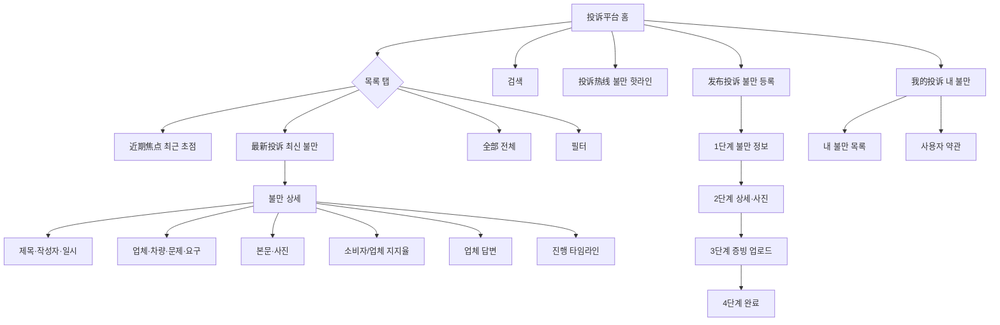
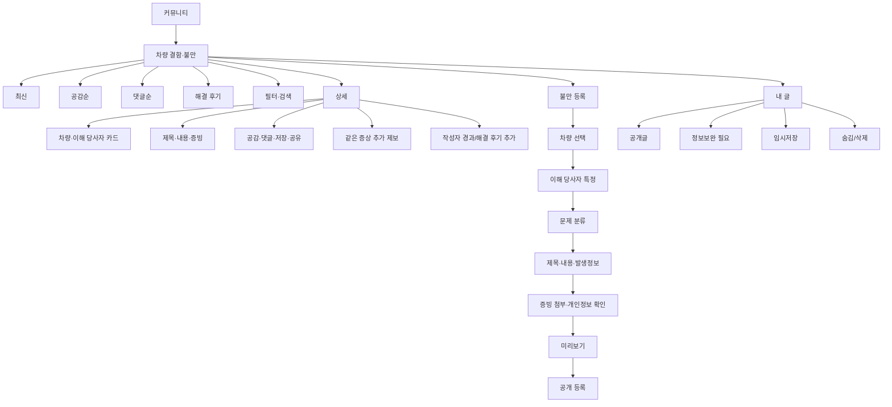

# 오토홈 불만 플랫폼 전수조사와 보배드림 결함·불만 게시판 플로우

- 조사일: 2026-10-17 (KST)
- 원본: 자동차之家 21.0.5 내부 브라우저의 `投诉平台`
- 원본 주소: `https://tousu.m.autohome.com.cn/index?refpage=m_tousu`
- 조사 기기: Android 16 · 1080×2400 · 로그인 유지
- 증거 폴더: `artifacts/autohome-restart-audit-20261017/`
- 안전 원칙: 실제 민원은 제출하지 않았고 개인정보·차량서류는 입력하지 않았다.

## 1. 최종 제품 방향

보배드림 버전은 **공식 민원 접수 대행 서비스가 아니다.** 차량 결함·판매·정비 불만을 공개하고, 같은 증상을 겪은 이용자의 공감·댓글·추가 제보를 모아 공론화하는 독립 커뮤니티 게시판이다.

다만 사실관계 확인과 검색성을 위해 이해 당사자는 구조화해서 특정한다.

- 국내차: 제조사 → 모델/세대/세부등급 → 판매 딜러사 또는 정비 서비스센터
- 수입차: 브랜드 → 모델/세대/세부등급 → 공식 수입사(디스트리뷰터) → 딜러 그룹 → 판매/정비 지점
- 중고차: 제조사·모델 → 중고차 판매상사 → 담당 딜러(선택) → 정비업체(해당 시)
- 병행수입: 브랜드·모델 → 병행수입 업체 → 판매업체 → 정비업체(해당 시)

`상사 통지`, `공식 접수`, `처리 기한`, `상사 회신`, `배상·리콜 요구`, `공식 종결`은 원본 조사 자료에만 남기고 보배드림 사용자 화면에서는 제외한다.

## 2. 원본과 한국형 구조의 핵심 차이

| 항목 | 오토홈 원본 | 보배드림 적용 |
|---|---|---|
| 목적 | 플랫폼을 통한 민원 전달·처리 | 공개 게시·공론화·동일 증상 수집 |
| 상대방 | 4S점/중고차점 | 제조사·수입사·딜러 그룹·지점·상사·정비업체 |
| 요청 | 수리·배상·리콜·교환/환불 | 공식 요구값 없음. `원하는 해결`은 자유 서술 선택값 |
| 상태 | 처리중·완료·기한초과 | 공개·정보보완·작성자 업데이트·해결 후기·숨김/삭제 |
| 전달 | 상사 통지 단계 존재 | 제거 |
| 증빙 | 차량/등록증·구매영수증/계약서 필수 | 개인정보가 가려진 사진·영상·문서 선택 첨부 |
| 최종 화면 | 완료/평가 | 게시 완료 후 공개 상세로 이동 |

## 3. 원본 전체 정보 구조



## 4. 보배드림 최종 전체 플로우



## 5. 원본 홈·목록 화면

### 홈 상단

- 제목: `投诉平台`
- 검색 placeholder: `看看其他车主的遭遇` — 다른 차주의 사례 보기
- 보조 기능: `投诉热线` — 불만 핫라인
- 지표: 누적 불만 92,755 / 업체 답변률 94% / 열람 이용자 637.77W
- 이용자 평가 카드: 별점, 마스킹 닉네임, 평가 일자, 해결 후기, `评论详情`
- 국가 권위 협력: `中国汽车召回网专区`

보배드림 적용:

- 공식 민원처럼 보이는 누적·답변률·핫라인·국가 협력 블록은 제외한다.
- 대신 `등록된 불만`, `같은 증상 제보`, `해결 후기` 세 지표를 사용한다.
- 검색 placeholder는 `차종·제조사·딜러사·결함을 검색해보세요`로 한다.

### 탭

- `近期焦点`: 현재 데이터 없음 상태 확인
- `最新投诉`: 최신 카드 목록
- `全部`: 전체 목록
- 우측 필터 아이콘

보배드림 탭:

- 최신 / 공감순 / 댓글순 / 해결 후기
- 카테고리 탭과 정렬을 섞지 않는다.

### 원본 카드 필드

1. 대표 이미지 또는 기본 이미지
2. 제목
3. 차량 모델 칩
4. 본문 2~3줄
5. 상태 칩
6. 날짜
7. 조회수

확인한 상태 원문:

- `处理中`: 처리중
- `已完结`: 완료
- `超时处理中`: 기한초과 처리중
- `超时已完结`: 기한초과 완료

보배드림 카드 상태:

- `새 글`
- `추가 제보 있음`
- `작성자 업데이트`
- `해결 후기`
- 운영 상태인 `정보보완 필요`, `숨김`은 작성자·운영자에게만 노출

## 6. 검색 플로우

### 원본

1. 홈 검색창 선택
2. `搜索标题和门店名称` — 제목과 매장명 검색
3. 검색 이력이 없으면 `暂无搜索记录`
4. 검색어 입력 후 결과 목록 표시
5. 검색 결과 카드 구조는 최신 목록과 동일
6. 검색어가 완전히 일치하지 않아도 형태소·부분 문자열로 관련 결과를 반환

### 보배드림

검색 대상:

- 제목·본문
- 제조사·브랜드·모델·세대·세부등급
- 수입사
- 딜러 그룹·지점·판매상사·정비업체
- 문제 대분류·세부 유형

빈 결과 문구:

> 일치하는 결함·불만이 없습니다. 다른 모델명이나 문제 증상으로 검색해보세요.

## 7. 필터 플로우

### 원본 필터

문제 유형:

- `售前问题` 판매 전 문제
- `售后问题` 판매 후 문제
- `质量问题` 품질 문제
- `全部` 전체

문제 상태:

- `处理中` 처리중
- `已完结` 완료
- `全部` 전체

추가 토글:

- `与我相关` / `展示同车系问题投诉` — 나와 관련 / 동일 차종 문제 보기

하단 동작:

- `取消` 취소
- `确定` 적용

### 보배드림 필터

- 문제 영역: 구매/계약 · 차량 품질 · 정비/AS · 안전 · 중고차 거래 · 기타
- 차종: 제조사 · 모델 · 세대 · 연료/동력
- 이해 당사자: 제조사 · 수입사 · 딜러 그룹 · 지점 · 상사 · 정비업체
- 콘텐츠: 사진 있음 · 영상 있음 · 문서 있음 · 같은 증상 제보 있음 · 해결 후기 있음
- 기간: 최근 1개월 · 3개월 · 1년 · 전체
- `내 차와 같은 모델만 보기` 토글
- 초기화 / 적용

공식 처리 상태 필터는 사용하지 않는다.

## 8. 상세 페이지 플로우

### 원본 상세 구성

1. 헤더: 뒤로, 닫기, `投诉详情`, 공유
2. 제목·닉네임·등록 시각
3. 정보 카드
   - `投诉门店` 불만 매장
   - 상태 칩
   - `汽车品牌` 차량 브랜드·모델·연식
   - `投诉问题` 문제 유형
   - `投诉诉求` 수리/배상/리콜/교환·환불
4. 상세 본문
5. 증빙 이미지
6. `支持消费者` 대 `支持商家` 지지율
7. `商家回复` 업체 답변
8. `投诉进度` 타임라인
9. 하단 `我也要投诉`

원본에서 확인한 타임라인:

- `投诉创建` 불만 생성
- `投诉审核中` 심사 중
- `审核通过` 심사 통과
- `已通知商家` 업체 통지
- 업체 `回复投诉`
- `进行投诉评价` 불만 평가 진행

### 보배드림 상세 구성

1. 헤더: 뒤로, `차량 결함·불만`, 공유
2. 작성자: 프로필, 닉네임, 실차주 인증 여부, 등록/수정일
3. 차량 카드: 제조사 로고, 모델·세대·세부등급, 연식, 연료/동력, 주행거리
4. 이해 당사자 카드
   - 국내차: 제조사 / 판매·정비 딜러사
   - 수입차: 브랜드 / 수입사 / 딜러 그룹 / 지점
   - 중고차: 판매상사 / 담당 딜러(선택) / 정비업체(선택)
5. 분류·발생일·발생 지역·증상 시작 주행거리
6. 제목·본문
7. 사진·영상·개인정보를 가린 문서
8. 공감 / 댓글 / 저장 / 공유
9. `같은 증상 있어요` 추가 제보
10. 작성자 업데이트·해결 후기 타임라인
11. 관련 모델의 다른 불만

원본의 업체 지지율, 업체 답변, 공식 처리 타임라인은 제외한다.

## 9. 등록 1단계: 차량·문제·업체·요구

### 차량 선택 원본

3단 드릴다운이다.

1. 제조사/브랜드: 로고 + 이름 + 우측 알파벳 인덱스
2. 차계열/모델: 예) 宝马3系
3. 연식·세부트림: 예) `2025款 325i M运动套装`

보배드림은 기존 중고차 제조사·모델 정본을 사용한다.

### 문제 유형 원문 전체

판매 전 `售前问题`:

- `销售态度差` 판매 태도 불량
- `虚假车源` 허위 매물
- `虚假报价` 허위 견적
- `车型配置不符` 차량 구성 불일치
- `金融服务费` 금융 서비스 비용
- `其他费用问题` 기타 비용 문제
- `其他售前问题` 기타 판매 전 문제

판매 후 `售后问题`:

- `技术水平` 기술 수준
- `备件质量` 부품 품질
- `维修纠纷` 정비 분쟁
- `费用争议` 비용 분쟁
- `承诺不履行` 약속 불이행
- `服务水平` 서비스 수준
- `隐瞒车况` 차량 상태 은폐
- `其他售后问题` 기타 판매 후 문제

품질 `质量问题`:

- `异响` 이상 소음
- `抖动` 진동
- `油耗过高` 연비 과다
- `机油消耗大` 엔진오일 과다 소모
- `发动机` 엔진
- `变速器` 변속기
- `离合器` 클러치
- `转向系统` 조향 시스템
- `制动系统` 제동 시스템
- `前后桥及悬挂系统` 전후 차축·서스펜션
- `轮胎` 타이어
- `车身附件及电器` 차체 부품·전장
- `其他异常` 기타 이상

원본은 한 카테고리 안에서 복수 선택 가능하다.

### 이해 당사자 선택 원본

- 도시 드롭다운: GPS / 최근 도시 / 전국 / 알파벳 인덱스
- 매장명 검색
- `4S店` / `二手车店` 탭
- 매장 카드: 사진·업체명·주소

### 원본 요구 선택

- `维修` 수리
- `赔偿` 배상
- `召回` 리콜
- `退换车` 교환·환불

### 보배드림 등록 1단계

1. 차량 유형: 국내차 / 수입차 / 병행수입 / 중고차
2. 제조사 또는 브랜드
3. 모델 / 세대 / 세부등급 / 연식
4. 이해 당사자(복수 가능)
5. 문제 대분류와 세부 유형(복수 가능)
6. 발생일·지역·주행거리

`원하는 해결`은 선택형 요구가 아니라 200자 이하 자유 서술 선택값으로 둔다.

## 10. 수입차 이해 당사자 규칙

수입차는 브랜드와 실제 책임 주체를 분리한다.

```text
브랜드
└─ 공식 수입사/디스트리뷰터
   └─ 딜러 그룹
      └─ 판매 지점 또는 서비스센터
```

필드:

- `brand_id`, `brand_name`
- `importer_id`, `importer_name`, `official_importer`
- `dealer_group_id`, `dealer_group_name`
- `dealer_branch_id`, `dealer_branch_name`, `branch_type`
- `address`, `phone_masked`, `business_registration_number_masked`

등록 시 최소 필수:

- 수입차 구매·판매 불만: 브랜드 + 수입사 + 판매 지점
- 수입차 정비 불만: 브랜드 + 수입사 + 서비스센터
- 수입사 불명/병행수입: 브랜드 + 병행수입 업체 + 판매업체

목록에는 브랜드·모델을 우선 노출하고, 상세에서 수입사·딜러 그룹·지점을 모두 보여준다.

## 11. 등록 2단계: 제목·내용·사진

원본:

- `投诉标题` 불만 제목
- `投诉内容` 불만 내용
- placeholder: `请准确描述问题的症状...`
- 내용 최대 1,000자
- `上传照片`
- 첫 사진: 차량 45도 전경 또는 자동차등록증
- 둘째 사진: 구매 영수증/계약 증빙
- 중고차 매장 불만: 공식 직인이 있는 중고차 계약서
- 이미지 추가: 즉시 촬영 / 갤러리 선택
- 누락 오류: `请上传投诉图片` — 불만 이미지를 올려주세요

보배드림:

- 제목 10~60자
- 본문 50~3,000자
- 사고·증상·업체 대응·현재 상태를 안내 문장으로 유도
- 사진 최대 20장, 영상 최대 3개, 문서 최대 5개
- 개인정보 자동 경고: 번호판·VIN·주소·전화·주민번호·계좌번호 가림 확인
- 대표 이미지 지정
- 차량등록증·계약서·정비명세서는 공개 범위를 `전체 공개/운영자만` 중 선택

## 12. 등록 3·4단계 원본과 한국판 처리

원본은 별도 `上传凭证` 증빙 단계와 `完成投诉` 완료 단계를 둔다. 공식 접수를 전제로 차량·구매 증명과 업체 전달·처리 절차를 연결한다.

보배드림은 이 두 단계를 그대로 복제하지 않는다.

- 3단계: `증빙 및 개인정보 확인`
- 4단계: `미리보기 및 공개 등록`
- 등록 완료 후 곧바로 공개 상세로 이동
- 제조사·수입사·딜러사에 자동 통지하지 않음
- `보배드림은 공식 민원 접수기관이 아니며, 게시물은 이용자의 공개 제보입니다` 고지

## 13. 내 불만/내 글

원본 `我的投诉` 첫 화면:

- `我的投诉` 내 불만
- `用户协议` 사용자 약관

목록이 없을 때:

- 일러스트 + `暂无相关投诉` — 관련 불만 없음

보배드림 `내 글`:

- 공개 중
- 정보보완 필요
- 작성자 업데이트 있음
- 해결 후기
- 임시저장
- 숨김/삭제

게시물 삭제는 복구 가능 기간을 안내하고, 댓글이 존재하면 `작성자 삭제` 표시 후 본문만 비공개 처리한다.

## 14. 가변 요소·분기표

| 조건 | 추가 필드/행동 |
|---|---|
| 국내 신차 | 제조사, 판매 딜러사/정비센터 |
| 수입 신차 | 브랜드, 공식 수입사, 딜러 그룹, 지점/센터 |
| 병행수입 | 브랜드, 병행수입 업체, 판매업체, 공식수입 여부 경고 |
| 중고차 | 제조사·모델, 판매상사, 담당 딜러 선택, 계약서 선택 첨부 |
| 품질 결함 | 시스템별 증상, 최초 발생 주행거리, 반복 횟수 |
| 안전 결함 | 운행 중지 권고 문구, 사고/부상 여부, 리콜 조회 링크 |
| 구매/계약 | 계약일, 인도일, 계약·견적·입금 증빙 |
| 정비/AS | 입고일, 정비센터, 작업명세서, 재발 여부 |
| 동일 증상 제보 | 내 차량 모델·연식·주행거리·증상만 추가, 원글과 연결 |
| 해결 후기 | 해결일, 해결 방식, 비용, 만족도, 추가 설명 |

## 15. 오류·비정상·복구 시나리오

| ID | 상황 | 기대 동작 |
|---|---|---|
| CP-E01 | 제조사만 선택하고 다음 | 모델 선택 안내, 단계 이동 안 함 |
| CP-E02 | 수입차인데 수입사 누락 | 공식수입/병행수입 선택 안내 |
| CP-E03 | 제목 10자 미만 | 글자 수와 예시 표시 |
| CP-E04 | 본문 50자 미만 | 사실관계 작성 가이드 표시 |
| CP-E05 | 증빙 없음 | 등록 허용하되 `증빙 없음` 라벨과 보완 권고 |
| CP-E06 | 개인정보가 감지된 문서 | 가림 확인 전 공개 등록 차단 |
| CP-E07 | 네트워크 중단 | 로컬 임시저장, 재연결 후 재시도 |
| CP-E08 | 뒤로/닫기 | 임시저장/계속 작성/나가기 선택 |
| CP-E09 | 중복 모델·유사 증상 | 관련 글 제안, 등록은 막지 않음 |
| CP-E10 | 업체를 찾을 수 없음 | `직접 입력` + 운영자 검수 상태 |
| CP-E11 | 업체 정보 수정 필요 | 수정 제안 접수, 원글 데이터는 보존 |
| CP-E12 | 댓글·공감 남용 | 신고·차단·속도 제한·운영자 로그 |

## 16. 캡처 인덱스

| 파일 | 확인 내용 |
|---|---|
| `31-complaint-platform.png` | 실제 불만 플랫폼 홈 진입 |
| `33-app-complaint-home.png` | 오토홈 로그인 세션 내부 홈 |
| `34-latest.png`, `35-current.png` | 최신 목록 카드·상태 |
| `36-detail-top.png` | 처리중 상세 상단 |
| `37-detail-scroll.png`, `38-detail-scroll.png` | 지지율·진행 타임라인 |
| `44-detail-complete-top.png` | 기한초과 완료 상세 |
| `45-complete-scroll.png`, `46-complete-scroll.png` | 업체 답변·평가 단계 |
| `50-filter.png`, `51-filter-selected.png`, `52-filter-results.png` | 필터 기본·선택·결과 |
| `53-search-page.png`, `54-search-results.png`, `55-search-empty.png` | 검색 시작·결과·부분 일치 |
| `56-publish-step1.png` | 등록 1단계 |
| `57-vehicle-selector.png` | 브랜드 선택 |
| `58-brand-b.png` | B 브랜드 구간 |
| `59-bmw-models.png` | 모델 선택 |
| `60-bmw3-variants.png` | 연식·세부트림 선택 |
| `62-issue-selector.png` | 판매 전 문제 |
| `63-issue-aftersales.png` | 판매 후 문제 |
| `64-issue-quality.png` | 품질 문제 |
| `65-quality-multi-selected.png` | 복수 문제 선택 |
| `67-merchant-selector.png` | 4S점 선택 |
| `68-city-selector.png` | 도시 선택 |
| `69-merchant-used.png` | 중고차점 탭 |
| `71-request-selector.png` | 원본 해결 요구 선택 |
| `72-publish-step2.png` | 제목·내용·사진 |
| `73-photo-rules.png` | 증빙 업로드 규칙 |
| `75-step2-missing-photos.png` | 사진 누락 오류 |
| `76-photo-picker.png` | 촬영/갤러리 선택 |
| `87-my-complaints.png`, `88-my-list.png` | 내 불만·빈 목록 |

영상:

- `autohome-complaint-audit-03.mp4`
- `autohome-complaint-audit-04.mp4`
- `autohome-complaint-audit-05.mp4`

## 17. 구현 검수 기준

1. 커뮤니티에 `차량 결함·불만`이 독립 게시판으로 존재한다.
2. 목록·상세·등록·내 글이 각각 독립 URL 상태를 가진다.
3. 기존 중고차 제조사·모델·세대 정본을 그대로 재사용한다.

## 19. 이해관계자 식별 구현 확정

차량만 특정하면 판매·수입·정비 책임 주체가 섞이므로 등록 첫 단계에서 차량 유통 유형을 먼저 고른다.

| 차량 유형 | 필수 식별값 | 선택 식별값 |
|---|---|---|
| 국내 신차 | 제조사, 모델, 신차 딜러사, 판매·정비 지점 | 세부 모델 |
| 공식 수입차 | 제조사, 모델, 공식 수입사, 수입차 딜러사, 판매·정비 지점 | 세부 모델 |
| 병행수입차 | 제조사, 모델, 병행수입 업체, 판매 업체·지점 | 세부 모델, 별도 정비업체 |
| 중고차 | 제조사, 모델, 판매 상사 | 세부 모델, 판매자·담당자, 별도 정비업체 |

상세 화면은 위 값을 `관련 차량·이해관계자` 표로 그대로 공개한다. 다만 이 표는 이용자가 입력한 식별 정보이며, 업체에 자동 통지되거나 보배드림이 공식 민원을 접수·중재했다는 의미가 아니다.

현재 구현은 `공개`, `추가 제보`, `작성자 업데이트`, `해결 후기`만 상태성 문구로 사용한다. `답변 대기`, `센터 확인 중`, `제조사 전달`, `조치 완료`처럼 공식 처리 절차로 오인될 표현은 사용하지 않는다.

## 20. 공식 수입사·딜러사 후보 사전

제조사 선택 시 `public/community/data/importer-dealer-directory.js`의 후보를 자동완성으로 제공한다. 후보는 입력 편의를 위한 것이며 사용자가 계약서·정비명세서에 적힌 실제 사업자명으로 수정할 수 있다.

| 브랜드 | 자동 제안 수입사 | 확인된 딜러 후보 범위 | 공식 근거 |
|---|---|---|---|
| BMW | BMW 코리아 | 공식 딜러 7개사 | BMW 코리아 딜러 정보 |
| 벤츠 | 메르세데스-벤츠 코리아 | 공식 페이지에서 확인한 7개사 | 메르세데스-벤츠 코리아 AET 모집 파트너 |
| 렉서스 | 한국토요타자동차 | 공식 딜러 8개사 | 렉서스 코리아 브랜드 스토리 |
| 포르쉐 | 포르쉐코리아 | 공식 딜러 4개사 | 포르쉐코리아 회사 소개 |
| 람보르기니 | 자동 입력 없음 | SQDA Motors, 서울·서울 센트럴 | Lamborghini 공식 딜러 로케이터 |

공식 자료에서 수입 법인 명칭을 명확히 확인하지 못한 람보르기니와 아직 사전에 등록하지 않은 브랜드는 수입사·딜러사를 비운 상태로 보여주고 직접 입력하게 한다. 기존 자동완성 값은 제조사를 바꿀 때 즉시 초기화하여 잘못된 수입사나 딜러사가 다른 브랜드에 남지 않게 한다.

공식 출처:

- BMW: https://www.bmw.co.kr/content/bmw/marketKR/bmw_co_kr/ko/fastlane/dealer-locator/dealer-information.html
- 메르세데스-벤츠: https://www.mercedes-benz.co.kr/passengercars/brand/mercedes-benz-aet.html
- 렉서스: https://www.lexus.co.kr/contents/20th-lexus-brand-story/
- 포르쉐: https://www.porsche.com/korea/ko/porsche-korea-ltd/
- 람보르기니: https://www.lamborghini.com/en-en/dealerships/lamborghini-seoul
4. 수입차는 브랜드·수입사·딜러 그룹·지점을 분리 저장한다.
5. 원본의 공식 통지·처리·종결 상태가 사용자 화면에 남지 않는다.
6. 목록 카드에서 모델·제목·본문·대표 이미지·공감·댓글이 한눈에 보인다.
7. 상세에서 이해 당사자와 사실관계가 명확히 구분된다.
8. 동일 증상 제보가 원글과 연결된다.
9. 등록 오류·네트워크 실패·임시저장·뒤로가기가 모두 복구 가능하다.
10. 모바일 390×844와 PC 1440×900에서 잘림·겹침·가로 스크롤이 없다.

