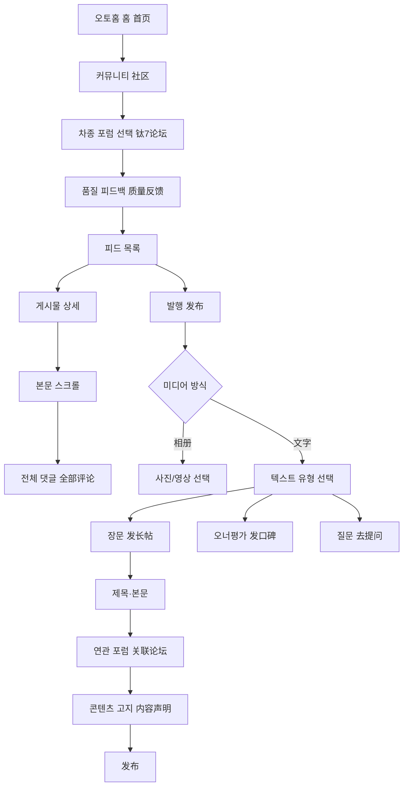

# 오토홈 质量反馈 전수조사 및 보배드림 이식 규칙

- 조사 일시: 2026-10-17 (KST)
- 원본 앱: 汽车之家 21.0.5 (`com.cubic.autohome`)
- 기기: Android 16, 1080×2400
- 조사 원칙: 로그인 세션은 유지하되 실제 게시·개인정보 입력은 하지 않음
- 구현 게시판 ID: `autohome-complaint`
- 구현 명칭: **차량 결함·불만**

## 정정된 핵심 판정

`质量反馈`는 차종 포럼 안의 일반 품질 피드백 탭이고, 이와 별개로 오토홈에는 정식 `投诉平台`이 존재한다. 후속 전수조사에서 정식 플랫폼의 홈·목록·검색·필터·상세·등록·내 불만 흐름을 확인했다.

정식 불만 플랫폼 조사와 한국형 최종 설계는 [`autohome-complaint-platform-flow-20261017.md`](./autohome-complaint-platform-flow-20261017.md)를 정본으로 삼는다. 보배드림 구현은 공식 민원 접수나 상사 통지를 흉내 내지 않고, 이해 당사자를 구조화해 특정한 뒤 결함·불만을 공개하고 공론화하는 독립 게시판으로 만든다.

## 원본 전체 흐름

## 캡처·영상 증거

원본 파일은 `artifacts/autohome-restart-audit-20261017/`에 보존한다.

| 순서 | 파일 | 화면/검증 내용 |
|---:|---|---|
| 00 | `00-main-start.png/.xml` | 앱 강제 종료 후 메인 홈 재진입 |
| 01 | `01-community-home.png/.xml` | 하단 `社区` 진입, 차종 포럼 카드 |
| 02 | `02-titanium-forum.png/.xml` | `钛7论坛`, 탭과 게시물 피드 |
| 03 | `03-quality-feedback-list.png/.xml` | `质量反馈` 활성 목록, 작성자·차주 라벨·제목·본문·사진·댓글·좋아요 |
| 04 | `04-detail-top.png/.xml` | 상세 상단, 작성자·등급·지역·작성일·제목·본문 |
| 05 | `05-detail-body.png` | 긴 본문 중간 |
| 06 | `06-detail-comments.png/.xml` | `全部评论`, 최신/인기 정렬, 답글 묶음 |
| 07 | `07-publish-media-picker.png/.xml` | 최근 항목, 전체/사진/영상, 앨범/텍스트 |
| 08 | `08-text-type-chooser.png/.xml` | 텍스트 진입, 장문/오너평가/질문 선택 |
| 09 | `09-long-post-writer.png/.xml` | 장문 제목·본문·연관 포럼·사진·주제·친구·템플릿·발행 |
| 10 | `10-related-forum-selector.png/.xml` | 관심/최근/인기/전체 포럼 선택, 차종별 포럼 구조 |
| 11 | `11-content-statement.png/.xml` | 콘텐츠 고지 필수/선택 항목 |
| 영상 | `autohome-main-to-feedback.mp4` | 홈부터 품질 피드백·상세·등록·고지까지 180.13초 |

## 중국어 원문과 한국형 문구

| 원문 | 직역 | 서비스 적용 문구 |
|---|---|---|
| 社区 | 커뮤니티 | 커뮤니티 |
| 质量反馈 | 품질 피드백 | 차량 결함·불만 |
| 帖子 | 게시물 | 게시물 |
| 问答 | 문답 | 질문 |
| 口碑 | 평판/입소문 | 오너평가 |
| 发布 | 발행 | 등록 |
| 相册 / 照片 / 视频 | 앨범 / 사진 / 영상 | 앨범 / 사진 / 영상 |
| 文字 | 텍스트 | 텍스트 |
| 发长帖 | 긴 글 발행 | 장문 작성 |
| 去提问 | 질문하러 가기 | 질문하기 |
| 关联论坛 | 관련 포럼 | 연관 차종·모델 |
| 内容声明 | 콘텐츠 선언 | 콘텐츠 고지 |
| 草稿箱 | 임시 보관함 | 임시저장 |
| 全部评论 | 전체 댓글 | 전체 댓글 |
| 最新 / 热度 | 최신 / 인기 | 최신순 / 인기순 |
| 关注 | 팔로우 | 구독 |
| 个人观点仅供参考 | 개인 의견은 참고용 | 개인 의견이며 참고용입니다 |
| 含AI生成内容 | AI 생성 내용 포함 | AI 생성 콘텐츠 포함 |
| 内容含营销信息 | 마케팅 정보 포함 | 광고·마케팅 정보 포함 |
| 内容为转载 | 전재 콘텐츠 | 재게시 콘텐츠 |
| 内容含有高危险行为请勿模仿 | 위험 행위 포함, 모방 금지 | 위험 행동 포함·따라 하지 마세요 |

## 화면별 구현 규칙

### 목록

- 브랜드 로고 42px, 작성자와 실차주 라벨, `브랜드 모델 · 지역`, 처리 상태를 한 줄에 배치한다.
- 제목 18px/25px, 본문은 14px/21px 3줄 말줄임이다.
- 차량 사진은 카드 폭 전체, 10px 반경으로 사용한다.
- 하단 메타는 레딧 댓글, 레딧 엄지, 날짜 순이다.
- 검정 `불만 등록` 칩은 우측 하단 고정이다.

### 상세

- 56px 상단 바, 작성자 블록, 24px 제목, 분류·세부 모델·주행거리 칩, 본문, 사진, 댓글 순이다.
- 하단 고정 입력창에는 댓글·저장·도움 아이콘을 둔다.
- 댓글은 로컬 저장 후 즉시 목록에 반영한다.

### 등록

1. 최근 사진·영상 그리드에서 앨범/텍스트 방식을 고른다.
2. 텍스트는 장문 작성·오너평가·질문 중 하나를 고른다.
3. 장문 작성은 기존 중고차 카탈로그의 62개 제조사·662개 모델군·1,255개 세대를 그대로 불러온다.
4. 결함 유형, 주행거리, 제목, 상세 내용, 사진/영상, 콘텐츠 고지를 입력한다.
5. 필수값 누락 시 게시하지 않고 한 문장 오류를 노출한다.
6. 프로토타입 등록은 브라우저 로컬 저장소에만 저장하며 외부로 전송하지 않는다.

## 검증 시나리오

| ID | 시나리오 | 기대 결과 |
|---|---|---|
| AH-01 | 게시판 직접 진입 | 차량 결함·불만 목록 24개가 표시됨 |
| AH-02 | 첫 카드 선택 | 상세 URL과 해당 차량·제목·본문이 일치 |
| AH-03 | 댓글 입력 | 로컬 저장 후 댓글이 최상단에 표시됨 |
| AH-04 | 불만 등록 선택 | 최근 항목 미디어 그리드 표시 |
| AH-05 | 텍스트 선택 | 장문·오너평가·질문 3가지 선택지 표시 |
| AH-06 | 장문 작성 선택 | 제조사·모델·세대 계층 선택기가 로드됨 |
| AH-07 | 필수값 없는 등록 | 오류 문구 노출, 저장되지 않음 |
| AH-08 | 정상 등록 | 목록에 즉시 추가, 외부 전송 없음 |
| AH-09 | 새로고침 | 로컬 등록 글과 댓글 유지 |
| AH-10 | 모바일/PC | 393px 모바일 기준 유지, PC는 중앙 프레임으로 표시 |

## 구현 차이와 이유

- 오토홈의 파란 발행 색상은 보배드림 커뮤니티의 에어비앤비식 검정 활성 색상으로 통일했다.
- 중국 차종 포럼 대신 보배드림 중고차 카탈로그를 사용한다.
- 중국의 `关注`은 한국 커뮤니티 문맥에 맞춰 `구독`으로 번역한다.
- 앱의 실제 게시를 자동 실행하지 않았으며, 개인정보·로그인 정보도 수집하지 않았다.

