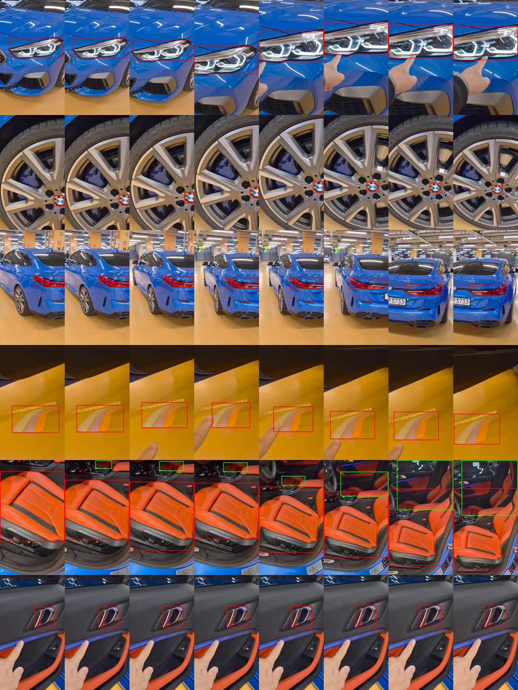
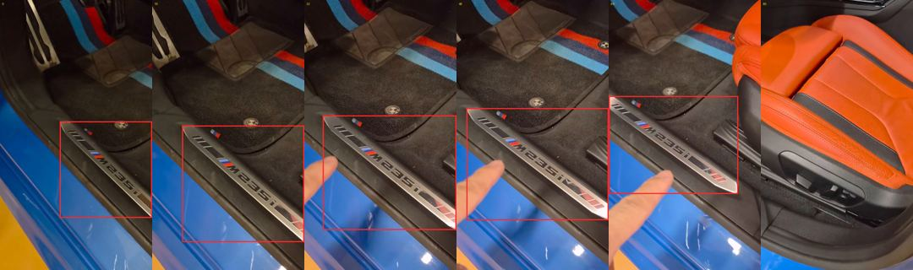
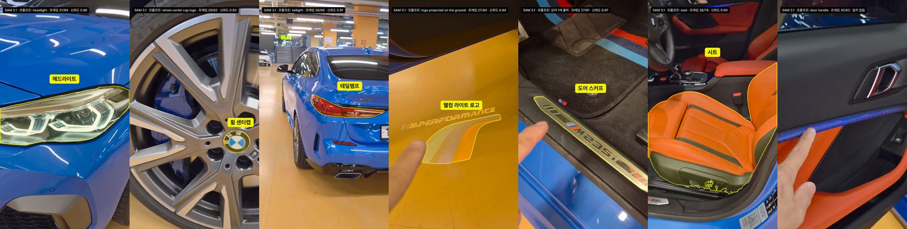

# SAM 3.1(Meta Model API) 첫 시험 — 2026-11-25

결제 등록 뒤 `scripts/shortform/auto/sam31_api.py`로 2회 호출했다(재시도 없음). 키는 `/root/.bobae_secrets/model_api.env`에만 있다.

| 시험 | 입력 | 글자 프롬프트 | 결과 | 걸린 시간 |
| --- | --- | --- | --- | --- |
| 사진 1장 | 서울오토갤러리 M3 대표 사진 900×506 | `car emblem` | 보닛 위 BMW 엠블럼 1개(14×11px) 정확히 찾음, 신뢰도 0.73 | 2.2초 |
| 영상 2초 | M235i 원본 휠 컷 6.30~8.30초, 540×960 · 30fps · 60프레임 | `wheel center cap logo` | 휠 센터캡 로고를 58프레임 연속 추적(물체 번호 0 하나), 신뢰도 0.93, 마지막 2프레임은 다음 장면이라 비어 있음(정상) | 4.0초 |

- 비교: 같은 컷의 기존 OpenCV CSRT 추적(`tracks.json` c3)은 60프레임 중 15프레임을 잃었다. 단, CSRT는 다른 점(캘리퍼 쪽)을 따라가 1:1 비교는 아니다.
- 프레임 간 상자 중심 이동은 평균 7.3px · 최대 15.1px(540폭 기준, 카메라가 움직이는 컷). 칩·섬광을 붙일 때는 기존처럼 3~5프레임 평활을 건다.
- 장면이 바뀌면 결과가 비어 나오므로 컷 경계 검출과 겹쳐 쓸 필요가 없다.

## 판정
- 엠블럼·센터캡처럼 작은 부위의 「찾기 + 추적」은 SAM 3.1로 교체 후보(조건부 → 채택 제안). 로컬 SAM 2.1(34프레임 4분 33초) 대비 훨씬 빠르고 설치가 필요 없다.
- 남은 시험: 손가락이 가리는 컷(xDrive 버튼), 빠른 줌 컷, 영문 프롬프트가 안 맞는 부위(예: 「통풍시트 버튼」), 마스크(base85) 풀기, 비용(영상은 프레임당 과금, 최소 50프레임).

---

# 2차 시험 — 정밀도 · 시간 · 샘플 영상 (2026-11-25)

대상: M235i 원본(1080×1920 · 30fps)에서 부위 컷 7개를 잘라 540×960으로 줄여 보냈다(업로드 시간 절약). 숫자는 540 기준.

## 결과표

| 부위 | 프롬프트 | 같은 장면 프레임 | 찾은 프레임 | 상자 중심 흔들림(상자 크기 대비, 중앙값 / 95%) | 평균 신뢰도 | 걸린 시간 | 프레임당 |
| --- | --- | --- | --- | --- | --- | --- | --- |
| 헤드라이트 | 글자 headlight | 63 | 63 (100%) | 1.6% / 3.1% | 0.98 | 13.0초 | 189ms |
| 휠 센터캡 | 글자 wheel center cap logo | 57 | 57 (100%) | 8.6% / 16.4% (돌아가는 작은 원) | 0.93 | 7.7초 | 124ms |
| 테일램프 | 글자 taillight | 56 | 56 (100%) | 1.4% / 3.2% | 0.91 | 8.4초 | 140ms |
| 웰컴 라이트 로고 | 글자 logo projected on the ground | 78 | 78 (100%) | 1.0% / 2.7% | 0.84 | 13.0초 | 155ms |
| 시트 | 글자 seat | 74 | 74 (100%) | 0.5% / 1.4% | 0.90 | 58.9초 | 755ms |
| 도어 핸들 | 글자 door handle | 57 | 10 (18%) | 2.0% / 3.2% | 0.75 | 6.1초 | 99ms |
| 도어 핸들 | **클릭 1번**(상자+점, 30번째 프레임) | 57 | 57 (100%) | 2.6% / 4.3% | 0.97 | 11.5초 | 186ms |
| 도어 스커프 | 글자 door sill · badge 등 3종 | 75 | 0 (0%) | — | — | 6~7초 | — |
| 도어 스커프 | **클릭 1번**(상자+점, 첫 프레임) | 75 | 75 (100%) | 0.7% / 2.4% | 0.97 | 14.5초 | 179ms |

- 위치 정확도(눈 검수): 무작위 48프레임(부위당 8장) 상자·윤곽 48/48 맞음. 손가락이 가려도 놓치지 않았다(헤드라이트 · 로고 · 도어 핸들).
- 윤곽 정밀도: 마스크를 공식 해독기(`@meta-sam/parser` 0.1.0, SAM License)로 풀어 겹쳐 보니 센터캡 원 테두리 · 시트 · 스커프 가장자리에 픽셀 단위로 붙었다.
- 장면이 바뀌면 결과가 비어 나온다(같은 장면 밖 프레임 0건 오검출).
- 시간: 2~3초 컷 하나에 6~15초(프레임당 0.1~0.19초). 시트처럼 큰 물체 2개는 59초로 느렸다. 컷 7개를 차례로 보내면 약 1분 30초 → 컷을 동시에 보내면 대략 가장 느린 컷 하나 시간으로 줄어든다(미시험).

## 판정
1. **글자로 잘 되는 부위:** 헤드라이트 · 테일램프 · 휠 센터캡 · 바닥 로고 · 시트 → 자동.
2. **글자로 안 되는 부위:** 도어 스커프(0%), 도어 핸들(18%) → 상자 1번 클릭이면 100%. 그래서 사람 손은 「안 잡힌 부위에 상자 1번」이면 된다(손터치 12후보 화면과 같은 승인 단계에 붙이면 됨).
3. **교체:** OpenCV CSRT · OWLv2 재탐색 → SAM 3.1(글자 먼저, 실패하면 클릭 1번)로 바꾸는 것을 제안한다. 칩 위치는 상자 위쪽 가운데 + 3프레임 평활.

## 샘플 영상
- `public/shortform-samples/sam31-track-v01/bobae_sam31_track_sample.mp4` (18.7초, 1080×1920, 원본 소리)
- 부위 윤곽(노랑 #F5F200 테두리 + 옅은 채움)과 부위 이름 칩이 SAM 결과를 그대로 따라간다. 왼쪽 위에 프롬프트 · 프레임 · 신뢰도를 표시한 **시험용 화면**이며, 판 규칙(붓칠 칩 · 자막 · 효과음) 영상이 아니다.
- 렌더 562프레임 24초(2코어).
- 코드: `scripts/shortform/auto/sam31/`(시험 실행 · 마스크 풀기 · 샘플 렌더), 결과 숫자 `metrics_m235i_1125.json`.

