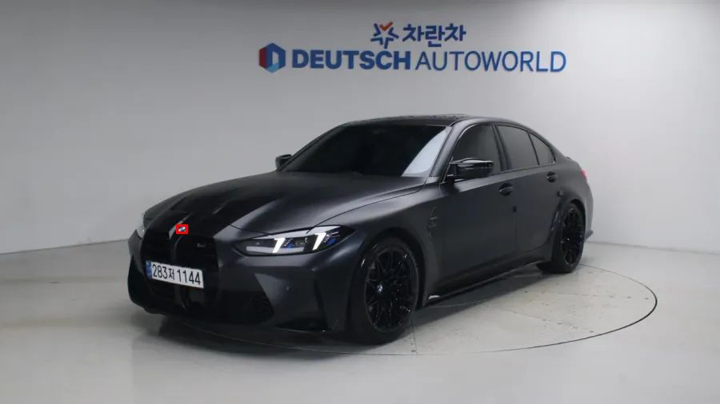
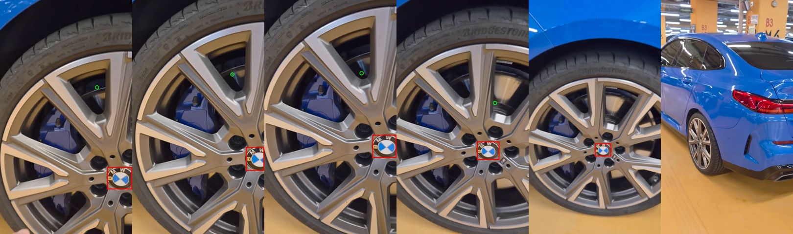

# SAM 3.1(Meta Model API) 첫 시험 — 2026-11-25

결제 등록 뒤 `scripts/shortform/auto/sam31_api.py`로 2회 호출했다(재시도 없음). 키는 `/root/.bobae_secrets/model_api.env`에만 있다.

| 시험 | 입력 | 글자 프롬프트 | 결과 | 걸린 시간 |
| --- | --- | --- | --- | --- |
| 사진 1장 | 서울오토갤러리 M3 대표 사진 900×506 | `car emblem` | 보닛 위 BMW 엠블럼 1개(14×11px) 정확히 찾음, 신뢰도 0.73 | 2.2초 |
| 영상 2초 | M235i 원본 휠 컷 6.30~8.30초, 540×960 · 30fps · 60프레임 | `wheel center cap logo` | 휠 센터캡 로고를 58프레임 연속 추적(물체 번호 0 하나), 신뢰도 0.93, 마지막 2프레임은 다음 장면이라 비어 있음(정상) | 4.0초 |

- 비교: 같은 컷의 기존 OpenCV CSRT 추적(`tracks.json` c3)은 60프레임 중 15프레임을 잃었다. 단, CSRT는 다른 점(캘리퍼 쪽)을 따라가 1:1 비교는 아니다.
- 프레임 간 상자 중심 이동은 평균 7.3px · 최대 15.1px(540폭 기준, 카메라가 움직이는 컷). 칩·섬광을 붙일 때는 기존처럼 3~5프레임 평활을 건다.
- 장면이 바뀌면 결과가 비어 나오므로 컷 경계 검출과 겹쳐 쓸 필요가 없다.

## 판정
- 엠블럼·센터캡처럼 작은 부위의 「찾기 + 추적」은 SAM 3.1로 교체 후보(조건부 → 채택 제안). 로컬 SAM 2.1(34프레임 4분 33초) 대비 훨씬 빠르고 설치가 필요 없다.
- 남은 시험: 손가락이 가리는 컷(xDrive 버튼), 빠른 줌 컷, 영문 프롬프트가 안 맞는 부위(예: 「통풍시트 버튼」), 마스크(base85) 풀기, 비용(영상은 프레임당 과금, 최소 50프레임).

