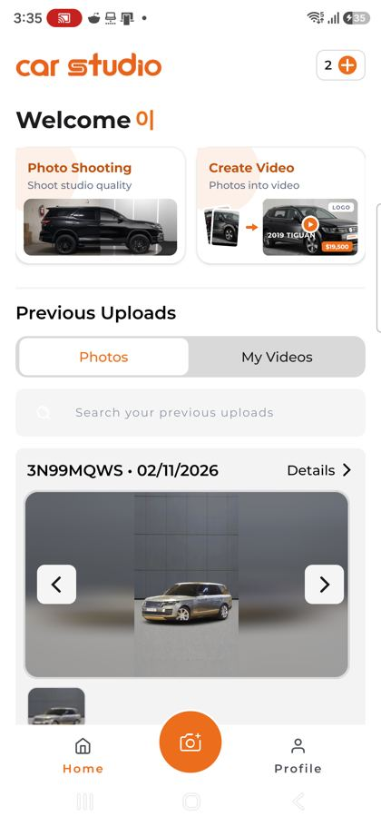
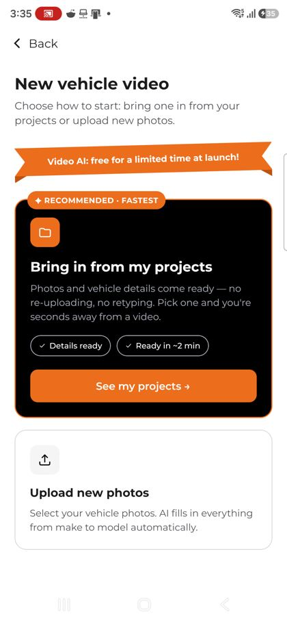
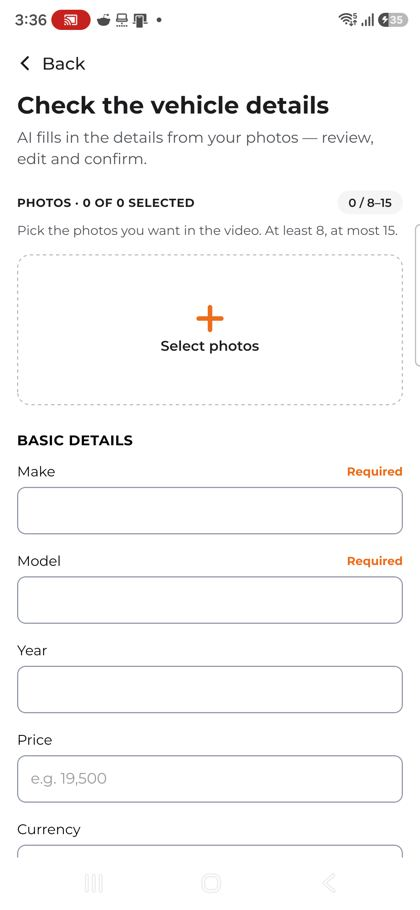
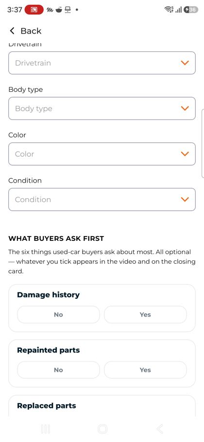
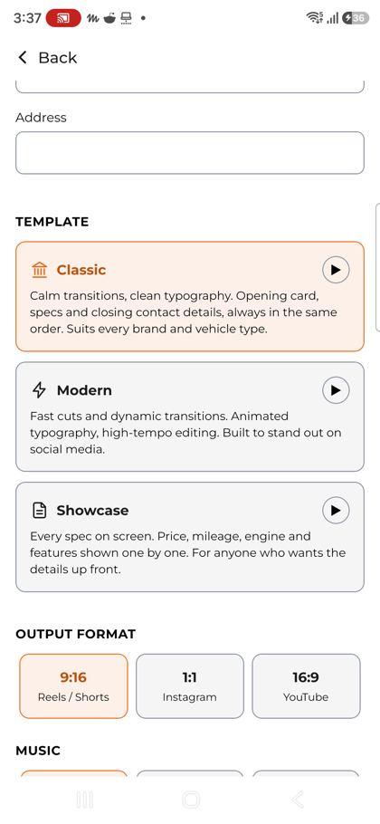
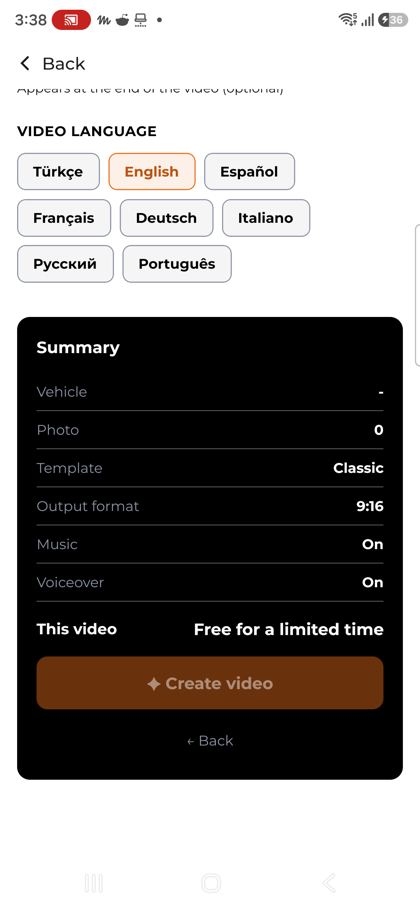
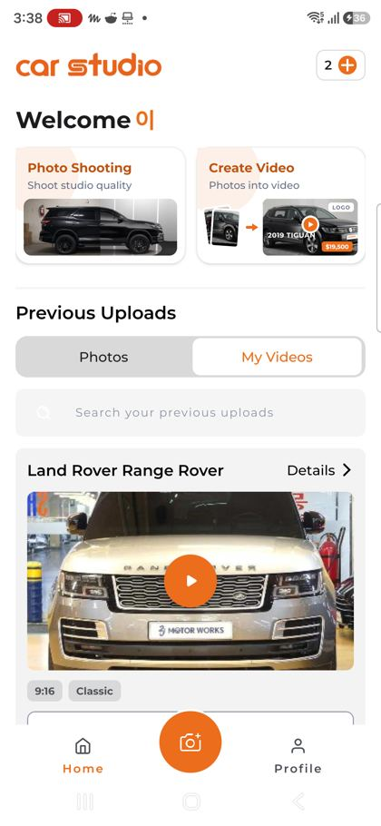

# 폰에 연결된 AI 숏폼 제작 앱(카스튜디오 AI) 만들기 — 준비 보고서

① **한 줄 요약**: 폰에 열려 있던 Car Studio AI 앱의 「Create Video(사진 → 영상)」 흐름을 처음부터 요약 화면까지 직접 눌러 기록했다. 우리 저장소에 이미 있는 숏폼 키트와 견주어 보니 화면 순서·입력 항목·AI 음성·결과 관리가 빠져 있다. 만드는 순서와, 정해 주셔야 할 것 6개를 정리했다.

② **과제 ID**: 없음(준비 단계) · **브랜치** `ai-shortform-prep` · **상태**: 보고서만 커밋함(코드 변경 없음) · 확인일 2026-11-03

## ③ 한 일

- 폰(갤럭시, PC와 USB로 연결됨)에서 지금 열려 있는 앱을 확인했다. **Car Studio AI 2.0.1**(`ai.carstudio`), 2026-10-31 설치.
- 홈 → Create Video → 프로젝트 고르기 → 사진·차량 정보 입력 → 템플릿·비율·음악·음성·로고·언어 → 요약까지 화면마다 캡처하고, 화면에 적힌 글자를 그대로 받아 두었다.
- 크레딧(남은 2개)이 쓰이는 **「Create video」 버튼은 누르지 않았다**. 결과 영상도 내려받지 않았다(폰에 파일이 저장되므로 허락이 필요함).
- 우리 저장소에 이미 있는 것과 하나씩 비교했다: `nuxt-shortform`(autohaus 판 숏폼 키트), `nuxt-shootkit`(촬영·mp4 만들기), `shorts-api`(숏폼 보기), 딜러 내레이션 샘플 v01.

## ④ 원본 흐름(Car Studio AI)

| 순서 | 화면 | 내용 |
|---|---|---|
| 1 | 홈 | 카드 2개: `Photo Shooting`(스튜디오 배경 사진) · `Create Video`(사진 → 영상). 아래 `Previous Uploads`는 `Photos` / `My Videos` 탭과 검색. 오른쪽 위에 남은 크레딧 `2 ⊕` |
| 2 | 새 영상 시작 | 두 갈래: **내 프로젝트에서 가져오기**(추천 · 가장 빠름 · 「약 2분이면 완성」: 사진과 정보를 다시 올리지 않음) / **사진 새로 올리기**(「AI가 제조사·모델을 자동으로 채움」). 위에 「출시 기념 한시 무료」 띠 |
| 3 | 내 프로젝트 | 처리된 사진이 8장 이상인 프로젝트만 보임. 없으면 「사진 올리기」 |
| 4 | 차량 정보 확인 | 사진 8~15장(`0 / 8–15`). 기본: 제조사*·모델*·연식·가격·통화(KRW). 기술: km/mi · 주행거리 · 마력 · 배기량 · 변속기 · 연료 · 구동 · 바디타입 · 색상 · 상태 |
| 4-1 | 구매자가 먼저 묻는 6가지 | 사고 이력 · 도색 부위 · 교환 부위(예/아니오), 소유자 수(1인 / 2인 / 3인 이상), 보증(유효 / 만료), 보상판매(가능 / 불가). 모두 선택 항목이며, 고른 것은 영상과 끝 장면에 나옴 |
| 4-2 | 끝 장면 정보 | 딜러 이름 · 전화 · 주소(모두 선택) |
| 5 | 템플릿 | **Classic**(차분한 전환 · 여는 장면 → 사양 → 연락처 순서 고정) / **Modern**(빠른 컷 · 움직이는 글자 · SNS용) / **Showcase**(가격·주행·엔진·옵션을 하나씩). 카드마다 ▶ 미리보기 |
| 6 | 출력 비율 | 9:16 릴스·쇼츠 / 1:1 인스타그램 / 16:9 유튜브 |
| 7 | 음악 | Presentation · Energetic · Cinematic · Relaxed · 음악 없음 |
| 8 | AI 음성 | 켜면 장면마다 대사를 편집 단계에서 자동으로 씀 |
| 9 | 로고 · 언어 | 로고 없음 / 로고 추가(영상 끝에 나옴). 언어 8개(터키어 · 영어 · 스페인어 · 프랑스어 · 독일어 · 이탈리아어 · 러시아어 · 포르투갈어). **한국어 없음** |
| 10 | 요약 → 만들기 | 차량 · 사진 수 · 템플릿 · 비율 · 음악 · 음성을 보여 주고 `✦ Create video`(「한시 무료」) / `← Back` |
| 11 | 내 영상 | 카드에 차명 · `9:16` · `Classic` 꼬리표, `Share` · `Download` |

      

## ⑤ 우리에게 있는 것과 비교

| 기능 | Car Studio AI | 우리 지금 | 해야 할 것 |
|---|---|---|---|
| 시작 갈래 | 내 프로젝트 / 사진 새로 | 사진 새로만(`nuxt-shortform`) | 「내 매물에서 가져오기」 = 보배드림 등록 매물 API로 사진·정보 채우기 |
| 차량 자동 인식 | 사진 → 제조사·모델 | 촬영 키트의 부위 인식만(폰 안 CLIP) | 사진으로 제조사·모델 후보를 만들고 차량 기준표에 맞추기. 딜러가 확인하는 화면은 필수 |
| 사진 장수 | 8~15장 | 4~20장 | 원본 기준에 맞출지 정하기 |
| 입력 항목 | 기본 · 기술 · 구매자 6가지 · 끝 장면 | 제조사 · 모델 · 연식 · 가격 · 주행 · 색상 · 주소 | 기술 항목과 「구매자가 먼저 묻는 것」을 한국판으로 추가 |
| 템플릿 | 3개 + 미리보기 영상 | 3개(릴스형 · 매물 카드형 · 사진 띠형), 미리보기 없음 | 원본 3개 성격에 맞추고 미리보기 영상 넣기 |
| 비율 | 9:16 · 1:1 · 16:9 | 같음 | — |
| 음악 | 4종 + 없음 | 코드로 만든 박자 3종 + 없음 | 무료 음원 1종 추가 검토 |
| AI 음성 | 장면별 대사 자동 | 내레이션 샘플 v01만(별도 스크립트, 화면 없음) | 한국어 음성 엔진 연결(서버) |
| 로고 · 언어 | 로고 · 8개 언어 | 판매자 로고 있음, 한국어만 | 한국어 기본, 영어는 나중에 |
| 만드는 곳 | 서버(약 2분) | 브라우저 안(서버 없음) | 음성까지 넣으려면 서버 작업 순서(큐)가 필요 |
| 결과 관리 | 내 영상 · 공유 · 내려받기 | 이 브라우저에만 저장 | 계정별 서버 저장(Laravel) |
| 크레딧 | 있음(지금은 한시 무료) | 처음 3개(브라우저만) | 정책 정하기 |

## ⑥ 정해 주셔야 할 것

1. **영상 만드는 곳**: 지금처럼 폰 브라우저에서 만들지(무료 · 빠름 · AI 음성은 따로 받아 붙임), 원본처럼 서버에서 만들지(약 2분 · 서버 비용 듦).
2. **AI 음성 엔진**: 한국어 남녀 목소리. 유료 서비스(예: ElevenLabs · Azure)는 계정·키가 필요하다. 샘플 v01은 무료 음성(InJoon)을 썼다.
3. **「구매자가 먼저 묻는 것」 한국판 항목**: 원본 6가지 중 보상판매 대신 **성능점검 유무**를 넣는 안을 제안한다(제안이며 확정 아님). 사고 이력 · 판금·도색 · 교환 · 소유자 수 · 보증 · 성능점검.
4. **사진 장수 기준**: 원본처럼 8~15장으로 할지, 지금의 4~20장을 유지할지.
5. **위치**: 매물 등록을 마친 뒤 바로 이어서 만들지(추천: 「내 매물에서 가져오기」가 원본에서 가장 빠른 길), 독립 화면으로 둘지.
6. **크레딧 · 무료 정책**.

## ⑦ 만드는 순서(과제 1개 = 브랜치 1개 = PR 1개)

1. **원본 전수 기록 마무리**: 템플릿 3개 미리보기 영상, `Photo Shooting` 흐름, 결과 영상 1개(레인지로버 9:16 Classic)의 장면 순서 · 자막 · 시간 분석. 결과 영상 내려받기는 허락받은 뒤 진행.
2. **화면을 원본과 똑같이**: `nuxt-shortform`의 「새 영상」을 원본 순서(시작 두 갈래 → 정보 확인 → 템플릿 · 비율 · 음악 · 음성 · 로고 · 언어 → 요약)로 다시 짜기. 아이콘은 노션 DB 원본만 쓴다.
3. **내 매물에서 가져오기**: 보배드림 등록 매물(사진 · 제원)을 불러와 칸을 채우기.
4. **서버(Laravel 12)**: 작업 · 상태(접수 · 만드는 중 · 완성 · 실패) · 결과 파일 · 크레딧 저장.
5. **AI 음성**: 장면별 대사는 매물 정보와 사진에 있는 사실만 쓴다(사고 · 가격을 지어내지 않음).
6. **차량 자동 인식**: 사진으로 제조사·모델 후보 → 딜러가 확인.
7. **내 영상 · 공유**: 계정별 목록, 내려받기, 휴대폰 공유창(인스타 · 틱톡 · 유튜브).

## ⑧ 주의할 것 · 확인 링크

- 원본의 영상 · 음악 · 로고 · 문구는 복사하지 않는다. 구성과 순서만 따른다.
- 크레딧이 쓰이는 버튼은 누르지 않는다. 폰에 파일을 저장하는 조작은 허락을 받은 뒤에 한다.
- 원본은 한국어를 지원하지 않는다. 우리는 한국어를 기본으로 두고, 이 점을 차별점으로 삼는다.
- 같은 폰에 비슷한 앱(AutoStudio: `app.autostudioai.app` · `com.autostudioai`)도 설치되어 있고, 지난번 캡처가 PC 폴더 `autostudio_analysis\shots`에 있다. 두 앱을 함께 비교할지 정해 주세요.
- 지금 우리 숏폼 키트: https://bobaekimboae.github.io/bobaedream/nuxt-shortform/
- 원본 캡처 원본(PC): `C:\Users\Thinkbook\Documents\autostudio_analysis\shots\cs_00~cs_10`
