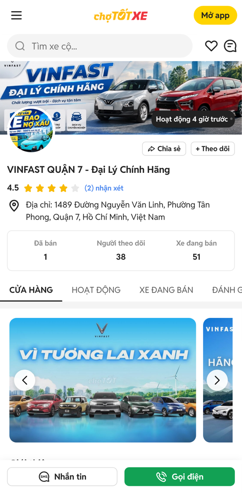
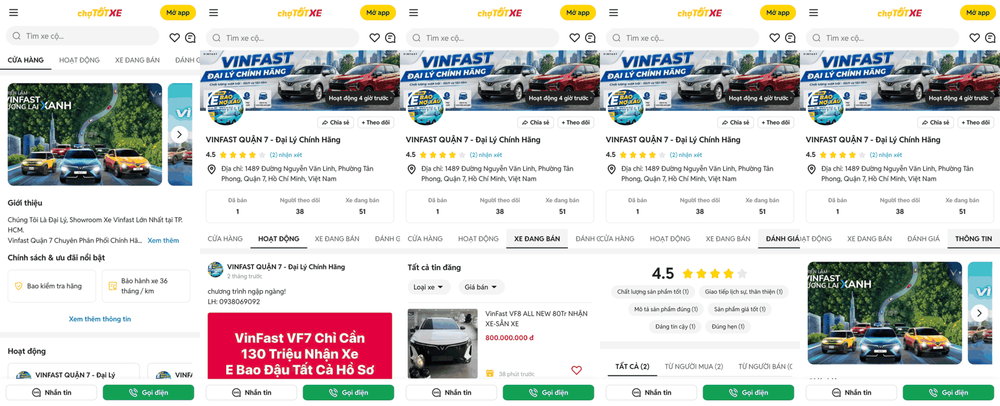

# 초톳 딜러 페이지 구조 분석 (클로드 코드)

① 한 줄 요약: 초톳 딜러 페이지는 「공통 머리 + 탭 5개」 구조이고 탭마다 주소가 따로 있습니다. 우리 쪽에는 매물 카드·딜러 줄·탭 뼈대가 이미 있어 새로 만들 것은 머리 영역, 활동·후기·정보 탭, 진입 칩 줄입니다.

② 과제 ID 미지정 · 브랜치 `analysis/dealer-page-1011` · 상태: 푸시만(병합·배포 없음, 분석 문서)
- 근거 문서: 구글 문서 「딜러페이지 제작_261011_170711.docx」
- 역할: 클로드 코드 = 구조 분석 → 검수팀(크로스체크·컨설팅). 디자인은 코덱스 마스터 1, 아이콘은 클로드 총괄 마스터 몫이라 이 문서에서 건드리지 않았습니다.

## ③ 조사 방법
- 초톳 모바일 웹 `xe.chotot.com/cua-hang/vinfastvietnam`을 모바일 화면(Pixel 7)으로 직접 열어 탭 5개를 모두 눌렀습니다.
- 앱 캡처 5장(드라이브 폴더)은 글자 인식 결과로 읽었습니다. 눈으로 비교한 것이 아니라 글자·위치 정보 기준입니다.

## ④ 페이지 수 (코덱스 마스터 분석용 제안)
| # | 화면 | 주소(초톳 웹) | 비고 |
|---|---|---|---|
| 0 | 진입 칩 줄 「Top người bán xe」 | 자동차 목록 화면 안 | 앱 캡처에만 있음, 웹 목록(`mua-ban-oto`)에서는 못 찾음 |
| 1 | 가게 홈(CỬA HÀNG) | `/cua-hang/{별칭}` | 기본 탭 |
| 2 | 활동(HOẠT ĐỘNG) | `?tab=posts` | 딜러 글 목록 |
| 3 | 판매 중인 차(XE ĐANG BÁN) | `?tab=ads` | 필터 칩 + 카드 목록 |
| 4 | 평가(ĐÁNH GIÁ) | `?tab=rating` | 평점·태그·후기 |
| 5 | 정보(THÔNG TIN) | `?tab=info` | 소개·가게 정보·정책 |
화면 5개 + 진입 줄 1개이고, 5개 화면은 위쪽 머리(배너·프로필·통계)를 공유합니다. 별도 시트·모달은 확인되지 않았습니다(필터 칩 `Loại xe`·`Giá bán`이 시트를 여는지는 눌러 보지 않았음).

## ⑤ 공통 머리 (모든 탭 위에 고정으로 보임)
위에서 아래로: 앱 상단바(메뉴·로고·`Mở app`) → 검색창 + 찜 + 채팅 → 배너 이미지(오른쪽 아래 「활동 4시간 전」 표시) → 프로필 원형 사진(배너에 겹침) + `공유` `+ 팔로우` → 가게 이름(H1) → 평점 4.5 + 별 5개 + `(2) 후기` → 위치 핀 + 주소 → 통계 상자 3칸(`판매완료 1` · `팔로워 38` · `판매중 51`) → 탭 줄(가로 스크롤, 선택은 밑줄).
- 아래에 항상 붙어 있는 막대: `메시지(SMS 아이콘)` + 초록 `전화`.
- 앱 캡처에서는 스크롤하면 상단바가 가게 이름(`VINFAST QUẬN 7 - Đại Lý Chín…`)으로 바뀌고 배너는 접힙니다(캡처 2~4번). 웹은 상단바가 그대로입니다.

## ⑥ 탭별 구성
1. **가게 홈**: 배너 슬라이드(좌우 화살표) → `소개`(3줄 + `더보기`) → `정책·혜택` 카드 격자(웹 6개, 2열) + `정보 더보기` → `활동` 가로 카드 5개 + `활동 더보기` → `판매중(51)` 필터 칩 + 카드 5개 + `더 보기` → `평가` 요약 + 후기 2개.
2. **활동**: 세로 목록. 한 칸 = 작은 프로필 + 가게 이름 + 「2개월 전」 + 글 + (이미지) + 숫자 2개(0 · 0, 좋아요·댓글로 추정).
3. **판매 중인 차**: 제목 `전체 게시글` + 필터 칩 2개(`차종` ▾, `가격` ▾) + 목록형 카드(사진 · 제목 · 가격 · 시간 · 찜).
4. **평가**: 큰 평점 4.5 + 별 → 칭찬 태그 칩(6종, 각각 건수) → 탭 3개(`전체` · `구매자` · `판매자`) → 후기 카드(이름 · 칭찬 태그 · 별점 · 시간 · 거래한 매물).
5. **정보**: 배너 슬라이드 → `소개`(펼치면 전문) → `가게 정보`(채팅 응답 속도 87% 「느림」, 운영 기간 6년 7개월, 가게 주소) → `정책·혜택`(웹 7개: 제조사 검사 · 보증 36개월 · 대출 80% · 시승 · 중고 매입 · 정비 · 품질 검사).

## ⑦ 진입점: 「딜러 칩」(앱 캡처 `초톳 딜러 칩`)
자동차 목록 위쪽의 가로 줄 `Top người bán xe - {지역}` + 부제 `Kết nối với người bán có tin đăng phù hợp với bạn`.
- 카드 한 장 = 순위 번호 + 가게 로고/이름 + `N tin đăng phù hợp`(맞는 매물 수) + 대표 매물 2개(사진·제목·가격·시간) + `N tin` 더보기.
- 바로 아래에 브랜드 칩 줄 `Bạn cần tìm hãng xe nào?`이 이어집니다.

## ⑧ 우리 쪽 재료와 크로스체크
| 필요한 것 | 지금 있는 것 | 판단 |
|---|---|---|
| 탭 뼈대 | 서울오토갤러리 탭 4개(차량·상사·딜러·소개) `seoul-auto-gallery-directory.tsx` | 탭 골격은 재사용 가능, 항목명·개수가 다름 |
| 딜러 목록 줄 | `seoul-auto-gallery-dealer-rail.tsx`(초상 일러스트 76×102) | 진입 칩 줄로 개조 가능 |
| 딜러 데이터 | 서울오토갤러리·도이치오토월드에 실제 상사명·딜러명·판매중 대수 | 있음. 판매완료·팔로워·평점은 없음 |
| 매물 카드·목록 | 목록형·피드형 카드 공통 컴포넌트 | 그대로 재사용 |
| 머리 배너·프로필 | 서울오토갤러리 헤더(`seoul-auto-gallery-header.tsx`) | 모양이 달라 새로 설계 |
| 활동 글·후기·평점·팔로워 | 없음 | 가상 데이터 필요 |
| 전화·채팅·팔로우·공유 | 없음 | 동작은 안내 문구만(전화번호는 저장 금지 규칙) |

## ⑨ 클로드 총괄 마스터에 요청할 아이콘 (노션 초톳 페이지에서 찾기)
공유 · 팔로우(+) · 위치 핀 · 별(채움/빈) · 메시지(SMS 말풍선) · 전화 · 찜(하트) · 검색 · 메뉴 · 좌우 화살표(배너) · 아래 화살표(칩) · 더보기 화살표 · 정책 7종(방패 검사 · 보증 · 대출 · 시승 · 중고 매입 · 정비 · 품질 검사) · 좋아요·댓글(활동) · 시계(「N분 전」, 있으면) · 가게 인증(물결 배지, 이미 있음).

## ⑩ 결정이 필요한 것 (코덱스 마스터·사용자)
1. 딜러 페이지 주소 규칙: `?dealer=<id>&tab=posts|ads|rating|info` 제안(초톳과 같은 구조).
2. 어떤 딜러부터 적용할지: 서울오토갤러리 딜러(실제 이름 예외 카테고리)를 먼저 하는 것을 추천.
3. 후기·활동 글·배너는 가상 값이 필요합니다. 「이름·전화번호는 저장하지 않는다」 기존 규칙과 실제 딜러 이름을 함께 쓰는 범위를 정해 주세요.
4. 진입 칩 줄을 어느 카테고리의 어느 위치에 둘지(앱은 목록 위, 브랜드 칩 줄 위).

## ⑪ 구현 순서 제안
A 머리+탭 골격 → B 가게 홈 → C 판매중(기존 카드 재사용) → D 평가 → E 정보 → F 활동 → G 진입 칩 줄. 각 단계마다 모바일 384px 캡처를 초톳 웹과 나란히 비교.

## ⑫ 검수 체크리스트 (구현 후 크로스체크용)
- 탭마다 주소가 바뀌고 새로고침해도 같은 탭이 열린다.
- 머리 영역(통계 3칸·탭 줄)이 모든 탭에서 같은 위치다.
- 하단 막대(메시지·전화)가 항상 붙어 있다.
- 판매중 카드는 기존 목록 카드와 같은 규칙이다.
- 아이콘은 노션 원본을 고치지 않고 쓴다.

## ⑬ 한계
- 앱 캡처는 글자 인식으로만 읽었습니다. 간격·색·글자 크기는 아직 재지 않았습니다(코덱스 마스터가 실측 담당).
- 초톳 웹은 한 가게(VinFast Quận 7)만 봤습니다. 가게마다 탭이 다를 수 있습니다(예: 활동 글이 없는 가게).
- 필터 칩·`더 보기`·후기 전체 보기의 동작은 눌러 확인하지 못했습니다.

## ⑭ 확인 링크
- 초톳 웹: https://xe.chotot.com/cua-hang/vinfastvietnam (탭은 `?tab=posts` `?tab=ads` `?tab=rating` `?tab=info`)
- 캡처: `reports/analysis-dealer-page-1011/chotot-web-top.png`, `chotot-web-5tabs.png`

