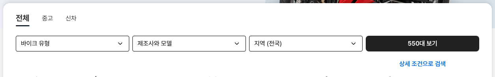

# 바이크 메인 검색 버튼 검정

① 한 줄 요약: `/bike/?home=as24` 검색 카드의 `N대 보기` 버튼 바탕을 검정 `#222`로 바꿨다.

② 과제 ID 없음 · 브랜치 `claude-consult/bike-as24-cta-black` · 커밋·PR·배포 v값은 채팅 보고 참고

③ 한 일: 검색 카드 버튼만 바탕 테마색 → `#222`, 마우스 올림 `#000`. 흰 글자 · 높이 40 · 반경 8 · 16/24 600 그대로.

④ 비교: 버튼 바탕 테마색 → `#222` (PC 1536 · 모바일 390 모두 rgb(34,34,34) 확인)

⑤ 검증: `npm run -s verify:qf` 통과, 콘솔 오류 없음.

⑥ 다르게 남긴 것: 제조사·모델 창 아래 `N대 보기`, 뉴스레터 버튼 등 다른 버튼은 테마색 그대로.

⑦ 다음: 다른 버튼도 검정으로 맞출지 결정 필요.

⑧ 확인: `/bike/?home=as24&v=<커밋>`
