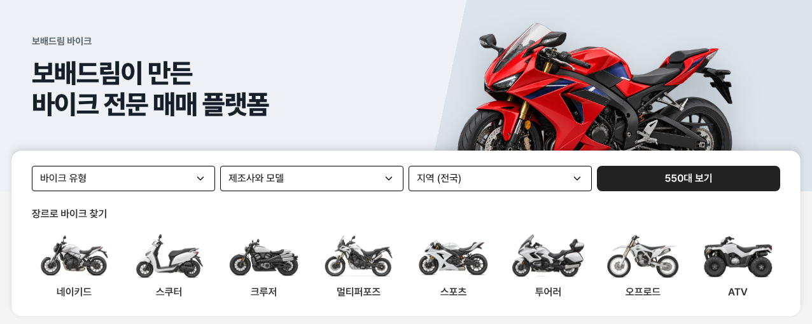

# 바이크 메인 — 상세 조건 링크 제거 · 간격 균형 · 히어로 문구

① 한 줄 요약: 검색 카드의 `상세 조건으로 검색`을 빼고 칸 ↔ 장르 간격을 카드 안쪽 여백과 같게 맞췄으며, 히어로 제목을 바꿨다.

② 과제 ID 없음 · 브랜치 `claude-consult/bike-as24-no-more` · 커밋·PR·배포 v값은 채팅 보고 참고

③ 한 일
- `상세 조건으로 검색` 링크 삭제.
- 칸 아래 → `장르로 바이크 찾기` 제목 = 24(PC) / 20(모바일), 카드 안쪽 위·아래와 같은 값.
- 히어로 제목 `보배드림이 만든 / 바이크 전문 매매 플랫폼`(`한국 유일의` 삭제). 작은 글 `보배드림 바이크`는 그대로.

④ 비교 (1536)

| 항목 | 전 | 후 |
|---|---|---|
| 카드 위 → 칸 | 24 | 24 |
| 칸 → 장르 제목 | 44(링크 줄 포함) | 24 |
| 장르 칸 → 카드 끝 | 24 | 24 |
| 카드 높이 | 281 | 261 |

⑤ 검증: `npm run -s verify:qf` 통과, 콘솔 오류 PC 1536 · 모바일 390 없음.

⑥ 다르게 남긴 것: 상세 조건 검색은 위 메뉴 `바이크 검색`(목록)에서 한다.

⑦ 다음: 없음.

⑧ 확인: `/bike/?home=as24&v=<커밋>`
