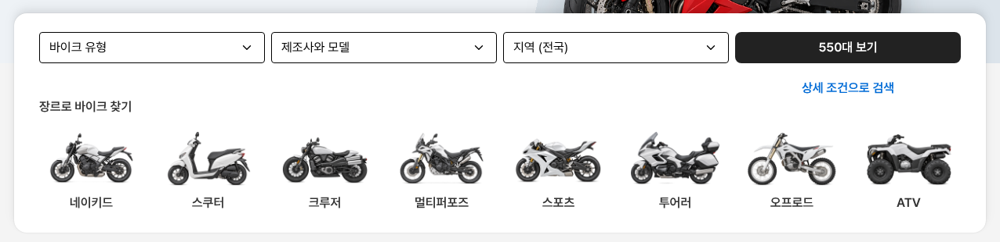

# 바이크 메인 검색 카드 탭 줄 제거

① 한 줄 요약: `/bike/?home=as24` 검색 카드에서 `전체 · 중고 바이크 · 신차 바이크` 탭 줄을 뺐다.

② 과제 ID 없음 · 브랜치 `claude-consult/bike-as24-no-tabs` · 커밋·PR·배포 v값은 채팅 보고 참고

③ 한 일: 탭 줄을 지우고 검색은 늘 전체(중고·신차 모두) 기준으로 둔다. 셀렉트 칸이 카드 안쪽 위 24에서 바로 시작한다. 중고·신차 구분은 위쪽 메뉴(`중고 바이크` · `신차 바이크`)에 이미 있다.

④ 비교 (1536): 카드 높이 340 → 281, 카드 위 → 칸 83 → 24.

⑤ 검증: `npm run -s verify:qf` 통과, 콘솔 오류 PC 1536 · 모바일 390 없음.

⑥ 다르게 남긴 것: AS24는 탭이 있지만 우리는 메뉴와 겹쳐 뺐다.

⑦ 다음: 없음.

⑧ 확인: `/bike/?home=as24&v=<커밋>`
