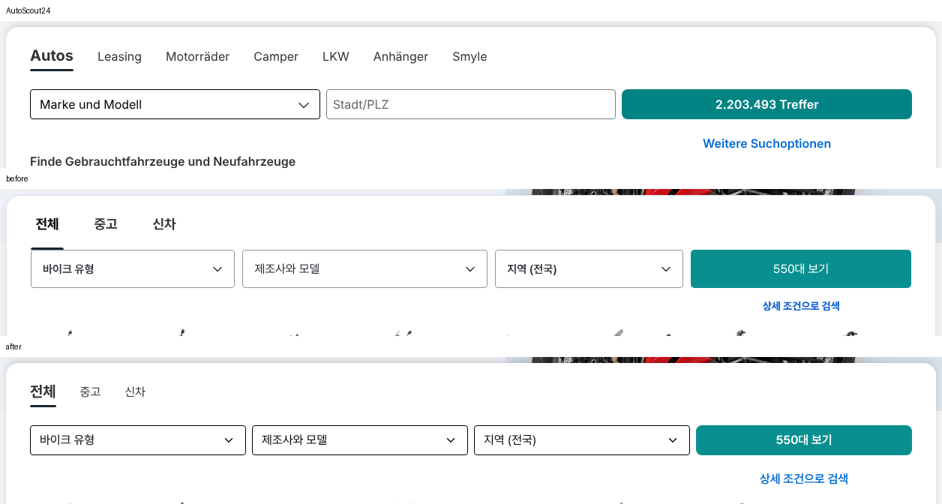

# 바이크 메인 검색 카드 — AutoScout24와 탭·셀렉트 크기 맞춤

① 한 줄 요약: `/bike/?home=as24` 검색 카드의 탭 줄과 셀렉트 칸을 autoscout24.de 실측값과 같게 맞췄다.

② 과제 ID 없음 · 브랜치 `claude-consult/bike-as24-search-crosscheck` · 커밋·PR·배포 v값은 채팅 보고 참고

③ 한 일
- autoscout24.de를 1536 폭에서 직접 열어 검색 카드·탭·칸·버튼·링크 값을 쟀다.
- 우리 탭을 18px 굵은 글자 · 72 높이에서 AS24처럼 현재 20/700 · 나머지 16/400 · 간격 32 · 글자 아래 4px 둥근 선으로 바꿨다.
- 칸 높이 51 → 40, 간격 10 → 8, 폭을 같게, 테두리를 검정 1px로, 글자를 16/400으로 맞췄다.
- 버튼 반경 5 → 8, 굵기 800 → 600, 상세 조건 링크 14 → 16px.
- 카드 테두리를 없애고 반경 18 → 16, 안쪽 위 0 → 24, 그림자를 AS24 값으로 바꿨다.

④ 원본과 비교 (1536)

| 항목 | AutoScout24 | 작업 전 | 작업 후 |
|---|---|---|---|
| 카드 반경 · 안쪽 | 16 · 24/32 | 18 · 0/32/28 | 16 · 24/32 |
| 카드 테두리 | 없음(그림자) | 1px `#DFE2E5` | 없음(같은 그림자) |
| 현재 탭 | 20/28 700 | 18/24 800 | 20/28 700 |
| 나머지 탭 | 16/24 400 | 18/24 650 | 16/24 400 |
| 탭 사이 | 32 | 34 | 32 |
| 선택 선 | 3px, 글자 아래 4, 둥금 | 3px, 72 줄 바닥 | 3px, 글자 아래 4, 둥금 |
| 탭 줄 → 칸 | 24(줄 35) | 0(줄 72) | 24(줄 35) |
| 칸 높이 · 간격 | 40 · 8 | 51 · 10 | 40 · 8 |
| 칸 폭 | 같음 386.7 ×3 | 272/327/251 | 같음 288 ×4 |
| 칸 테두리 · 반경 | 1px `#000` · 4 | 1px `#8F969D` · 4 | 1px `#000` · 4 |
| 칸 글자 | 16/24 400 `#000`, 왼쪽 13 | 15 600, 왼쪽 16 | 16/24 400 `#000`, 왼쪽 13 |
| 꺾쇠 | 18 | 20 | 18 |
| 버튼 | 40 · 반경 8 · 600 | 51 · 반경 5 · 800 | 40 · 반경 8 · 600 |
| 상세 링크 | 칸 아래 20 · 16/600 | 12 · 14/750 | 20 · 16/600 |

⑤ 검증: `npm run -s verify:qf` 통과. 콘솔 오류 PC 1536 · 모바일 390 없음. 모바일은 한 줄 1칸 그대로, 카드 안쪽 20.

⑥ 원본과 다르게 남긴 것: 칸이 4개(바이크 유형 칸이 더 있음) → 폭 288. 지역도 셀렉트라 테두리 검정(AS24 지역은 입력칸이라 회색). 버튼 색은 시안 테마색.

⑦ 다음: 장르 그림 줄(AS24 120×73 · 이름 16/600)도 같은 방식으로 맞출 수 있다.

⑧ 확인: 모바일·PC `/bike/?home=as24&v=<커밋>`
