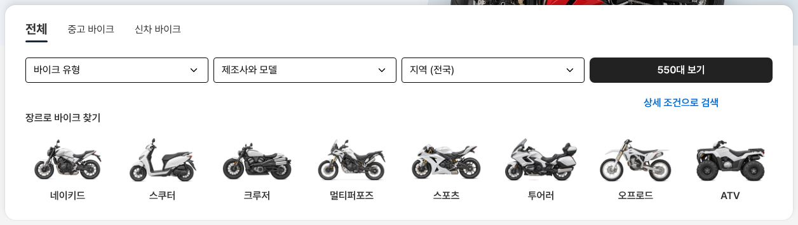

# 바이크 메인 검색 카드 — 탭 이름·높이 AutoScout24와 같게

① 한 줄 요약: 탭을 `전체 · 중고 바이크 · 신차 바이크`로 바꾸고 검색 카드 높이를 AutoScout24와 같은 340으로 맞췄다.

② 과제 ID 없음 · 브랜치 `claude-consult/bike-as24-tabs-height` · 커밋·PR·배포 v값은 채팅 보고 참고

③ 한 일
- 탭 글자만 바꿨다(검색 조건 값은 전체·중고·신차 그대로).
- AS24처럼 상세 조건 링크 바로 아래 제목 `장르로 바이크 찾기`(16/24 600)를 넣었다.
- 장르 칸을 AS24 차종 칸과 같은 109 높이(그림 73 · 이름 16/24 600)로 바꿨다.

④ 원본과 비교 (1536, 카드 위 기준 위치)

| 항목 | AutoScout24 | 전 | 후 |
|---|---|---|---|
| 탭 | 24 | 24 | 24 |
| 칸 | 83 | 83 | 83 |
| 상세 조건 링크 | 143 | 143 | 143 |
| 제목 | 167 | 없음 | 167 |
| 그림 칸 | 207 · 109 | 180 · 104 | 207 · 109 |
| 그림 · 이름 | 73 · 16/600 | 72 · 14/750 | 73 · 16/600 |
| 카드 높이 | 340 | 308 | 340 |

⑤ 검증: `npm run -s verify:qf` 통과, 콘솔 오류 PC 1536 · 모바일 390 없음. 모바일 탭 세 개 한 줄 유지.

⑥ 다르게 남긴 것: 장르 8칸(AS24 차종 8칸과 같은 수), 칸 4개.

⑦ 다음: 없음.

⑧ 확인: `/bike/?home=as24&v=<커밋>`
