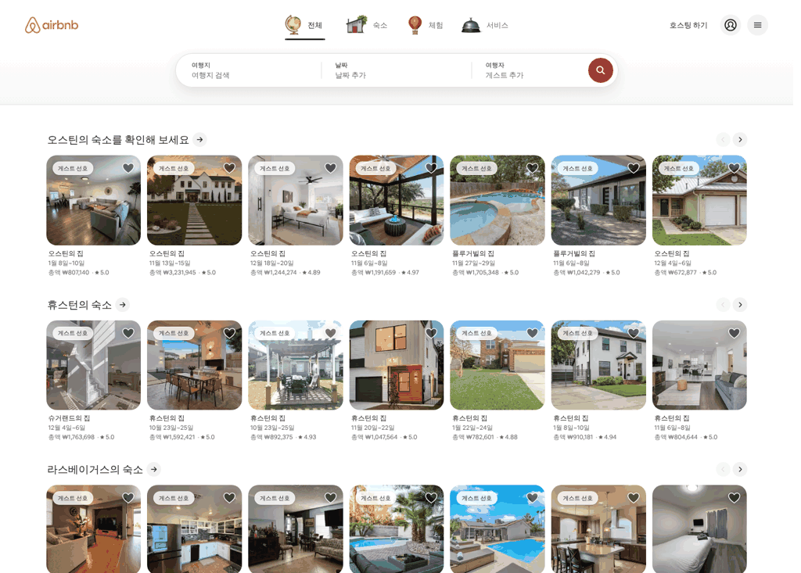
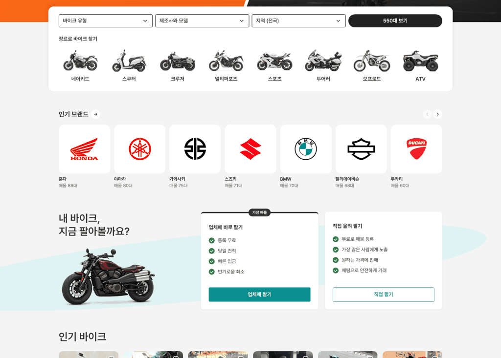
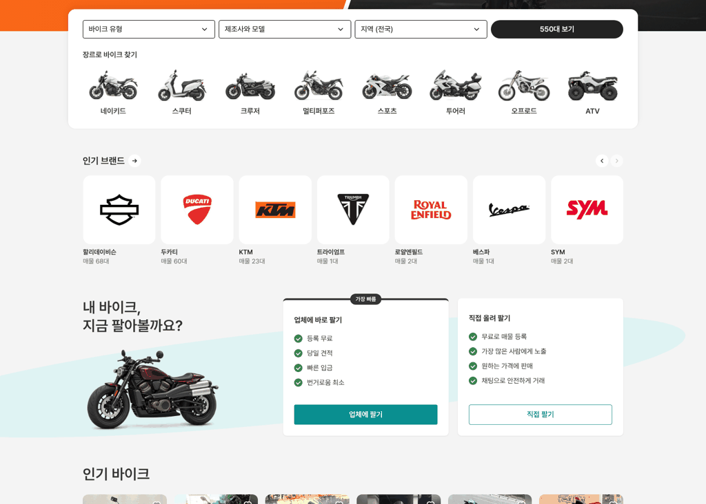
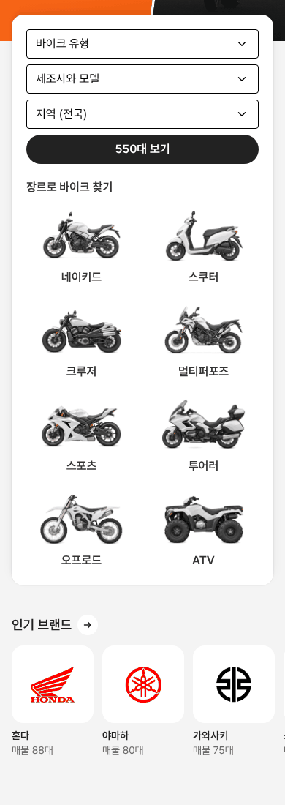

# 바이크 메인 — 인기 브랜드를 에어비앤비처럼 별도 섹션으로

① 한 줄 요약: 검색 카드 안에 넣었던 브랜드를 다시 빼서, 에어비앤비 첫 화면처럼 "제목 + → + 이전·다음 버튼 + 가로 한 줄" 섹션으로 만들었다.

② 과제 ID 없음 · 브랜치 `claude-consult/bike-brand-airbnb` · 커밋·PR·배포 v값은 채팅 보고 참조 · 앞 PR #816(브랜드를 카드 안으로)을 되돌리는 변경 포함

③ 한 일
- 검색 카드는 칸 줄 + 장르 줄로 되돌렸다(높이 413 → 261).
- 카드 아래 56에 `인기 브랜드` 섹션. 제목 옆 → 원(28)을 누르면 제조사·모델 선택 창이 열린다.
- 오른쪽 끝 이전·다음 원(28, 간격 4)으로 넘긴다. 넘길 곳이 없는 쪽은 흐려진다.
- 칸은 흰 둥근 판(반경 16) + 이름 + `매물 N대`. 한 화면에 7칸, 전체 12개 브랜드.
- 회색 페이지라 에어비앤비의 연회색 판 대신 흰 판을 썼다.

④ 원본과 비교 (에어비앤비 1536 실측 → 우리)
| 항목 | 에어비앤비 | 우리 |
|---|---|---|
| 섹션 제목 | 20/24 600 #222 | 20/24 600 #222 |
| 제목 옆 → 원 | 28, #F2F2F2 | 28, 흰색 |
| 이전·다음 | 28 원 2개, 간격 4 | 같음 |
| 제목 → 카드 | 18 | 18 |
| 카드 간격 | 12 | 12 |
| 한 화면 칸 수 | 7 | 7 |

  

⑤ 검증: `npm run verify:qf` 통과. 콘솔 오류 PC 0 · 모바일 0. 다음 버튼 → 끝까지 이동, 이전 버튼 켜지고 다음 버튼 꺼짐 확인. 퀵필터 규격 항목은 이번 변경과 무관(바이크 메인만 수정).

⑥ 원본과 다르게 남긴 것: 판·버튼 색을 흰색으로(회색 페이지 대비). 에어비앤비 카드는 사진이지만 우리는 로고다.

⑦ 못 한 것·다음: 트라이엄프·로얄엔필드·베스파·SYM은 매물이 1~2대뿐이다. 로고 크기가 브랜드마다 달라 보이는 것은 로고 표시 기준표(`logo-display-lightwagen.json`)로 맞출 수 있다.

⑧ 확인 링크: PC `/bike/?home=as24&pc=1`, 모바일 `/bike/?home=as24` (배포본은 `&v=<커밋>`)
