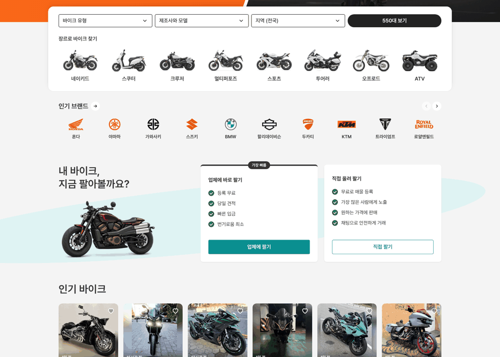
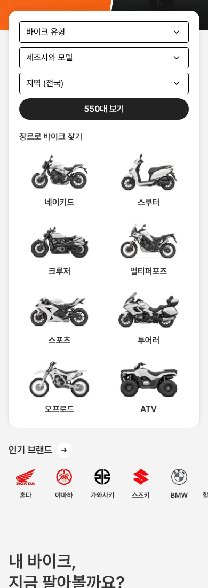

# 바이크 메인 — 인기 브랜드를 검색 카드 쪽으로 올림

① 한 줄 요약: 검색 카드와 인기 브랜드 사이를 56에서 32로 줄여, 두 영역을 같은 「찾기」 묶음으로 붙였다.

② 과제 ID 없음 · 브랜치 `claude-consult/bike-brand-closer` · 커밋·PR·배포 v값은 채팅 보고 참조 · 함께 들어간 과제 없음

③ 한 일
- 검색 카드 아래 → `인기 브랜드` 제목: PC 56 → 32, 모바일 40 → 28.
- 브랜드 줄 아래 → 팔기 섹션 간격은 그대로 둬서, 찾기 묶음과 팔기 섹션이 나뉘어 보인다.

④ 원본과 비교 (1536)
| 항목 | 전 | 후 |
|---|---|---|
| 검색 카드 → 인기 브랜드 | 56 | 32 |
| 인기 브랜드 → 팔기 섹션 | 그대로 | 그대로 |

  

⑤ 검증: `npm run verify:qf` 통과. 콘솔 오류 PC 0 · 모바일 0. 퀵필터 규격 항목은 이번 변경과 무관.

⑥ 원본과 다르게 남긴 것: 없음(간격만 조정).

⑦ 못 한 것·다음: 로고마다 보이는 크기 차이 맞추기.

⑧ 확인 링크: PC `/bike/?home=as24&pc=1`, 모바일 `/bike/?home=as24` (배포본은 `&v=<커밋>`)
