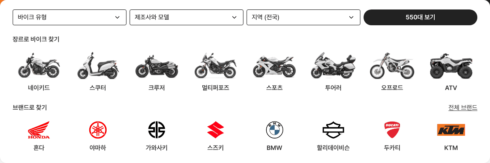
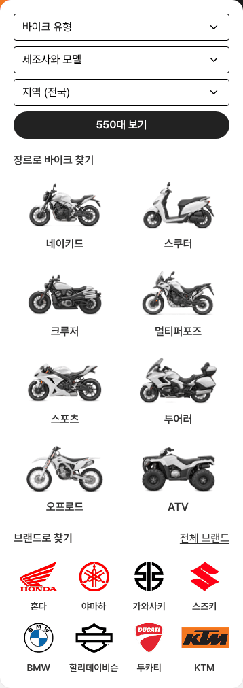

# 바이크 메인 — 인기 브랜드를 검색 카드 안으로

① 한 줄 요약: 따로 있던 `인기 브랜드` 섹션을 검색 카드 안 장르 줄 아래 `브랜드로 찾기` 줄로 옮겼다.

② 과제 ID 없음 · 브랜치 `claude-consult/bike-brand-in-card` · 커밋·PR·배포 v값은 채팅 보고 참조 · 함께 들어간 과제 없음

③ 한 일
- 검색 카드: 칸 줄 → 장르 줄 → `브랜드로 찾기` 줄 순서. 장르를 고르거나 브랜드를 고르는 두 길이 한 상자 안에 있다.
- 브랜드 8칸은 장르 줄과 같은 8칸 격자·간격 16이라 칸의 왼쪽 시작선이 장르와 똑같다.
- 칸: 로고 상자 52(로고 최대 72×44) · 이름 16/24 600 `#333` · 높이 88. 누르면 그 제조사 목록.
- 제목 오른쪽 `전체 브랜드` 밑줄 버튼은 기존 제조사·모델 선택 창을 연다(9번째 칸은 열이 어긋나 뺐다).
- 아래쪽 별도 `인기 브랜드` 섹션은 지웠다.

④ 원본과 비교 (1536)
| 항목 | 전 | 후 |
|---|---|---|
| 검색 카드 높이 | 261 | 413 |
| 장르 줄 → 브랜드 제목 | — | 24 (모바일 20) |
| 브랜드 제목 → 칸 | — | 16 |
| 마지막 줄 → 카드 아래 | 24 | 24 (모바일 20) |
| 브랜드 칸 x와 장르 칸 x | 따로 | 같음 (180 · 329 · … · 1223) |

 

⑤ 검증: `npm run verify:qf` 통과. 콘솔 오류 PC 0 · 모바일 0. 로고 8장 모두 불러옴. `전체 브랜드` → 선택 창 열림. 퀵필터 규격 항목은 이번 변경과 무관(바이크 메인만 수정).

⑥ 원본과 다르게 남긴 것: AutoScout24는 브랜드를 카드 밖 별도 섹션에 둔다. 우리는 검색 입구를 한곳에 모으려고 카드 안으로 넣었다.

⑦ 못 한 것·다음: 카드가 152 커져 첫 화면에서 아래 섹션이 덜 보인다. 브랜드 수 조정(6개 등)은 반응을 보고 정한다.

⑧ 확인 링크: PC `/bike/?home=as24&pc=1`, 모바일 `/bike/?home=as24` (배포본은 `&v=<커밋>`)
