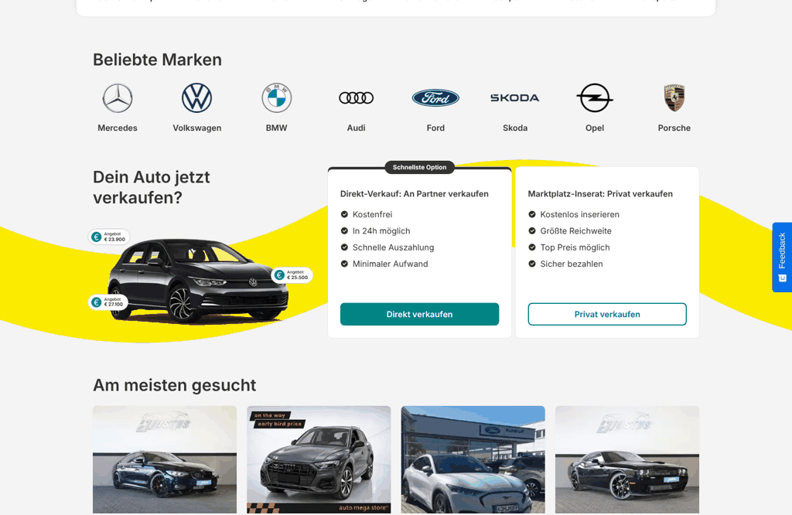
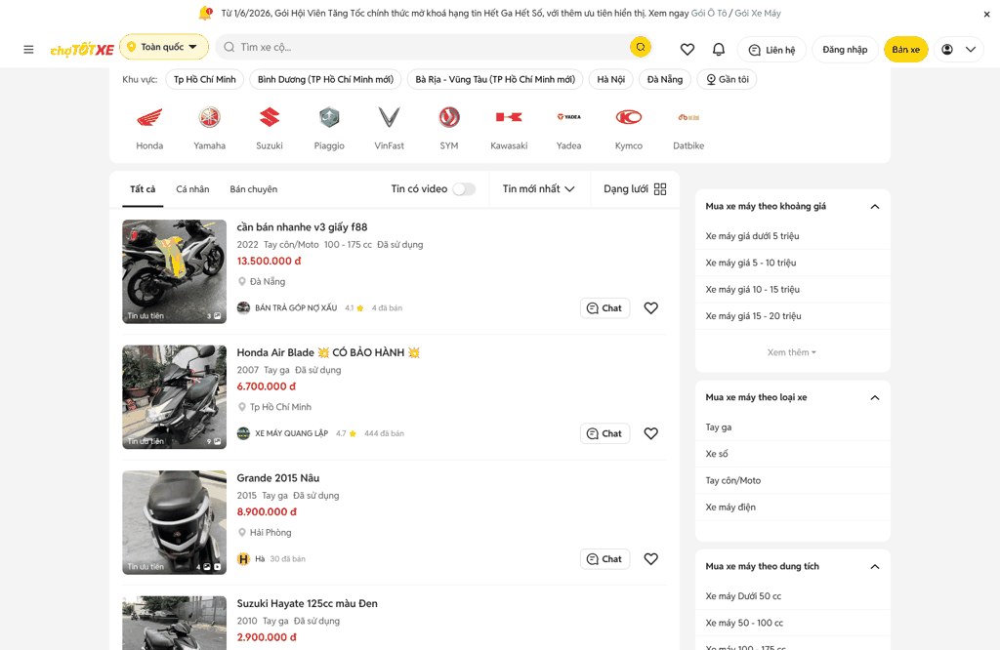
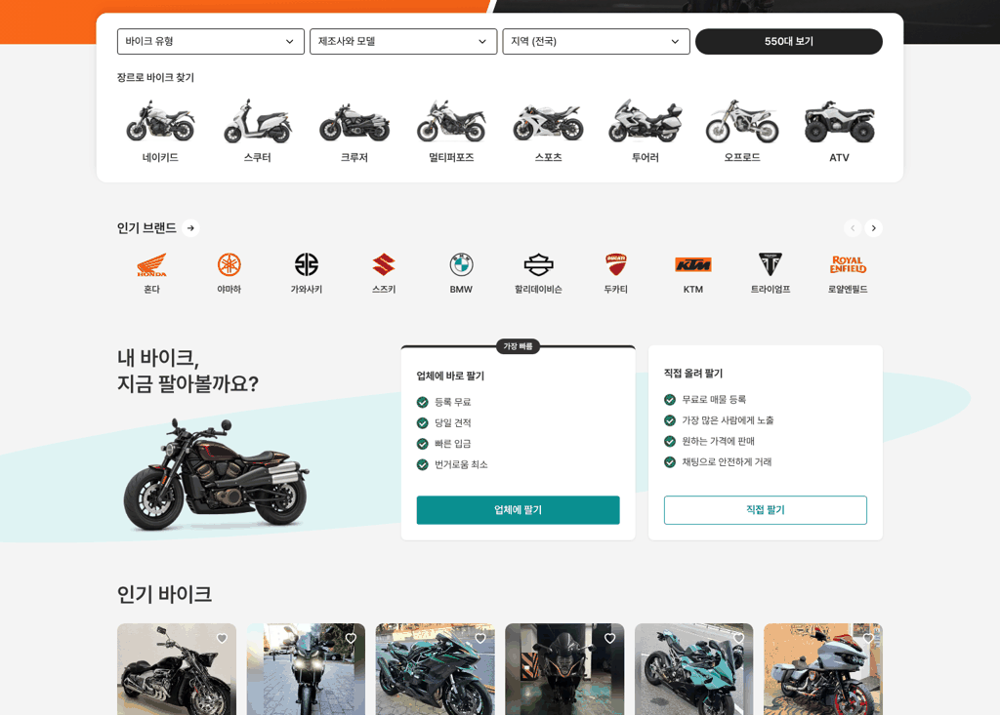
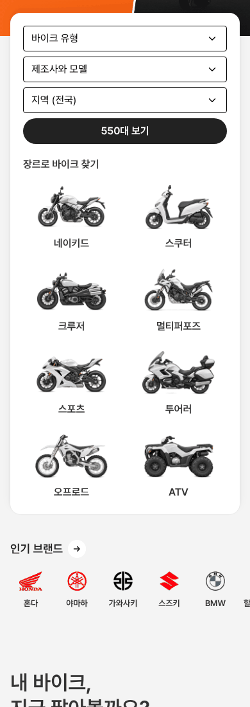

# 바이크 메인 — 인기 브랜드 로고 줄 축소

① 한 줄 요약: 숙소 사진처럼 크던 흰 판 칸을 없애고, 중고차·바이크 사이트처럼 판 없는 작은 로고 + 이름 줄로 바꿨다.

② 과제 ID 없음 · 브랜치 `claude-consult/bike-brand-smaller` · 커밋·PR·배포 v값은 채팅 보고 참조 · 함께 들어간 과제 없음

③ 한 일
- 중고차·중고 바이크 사이트의 브랜드 줄을 직접 열어 쟀다(AutoScout24 메인, 초톳 오토바이).
- 두 곳 모두 판·테두리 없이 로고 + 이름만 두고 대수는 쓰지 않는다. 그 방식으로 바꿨다.
- 로고 상자 64×40(로고 최대 56×36), 이름 14/20 600, 한 줄 10칸.
- 제목 줄(제목 + → + 이전·다음 버튼)은 에어비앤비 방식 그대로 남겼다.

④ 원본과 비교
| 항목 | AutoScout24 메인 | 초톳 오토바이 | 우리 전 | 우리 후 |
|---|---|---|---|---|
| 판·테두리 | 없음 | 없음 | 흰 판 158×150 | 없음 |
| 로고 상자 | 96×60 | 40×40 | 판의 56%×46% | 64×40 |
| 한 줄 칸 수 | 8 | 10 | 7 | 10 |
| 대수 표시 | 없음 | 없음 | 있음 | 없음 |
| 섹션 높이 | — | — | 242 | 122 |

 
 

⑤ 검증: `npm run verify:qf` 통과. 콘솔 오류 PC 0 · 모바일 0. 다음 버튼으로 끝까지 이동(이전 켜짐 · 다음 꺼짐) 확인. 퀵필터 규격 항목은 이번 변경과 무관.

⑥ 원본과 다르게 남긴 것: 로고 상자는 AutoScout24(96×60)와 초톳(40×40) 사이 64×40. 제목 줄의 → · 이전·다음 버튼은 에어비앤비 방식 유지.

⑦ 못 한 것·다음: mobile.de · Autotrader UK · cars.com · 카이디는 이 환경에서 접속이 막혀 비교하지 못했다. 로고마다 보이는 크기 차이(가와사키 · KTM 등)는 로고 표시 기준표로 더 맞출 수 있다.

⑧ 확인 링크: PC `/bike/?home=as24&pc=1`, 모바일 `/bike/?home=as24` (배포본은 `&v=<커밋>`)
