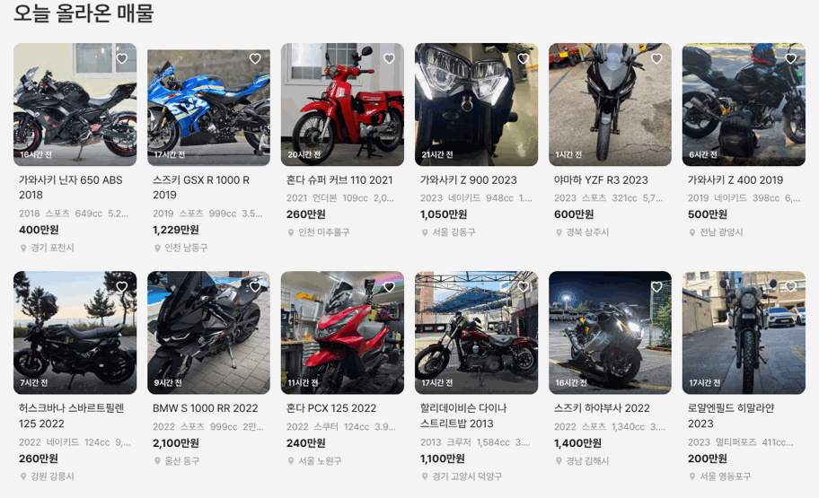

# 바이크 메인 「오늘 올라온 매물」 초톳 카드 · 썸네일 등록 시각

① 한 줄 요약: `오늘 올라온 매물`도 초톳 카드로 바꾸고, 두 섹션 사진 왼쪽 아래에 등록 시각을 넣었다.

② 과제 ID 없음 · 브랜치 `claude-consult/bike-fresh-chotot` · 커밋·PR·배포 v값은 채팅 보고 참고

③ 한 일
- `오늘 올라온 매물`을 인기 바이크와 같은 초톳 카드 6열 × 2줄(12대)로 바꿨다.
- 사진 왼쪽 아래에 `N시간 전` / `N일 전`을 흰 글자로 넣었다(초톳 사진 위 시간 표기와 같은 자리).
- 같은 자리의 `인증 중고` 라벨은 뺐다.
- 이제 안 쓰는 이전 흰 카드 코드를 지웠다.

④ 비교

| 항목 | 전 | 후 |
|---|---|---|
| 오늘 올라온 매물 카드 | 흰 카드 4열 × 2줄 8대 | 초톳 카드 6열 × 2줄 12대 |
| 사진 위 글 | `인증 중고`(인기만) | 등록 시각(두 섹션 모두) |

⑤ 검증: `npm run -s verify:qf` 통과, 콘솔 오류 PC 1536 · 모바일 390 없음.

⑥ 다르게 남긴 것: 오늘 게시 매물의 `N시간 전`은 시트에 시각이 없어 매물 id로 정한 가상 값이다.

⑦ 다음: 실제 등록 시각 데이터가 오면 교체.

⑧ 확인: `/bike/?home=as24&v=<커밋>`
