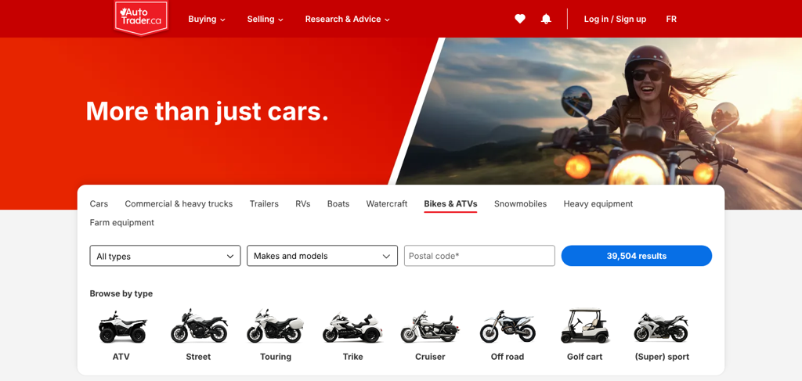
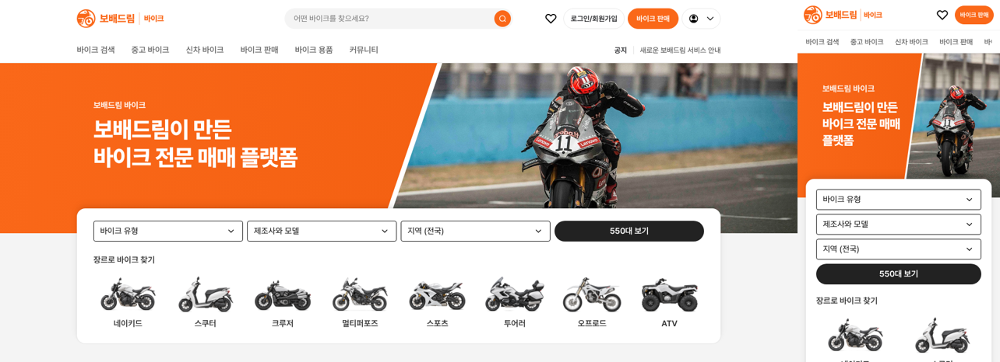

# 바이크 메인 히어로 Autotrader.ca 구성 · 검색 버튼 알약

① 한 줄 요약: 히어로를 왼쪽 주황 판 + 문구, 오른쪽 실사 사진(사선 경계)으로 바꾸고 검색 버튼을 둥근 알약으로 했다.

② 과제 ID 없음 · 브랜치 `claude-consult/bike-hero-atca` · 커밋·PR·배포 v값은 채팅 보고 참고

③ 한 일
- autotrader.ca/motorcycles-atvs를 1536에서 직접 쟀다: 히어로 330, 사선 경계 위 55.5% → 아래 48.2%, 흰 띠 약 10, 검색 카드 겹침 48, 검색 버튼 반경 999.
- 우리 히어로를 같은 높이·사선·겹침으로 바꾸고 왼쪽은 브랜드 주황 판에 흰 문구, 오른쪽은 실사 사진.
- 사진: 같은 시각 다른 작업(c61aa6f)이 넣은 두카티 공식 히어로 이미지를 오른쪽 칸에 그대로 쓰고, 그 작업의 흐림 그라데이션만 사선 경계로 바꿨다. 대체용으로 가상 매물 사진(`bike-v11-121`) 자른 본을 `public/assets/bike/hero/`에 두었다.
- 검색 버튼 반경 8 → 999.

④ 비교 (1536)

| 항목 | Autotrader.ca | 전 | 후 |
|---|---|---|---|
| 히어로 높이 | 330 | 310 | 330 |
| 좌 문구 · 우 사진 경계 | 사선 55.5% → 48.2% | 회색 사선 + 누끼 바이크 | 사선 55.5% → 48.2% |
| 왼쪽 바탕 | 브랜드 빨강 | 연회색 | 브랜드 주황 |
| 검색 카드 겹침 | 48 | 64 | 48 |
| 검색 버튼 반경 | 999 | 8 | 999 |

⑤ 검증: `npm run -s verify:qf` 통과, 콘솔 오류 PC 1536 · 1280 · 모바일 390 없음.

⑥ 다르게 남긴 것: 색은 Autotrader 빨강 대신 바이크 사이트 주황. 두카티 사진은 외부 주소를 직접 불러오므로 사용 허락·주소 변경 위험이 있다(정식 사진으로 교체 필요).

⑦ 다음: 고해상도 히어로 사진 확보.

⑧ 확인: `/bike/?home=as24&v=<커밋>`
