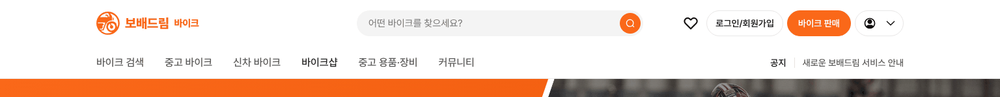
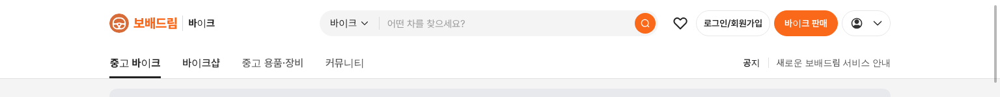
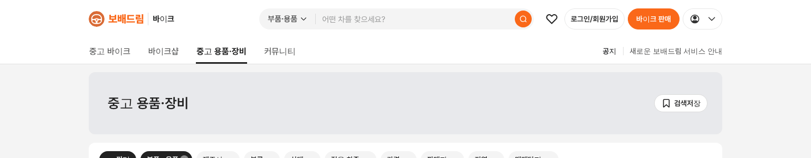

# 바이크 탑메뉴 — `바이크 용품` → `중고 용품·장비`

① 한 줄 요약: 바이크 사이트 탑메뉴와 용품 화면 제목의 `바이크 용품`을 `중고 용품·장비`로 바꿨다.

② 과제 ID 없음 · 브랜치 `claude-consult/bike-menu-gear` · 커밋·PR·배포 v값은 채팅 보고 참조 · 함께 들어간 과제 없음

③ 한 일
- 바이크 메인(`?home=as24`, `?home=at`) 탑메뉴 이름 변경.
- 바이크 목록 PC 탑메뉴 이름, 용품 화면의 현재 메뉴 표시와 배너 제목 변경.
- 가운데점은 `용품·장비`처럼 붙여 썼다.
- 누르면 가는 곳(부품·용품 목록)은 그대로.

④ 원본과 비교
| 위치 | 전 | 후 |
|---|---|---|
| 바이크 메인 탑메뉴 | 바이크 용품 | 중고 용품·장비 |
| 바이크 목록 탑메뉴 | 바이크 용품 | 중고 용품·장비 |
| 용품 화면 배너 제목 | 바이크 용품 | 중고 용품·장비 |

  

⑤ 검증: `npm run verify:qf` 통과. 콘솔 오류 0. 용품 화면에서 탑메뉴 현재 표시(굵게 + 밑줄)가 `중고 용품·장비`에 붙는 것 확인. 퀵필터 규격 항목은 이번 변경과 무관.

⑥ 원본과 다르게 남긴 것: 헤더 검색칸 범위 버튼은 여전히 `부품·용품`이다(카테고리 이름이라 바꾸지 않음).

⑦ 못 한 것·다음: 범위 버튼 이름까지 바꿀지 결정 필요.

⑧ 확인 링크: PC `/bike/?home=as24&pc=1`, `/bike/?pc=1` (배포본은 `&v=<커밋>`)
