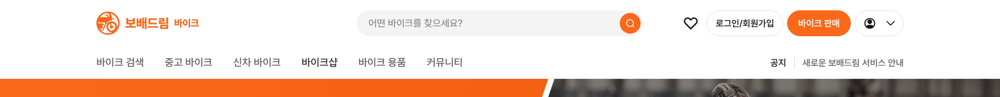
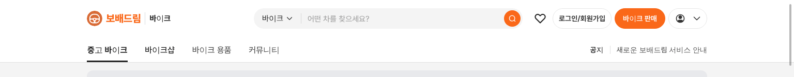

# 바이크 탑메뉴 — `바이크 판매` 대신 `바이크샵`

① 한 줄 요약: 헤더 알약 버튼과 겹치던 탑메뉴 `바이크 판매`를 빼고 그 자리에 `바이크샵`을 넣었다.

② 과제 ID 없음 · 브랜치 `claude-consult/bike-menu-shop` · 커밋·PR·배포 v값은 채팅 보고 참조 · 함께 들어간 과제 없음

③ 한 일
- 바이크 메인(`?home=as24`) 탑메뉴: `바이크 검색 · 중고 바이크 · 신차 바이크 · 바이크샵 · 바이크 용품 · 커뮤니티`.
- 바이크 목록 PC 탑메뉴: `중고 바이크 · 바이크샵 · 바이크 용품 · 커뮤니티`.
- 바이크샵 화면이 아직 없어 누르면 「바이크샵은 준비 중입니다.」 안내.
- 헤더 오른쪽 주황 `바이크 판매` 버튼은 그대로(매물 등록으로 연결).

④ 원본과 비교
| 위치 | 전 | 후 |
|---|---|---|
| 바이크 메인 탑메뉴 4번째 | 바이크 판매 | 바이크샵 |
| 바이크 목록 탑메뉴 2번째 | 바이크 판매 | 바이크샵 |
| 헤더 주황 버튼 | 바이크 판매 | 바이크 판매(그대로) |

 

⑤ 검증: `npm run verify:qf` 통과. 콘솔 오류 0. 두 화면 모두 `바이크샵` 글자 16px · 500 · `#595959`로 다른 메뉴와 같고, 누르면 안내가 뜬다. 퀵필터 규격 항목은 이번 변경과 무관.

⑥ 원본과 다르게 남긴 것: 없음.

⑦ 못 한 것·다음: 바이크샵 목록 화면(가상 바이크샵 40곳 `bikeShopNames` 기준)이 아직 없다. 만들면 안내 대신 그 화면으로 연결한다.

⑧ 확인 링크: PC `/bike/?home=as24&pc=1`, `/bike/?pc=1` (배포본은 `&v=<커밋>`)
