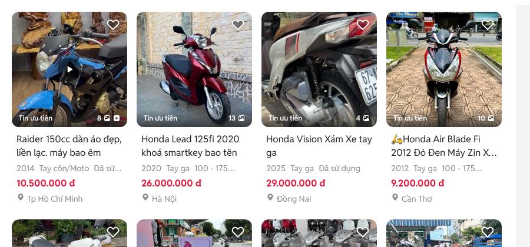
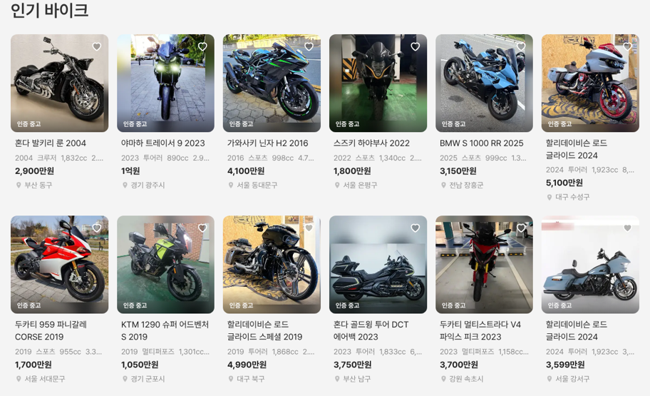

# 바이크 메인 「인기 바이크」 초톳 카드

① 한 줄 요약: `가장 많이 찾는 바이크`를 `인기 바이크`로 바꾸고 카드를 초톳 그리드 카드 모양으로 바꿨다.

② 과제 ID 없음 · 브랜치 `claude-consult/bike-popular-chotot` · 커밋·PR·배포 v값은 채팅 보고 참고

③ 한 일
- xe.chotot.com 오토바이 목록을 그리드 보기로 바꿔 카드 하나를 1536에서 쟀다.
- 같은 구성으로 새 카드를 만들었다: 정사각 사진(반경 12) · 사진 아래 그라데이션과 라벨 · 하트 · 제목 2줄 · 회색 사양 한 줄 · 굵은 가격 · 위치.
- 6열 × 2줄 12대로 늘렸다(브랜드별 1대 뒤에 최근 고가 매물로 채움).

④ 비교

| 항목 | 초톳 | 전 | 후 |
|---|---|---|---|
| 카드 폭 · 간격 | 196 · 16 | 274 · 20 (4열) | 183 · 16 (6열) |
| 사진 | 정사각 · 반경 12 | 4:3 · 카드 반경 8 | 정사각 · 반경 12 |
| 카드 바탕 | 없음 | 흰 카드 + 그림자 | 없음 |
| 제목 | 16/22.88 400 2줄 | 16/24 굵은 제조사 1줄 | 16/22.88 400 2줄 |
| 사양 | 14/20 회색 1줄 | 12/18 `|` 구분 | 14/20 회색 1줄 |
| 가격 | 16/24 700 빨강 | 20/28 700 | 16/24 700 검정 |
| 위치 | 아이콘 + 14 | 아래 칸 12 | 아이콘 + 14 |
| 찜 | 사진 위 하트 | 아래 별 버튼 | 사진 위 하트 |

⑤ 검증: `npm run -s verify:qf` 통과, 콘솔 오류 PC 1536 · 모바일 390 없음.

⑥ 다르게 남긴 것: 가격 색 검정(우리 규칙), 사진 수 표시 없음(사진 1장 데이터), 라벨은 인증 중고만.

⑦ 다음: `오늘 올라온 매물`도 같은 카드로 바꿀지 결정.

⑧ 확인: `/bike/?home=as24&v=<커밋>`
