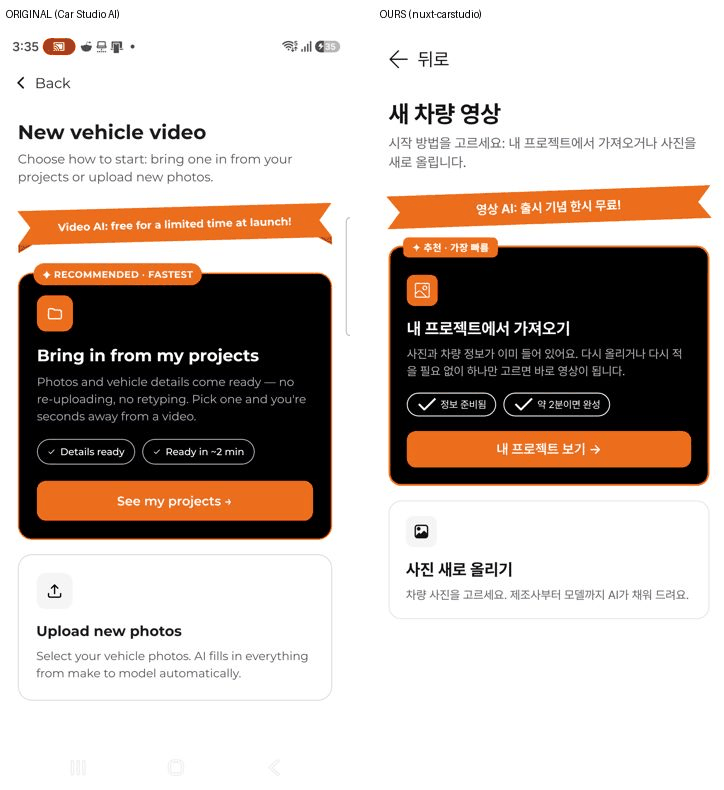
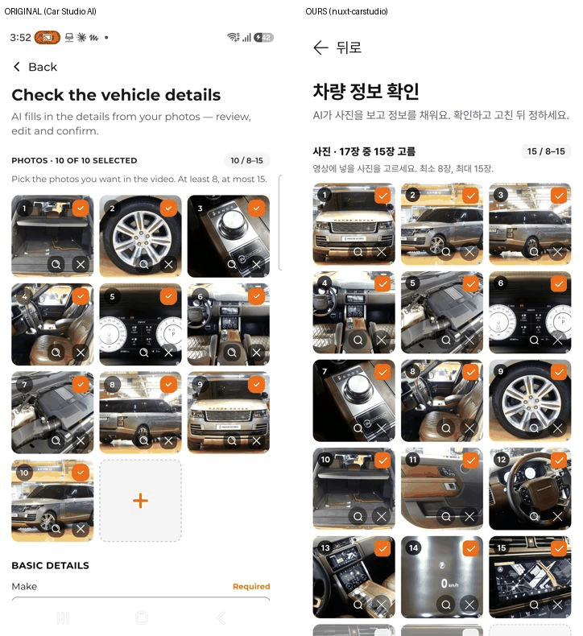
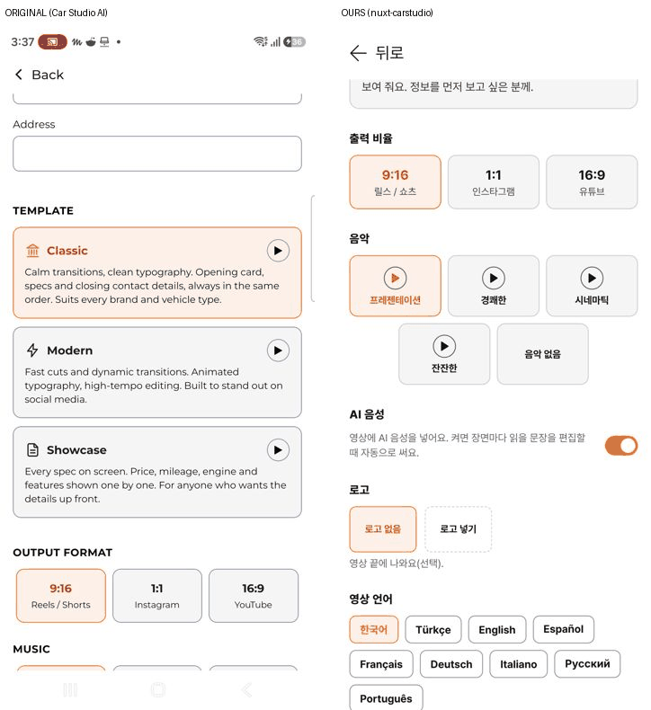
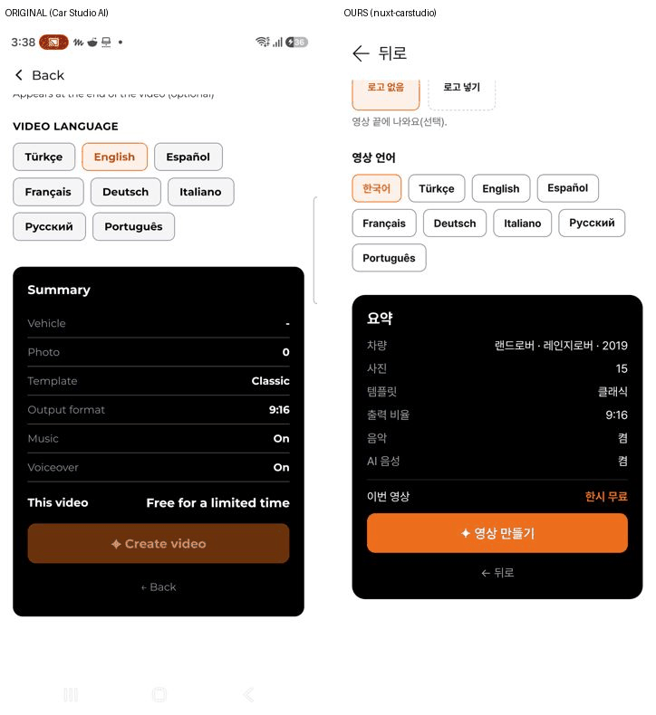
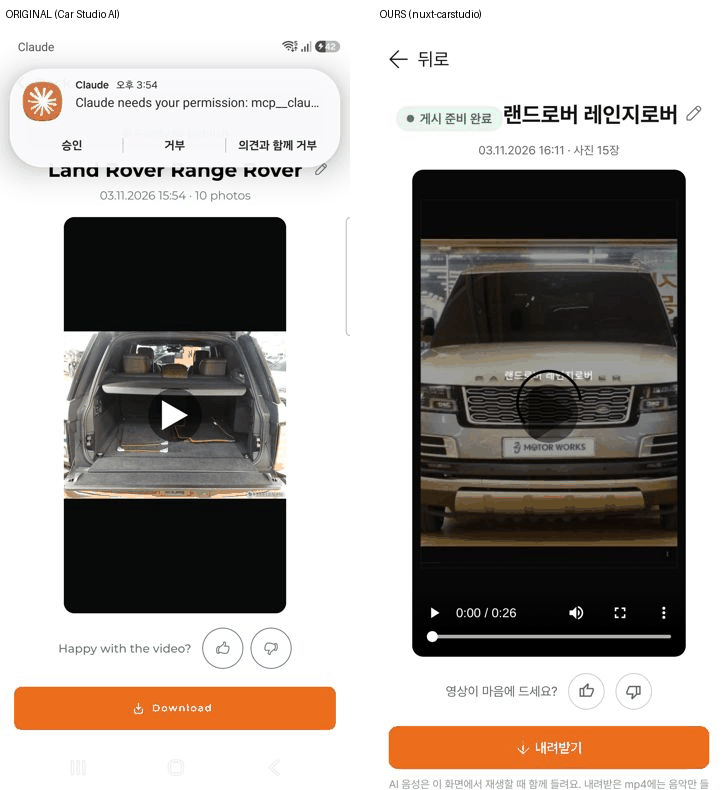
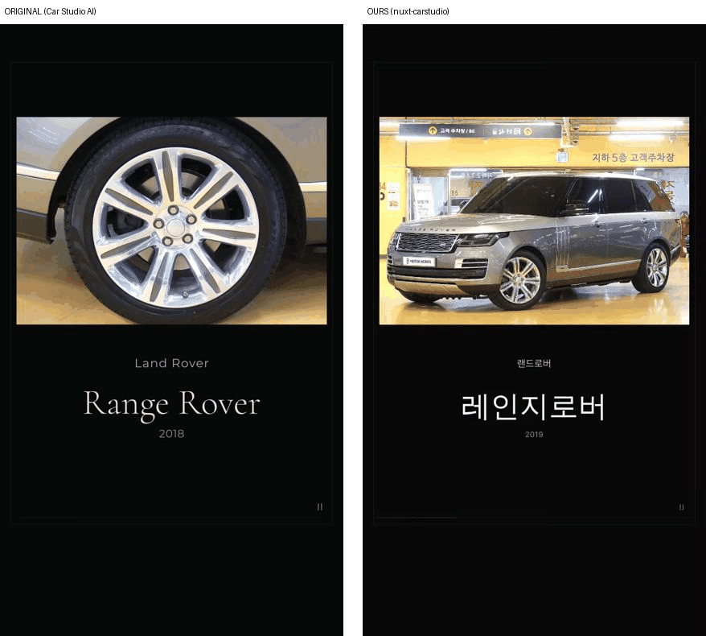
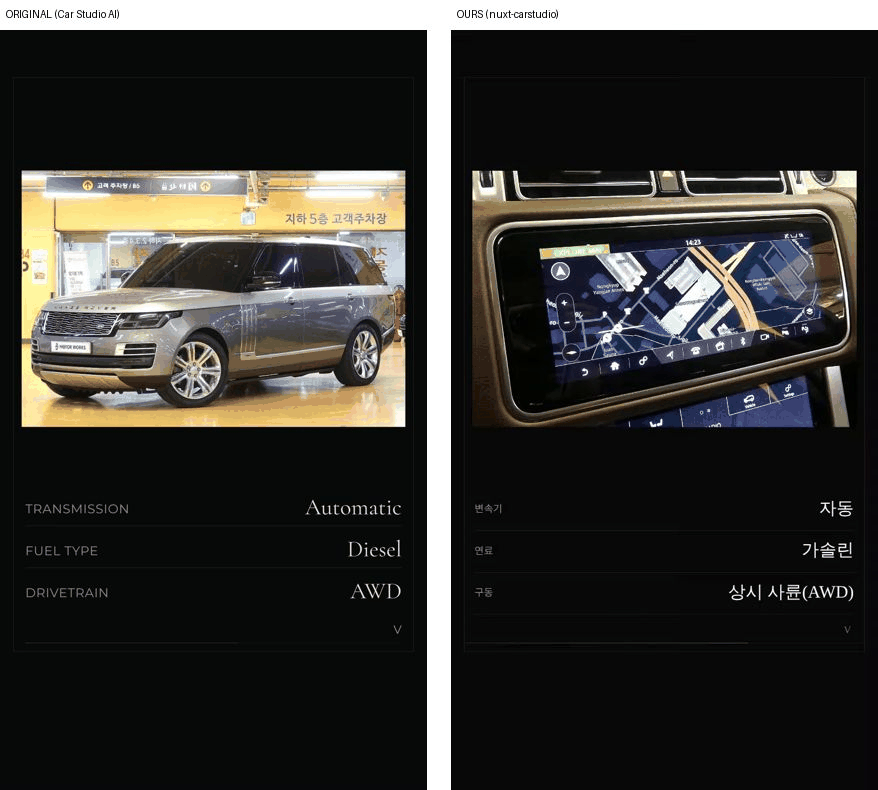

# 카스튜디오(Car Studio AI) 영상 만들기 동일 구현

① **한 줄 요약**: 폰에 있는 Car Studio AI의 「사진 → 차량 영상」 흐름을 리뉴얼 스택(Nuxt 4.6.2)으로 화면 · 입력 · 동작 · 결과 영상 구성까지 그대로 옮겼다. 원본에서 실제로 영상 1개를 만들어 장면 · 시간 · 대사를 재서 맞췄다.

② **과제 ID** 없음 · **브랜치** `carstudio-clone` · **상태** 푸시(병합 · 배포 전) · 함께 들어간 과제 없음 · 앞선 준비 보고서는 PR #1145(`reports/ai-shortform-prep.md`)

## ③ 한 일

- 원본에서 영상 1개를 직접 만들었다. 한시 무료라 크레딧은 줄지 않았다. 사진은 서울오토갤러리 레인지로버 실매물 10장, 템플릿은 Classic · 9:16 · 영어. 약 15초 만에 완성됐다.
- 완성된 원본 mp4(1080×1920 · 25fps · 35.4초)를 프레임 단위로 재고, 음성은 글자로 받아 적었다.
- 새 앱 `nuxt-carstudio/`를 만들었다(주소 `/bobaedream/nuxt-carstudio/`). 화면은 홈 → 새 영상 시작 → 내 프로젝트 → 차량 정보 확인 → 만드는 중 → 결과, 그리고 크레딧 · 프로필.
- 영상은 원본 Classic 구성 그대로 그린다. 장면 7개, 장면마다 검정에서 밝아지고 사진이 천천히 줄어든다. 오른쪽 아래 로마 숫자, 아래 진행선. 만든 영상은 mp4로 받는다(H.264 우선).
- 「내 프로젝트에서 가져오기」는 보배드림 실매물 2대(레인지로버 17장 · M3 20장)의 사진과 정보로 바로 채운다.
- 음악 5종(원본 이름 그대로 · 소리는 보배드림이 코드로 만듦). AI 음성은 장면마다 대사를 자동으로 쓰고, 결과 화면에서 재생할 때 같이 읽는다.

## PC웹 · 모바일 두 판(2026-11-03 「pc웹과 모바일 버전 2개 만들어」 · 「완벽하게 작동되게」)

- 화면 폭 1024 이상은 PC웹, 그 아래는 모바일이다. 주소 끝 `?pc=1`은 PC, `?m=1`은 모바일로 고정한다(화면을 옮겨도 유지).
- **PC웹**: 머리 72(로고 · 홈 · 영상 만들기 · 내 프로젝트 · 사진 촬영 · 프로필 · 크레딧 · 새 영상) · 본문 1200.
  - 홈: 기능 카드 2개 · 사진/내 영상 탭 · 검색 한 줄 · 영상 4열.
  - 시작: 두 카드 나란히. 프로젝트: 3열.
  - 정보 확인: 왼쪽 입력(사진 5열 · 칸 2열 · 구매자 6가지 2열 · 템플릿 3열) + 오른쪽 따라오는 대표 사진 · 요약.
  - 결과: 영상 왼쪽 + 이름 · 좋아요 · 내려받기 · 공유 오른쪽.
  - 고르기 · 크레딧 창은 가운데 창.
- **모바일**: 원본 앱과 같은 한 줄 구성. 아래 홈 · 카메라 · 프로필.
- 바로잡은 것:
  - 음악 ▶를 누르면 그 음악도 고르게 했다.
  - 「내 영상으로 돌아가기」를 누르면 「내 영상」 탭이 열린다(원본 기본 탭은 「사진」).
  - 한글 차명 영상은 파일 이름을 `bobae-carstudio-<번호>.mp4`로 둔다(한글이 깨지지 않게).
- 자동 시험(PC 1440 · 모바일 384, 각 48개 항목) 모두 통과, 콘솔 오류 0. 시험 항목:
  - 프로필 저장 → 환영 이름 · 크레딧 창 요금제 · Esc
  - 브라우저 뒤로 · 앞으로
  - 프로젝트 사진 17장 · 15장 고름 · 고름 풀기 · 15장 넘으면 알림 · 크게 보기 · 빼기
  - 고르기 시트 · 구매자 칸 다시 누르면 풀림
  - 템플릿 · 미리보기 · 비율 · 음악 듣기 · 고르기 · 음성 스위치 · 로고 · 언어
  - 만들기 → 결과(PC 16:9 1280×720 · 모바일 9:16 720×1280)
  - 이름 바꾸기 · 좋아요 · 내려받기 · 저장 시트
  - 내 영상 · 사진 탭 넘기기 · 검색 · 새로 고침 뒤 보관
  - 새 사진 8장 → 제조사 없으면 꺼짐 · 적으면 켜짐
  - 가로 넘침 없음

## ④ 원본과 비교

| 화면 · 기능 | 원본 | 우리 | 같음 |
|---|---|---|---|
| 홈 | 로고 · 크레딧 · 사진 촬영 / 영상 만들기 · 사진 / 내 영상 탭 · 검색 · 카드 · 아래 3칸 | 같은 구성. 로고는 보배드림 글자 | ✅ |
| 새 영상 시작 | 주황 띠(한시 무료) · 추천 검정 카드 · 사진 새로 올리기 | 같음 | ✅ |
| 내 프로젝트 | 사진 8장 이상만 · 비면 「사진 올리기」 | 같음(실매물 2대) | ✅ |
| 사진 칸 | 3열 · 번호 · 주황 체크 · 돋보기 · × · + 칸 · 8~15장 | 같음 | ✅ |
| 정보 칸 | 기본 5 · 기술 11(km/mi) · 구매자 6가지 · 마지막 장면 3 | 같음(글은 한국어) | ✅ |
| 템플릿 | Classic · Modern · Showcase + ▶ 미리보기 | 같음. 미리보기는 내 사진으로 바로 그림 | ✅ |
| 비율 · 음악 · 음성 · 로고 · 언어 | 3 · 5(▶) · 켜기 · 없음/넣기 · 8개 | 같음 + 한국어(기본) | ✅ |
| 요약 · 만들기 | 검정 카드 · 한시 무료 · 조건 안 맞으면 흐린 버튼 | 같음 + 무엇이 모자란지 한 줄 | ✅ |
| 만드는 중 | 주황 원 · 「Reviewing photos…」 · 내 영상으로 돌아가기 | 같음(단계 4개 · %) | ✅ |
| 결과 | ● 게시 준비 · 이름 ✎ · 날짜 · 사진 수 · ▶ · 👍👎 · 내려받기 → 저장 시트 | 같음 | ✅ |
| 결과 영상(Classic) | 7장면 · 장면당 약 4.4초(대사 길이) | 같은 7장면 · 같은 자리 · 같은 움직임 | ✅ |
| 사진으로 차 정보 자동 채움 | 제조사 · 모델 · 연식 · 계기판 주행거리 · 변속기 · 연료 · 구동 · 바디 · 색 | 프로젝트에서 가져오면 채워짐. 새 사진은 직접 입력 | 🔴 |
| AI 음성 | mp4 안에 들어감 | 앱 안에서 볼 때만 들림(mp4에는 음악만) | 🔴 |
| Modern · Showcase 결과 | 설명 글만 봄 | 설명대로 만든 추정판 | 🔴 |
| 크레딧 결제 | 월 100 · 300 · 600(85,000 · 150,000 · 240,000원) | 화면만(가격 준비 중) | 🔴 |









원본 Classic 영상 실측(1080×1920 기준)

```
장면	시간(초)	내용	원본 음성
I	0.0–4.5	첫 사진(가득) + 줄인 차명 「L. Rover R. Rover」	Presenting the 2018 Land Rover Range Rover.
II	4.6–8.8	사진(52,291 975×651) + 제조사 · 모델(명조) · 연식	Take a look at the details inside and out.
III	9.0–12.6	사진만	-
IV	12.8–15.8	DETAILS + 사진 6칸(2×3, 0.15초씩 차례로) + SUV · Brown	This SUV comes in brown.
V	16.0–22.4	마지막 사진 + 변속기 · 연료 · 구동 표	It runs on diesel, has an automatic gearbox and features all-wheel drive.
VI	22.8–28.6	HISTORY + 주행거리 · 상태 표(사진 없음)	It has 51,601 km on the clock.
VII	29.0–35.4	제조사 · 모델	Call today to find out more.
공통	-	배경 #080808 · 테두리 x33~1046 y119~1570 · 진행선 y1548 · 로마 숫자 오른쪽 아래	-
```

## ⑤ 검증

- `pnpm typecheck` 통과. `pnpm export` 빌드 통과. `npm run check:runtime` 통과.
- 자동 브라우저 384px, 화면 흐름 끝까지: 홈 → 영상 만들기 → 내 프로젝트 → 레인지로버 → 정보(사진 17장 중 15장 고름) → 고르기 시트 → 템플릿 미리보기 → 영상 만들기 → 만드는 중 → 결과 → 내려받기 → 저장 시트 → 홈 「내 영상」.
  - 결과 영상 26.8초. 시험 브라우저가 H.264를 못 만들어 VP9로 확인했다.
  - 콘솔 오류 0.
- 미리보기: Modern · Showcase · 16:9 · 1:1 모두 그려진다.
- 새 사진 9장을 올리면 제조사 · 모델이 비어 있어 「영상 만들기」가 흐려지고 「제조사와 모델을 적어 주세요」가 뜬다.
- 퀵필터 화면은 건드리지 않아 verify:qf · measure:qf 대상이 아니다.

## ⑥ 원본과 다르게 남긴 것과 이유

- **글은 한국어**: 언어 칸에 한국어를 넣고 기본으로 했다. 원본에는 한국어가 없다.
- **로고 · 음원**: 원본 로고는 쓰지 않고 「보배 카스튜디오」 글자를 썼다. 음악도 원본 음원이 아니라 코드로 만든 소리다.
- **글꼴**: 원본은 Montserrat · 명조 계열이다. 우리는 사이트 공용 Pretendard를 쓰고, 제목만 명조 계열로 했다.
- **AI 음성**: 브라우저는 합성 음성을 파일로 꺼낼 수 없다. 그래서 결과 화면에서 재생할 때만 읽는다. mp4에 넣으려면 서버 음성 연결이 필요하다.
- **사진 자동 인식**: 서버(사진 → 차량 인식)가 없어 새 사진은 직접 입력한다. 프로젝트에서 가져오면 원본처럼 바로 채워진다.
- **크레딧 결제**: 가격이 정해지지 않아 화면만 있다. 지금은 원본처럼 「한시 무료」로 크레딧을 쓰지 않는다.
- **「사진 촬영」 · 가운데 카메라**: 우리 촬영 키트(`nuxt-shootkit`)로 연결했다.
- **아이콘**: 사이트 공용 원본(레딧 · 초톳 · 오토스카우트24)을 썼다. 내려받기 아이콘이 없어 레딧 화살표를 돌려 썼다.

## ⑦ 못 한 것 · 다음에 할 것

- AI 음성을 mp4에 넣기: Laravel 큐 + 한국어 음성(무료 Edge 음성 또는 유료 엔진, 결정 필요).
- 사진 → 제조사 · 모델 · 주행거리 자동 인식(서버).
- 원본 Modern · Showcase 결과 영상 1개씩 만들어 장면 대조. 크레딧이 줄지 않는 한시 무료 기간에 하면 좋다.
- 실기기(갤럭시 · 아이폰)에서 H.264 mp4 만들기 속도와 저장 확인.
- 만든 영상 · 프로젝트를 계정별 서버에 저장.

## ⑧ 확인 링크

- 배포 뒤 주소: 모바일 https://bobaekimboae.github.io/bobaedream/nuxt-carstudio/?m=1 · PC https://bobaekimboae.github.io/bobaedream/nuxt-carstudio/?pc=1 (주소 끝 없이 열면 화면 폭으로 고름)
- 바로 정보 화면: `?v=details&project=sag-24`(레인지로버) · `?v=details&project=sag-1`(M3)
- 원본 캡처 · 결과 영상(PC): `C:\Users\Thinkbook\Documents\autostudio_analysis\shots\cs_*.png` · `cs_result.mp4`
