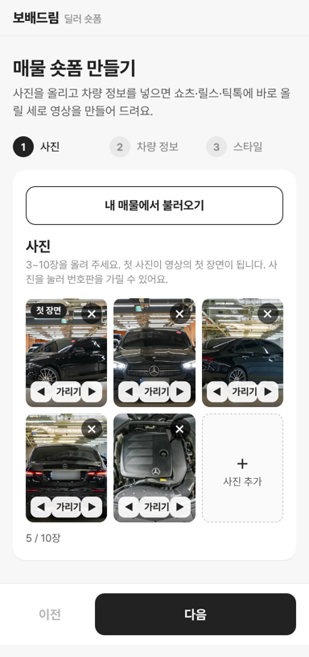
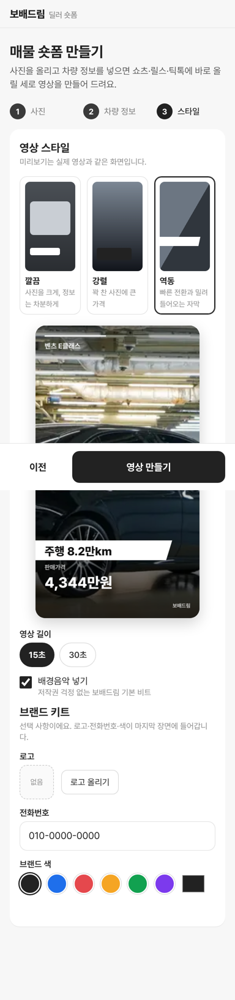
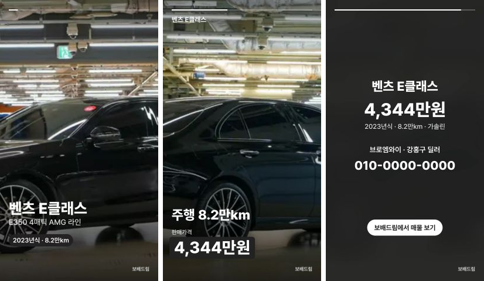

# 딜러용 숏폼 제작기 — ReelsMotor `/create` 흐름 (2026-10-11)

① 한 줄 요약: ReelsMotor 만들기 화면의 3단계 흐름(사진 → 정보 → 스타일 → 영상)을 보배드림 딜러용으로 새로 만들었다. 주소 `/shortform-reels/`.

② 과제 ID 없음 · 브랜치 `claude/shortform-reels` · 커밋·PR·배포 v값은 채팅 보고 참고 · 기존 `/shortform/` 제작기(다른 세션 작업)는 건드리지 않음.

③ 한 일
- ReelsMotor `/create`의 단계·입력 항목을 읽고(robots.txt 허용 구간, 화면 문구만 확인) 같은 순서로 화면을 새로 만들었다. 디자인·문구·코드는 우리 것이다.
- ① 사진 3~10장(첫 장 = 첫 장면, ◀▶ 순서 변경, ✕ 삭제, 「가리기」로 번호판·얼굴 위에 네모를 그려 모자이크).
- 「내 매물에서 불러오기」: 서울오토갤러리 매물 23대 중 하나를 고르면 사진 5장·제조사·모델·등급·연식·주행·가격·연료·상사명·딜러가 한 번에 채워진다(ReelsMotor에는 없는 보배드림 장점).
- ② 차량 정보: 제조사·모델·연식·주행·가격 필수, 세부모델·연료·변속기·강조할 점 3줄·상사명·딜러.
- ③ 스타일 3종(깔끔 · 강렬 · 역동) + 실제 영상과 같은 실시간 미리보기, 길이 15/30초, 배경음악(직접 합성한 비트, 저작권 없음), 브랜드 키트(로고·전화번호·색).
- 영상 만들기: 1080×1920 세로 캔버스를 실제 길이만큼 녹화해 MP4(브라우저가 지원하면) 또는 WebM으로 저장하고 바로 재생·내려받기.

④ 원본과 비교 (ReelsMotor `/create` 흐름)

| ReelsMotor | 보배드림 | 상태 |
|---|---|---|
| 1 Photos (3~10장, 첫 장이 시작) | 같음 + 순서 변경 + 수동 번호판 가리기 | 🔵 같음/추가 |
| (없음) | 내 매물에서 불러오기 | 🔵 추가 |
| 2 Details (Make·Model·Year·Mileage·Price·Gearbox·Fuel·Business name·Hide plate) | 같은 항목 + 강조할 점 3줄 · 딜러 이름 | 🔵 같음 |
| Hide plate 자동 흐림 | 수동 네모 모자이크만 | 🟡 자동 인식 미구현 |
| 3 Style (Clean · Bold · Dynamic) | 깔끔 · 강렬 · 역동 + 실시간 미리보기 | 🔵 같음 |
| Brand kit (logo · phone · colour) | 같음 | 🔵 같음 |
| Email로 결과 받기 · 서버 렌더 · AI 음성 · 바로 게시 | 브라우저에서 바로 생성·내려받기 | 🟡 서버 필요 기능 없음 |
| 무료 영상 워터마크 | 오른쪽 아래 「보배드림」 표시 | 🔵 |

⑤ 검증
- `npm run verify:qf` 통과(런타임 점검 · TypeScript · 빌드).
- 실제 Chromium(384×800) 끝까지 점검: 사진 0장일 때 다음 버튼 비활성 → 매물 불러오기(사진 5장) → 2번 사진 가리기 → 가격 비우면 「판매가격 입력이 필요해요.」 → 스타일 3종 미리보기 → 15초 영상 생성. 결과 14.9초 · 1080×1920 · 4.5MB, 콘솔 오류 0.
- 이 테스트 브라우저에는 H.264 인코더가 없어 VP9 코덱 MP4로 저장됐고 화면에 그 안내가 뜬다. 크롬·사파리 실기기에서 H.264 MP4로 저장되는지는 확인 전.

⑥ 원본과 다르게 남긴 것: 이메일 입력은 뺐다(서버가 없어 화면에서 바로 받는다). 번호판은 수동으로만 가린다.

⑦ 못 한 것·다음에 할 것
- 🟡 AI 음성 내레이션, 유튜브·인스타·틱톡 바로 게시, 번호판 자동 인식 — 서버 필요.
- 🟡 실기기 H.264 MP4 확인.
- 🔵 기존 `/shortform/`(고급 제작기)와 합칠지 결정.

⑧ 확인 링크: `https://bobaekimboae.github.io/bobaedream/shortform-reels/?v=<커밋>` · 매물 자동 채움 `&sample=5`.
