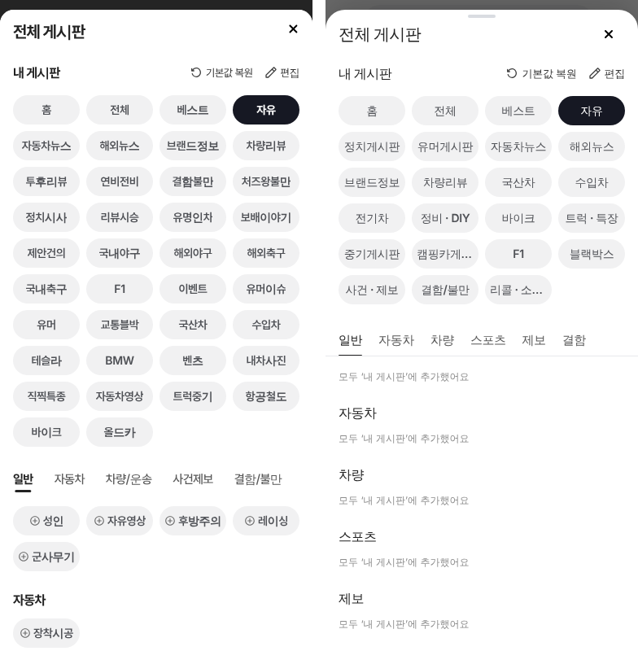
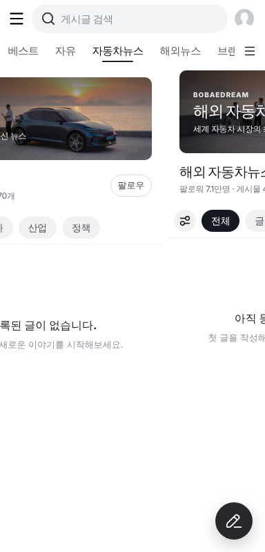

# 커뮤니티 넉스트 판에 게시판 넘기기 · 전체 게시판 창 옮김

## ① 한 줄 요약
정적 HTML 판에만 있던 게시판 좌우 넘기기(후푸식)와 전체 게시판 창(텐센트 비디오식)을 넉스트 판 커뮤니티(`nuxt-community/`, Nuxt 4.6.2)로 옮겼다.

## ② 과제 · 브랜치 · 상태
- 과제 ID: 없음(사용자 지시 「옮겨라」)
- 브랜치: `community-nuxt-port` · PR: 아래 링크 · 상태: 푸시, 병합 대기

## ③ 한 일
- 게시판 본문(배너 아래 전부)을 `board-swipe-stage`로 감싸고, 정적 판 `setupBoardSwipe`의 터치 규칙을 Vue로 옮겼다. 끄는 동안 지금 화면 복사본과 옆 게시판이 8px 틈으로 함께 움직이고, 놓으면 넘어가거나 돌아온다.
- 넘기는 동안에는 주소·최근 게시판 기록을 바꾸지 않고, 넘어간 뒤 한 번만 바꾼다. 탑메뉴 선택은 절반을 넘기면 미리 바뀐다.
- 전체 게시판 창에서 `기본 홈 설정`·하단 초기화 버튼·안내 문구·알림을 빼고, `기본값 복원`·`편집` 글자 버튼(원본 아이콘), 회색 알약 칩, 고정 칸(홈·전체·베스트), 길게 눌러 편집, 편집 중 눌러 빼기, + 로 넣고 바로 이동을 넣었다.
- 추가할 게시판은 분류 탭을 누를 때마다 바꾸던 방식에서 모든 분류를 구역 제목으로 이어 보이는 방식으로 바꿨다(탭은 위에 붙음, 누르면 스크롤, 굴리면 따라 바뀜).

## ④ 원본(정적 판)과 비교

| 동작 점검(384, 터치) | 결과 |
|---|---|
| 빠르게 왼쪽 240px | 자유 → 자동차뉴스 |
| 빠르게 오른쪽 250px | 자동차뉴스 → 자유 |
| 천천히 70px(0.9초) | 제자리 |
| 천천히 230px(1.2초) | 다음 게시판 |
| 152px 끌던 중 | 복사본 1개 · 옆 게시판 244px에 붙음, 놓으면 제자리 |
| 말머리 칩 줄 위에서 끌기 | 넘어가지 않음 |
| 편집 → 자유 누름 / 홈 누름 | 자유만 빠지고 지금 게시판은 홈 / 홈은 그대로 |
| + 자유(편집 아님) | 끝에 들어가고 지금 게시판 자유, 창 열림 |
| 기본값 복원 · 마지막 탭 · Esc · 길게 누르기 | 모두 정상 |

## ⑤ 검증
- `pnpm test` 16개 통과 · `pnpm typecheck` 오류 0 · `pnpm generate` 성공
- 콘솔 오류: 모바일 0
- 퀵필터 규격·verify:qf: 이번 작업은 커뮤니티라 해당 없음

## ⑥ 원본과 다르게 남긴 것
- 게시판 목록은 넉스트 판 데이터 그대로라 정적 판과 게시판 개수가 다르다(기본으로 모두 내 게시판에 들어 있어 추가할 게시판이 처음에는 비어 있음).
- 넉스트 판은 Pretendard 웹폰트를 불러오지 않아 글자가 기기 기본 글꼴(굵기 차이)로 보인다.

## ⑦ 못 한 것 · 다음에 할 것
- 넉스트 판 Pretendard 글꼴 연결
- 실제 폰에서 넘기기 느낌 확인

## ⑧ 확인 링크
- 모바일: https://bobaekimboae.github.io/bobaedream/nuxt-community/?board=free (배포 뒤 `&v=<커밋>`)
