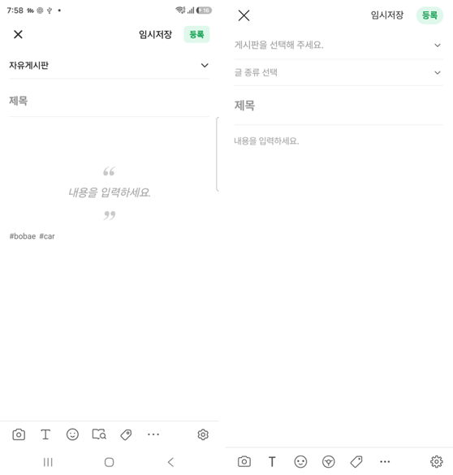
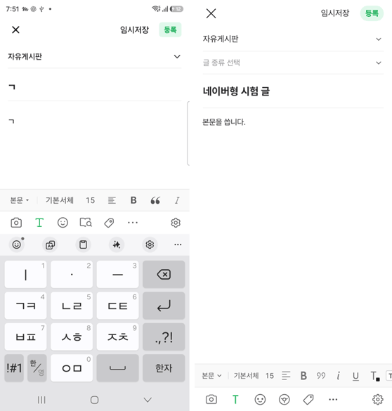
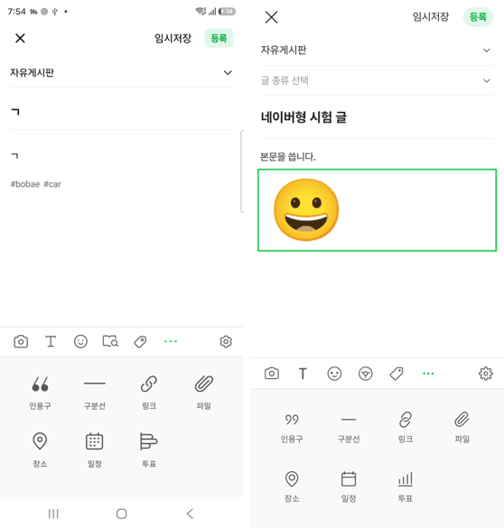
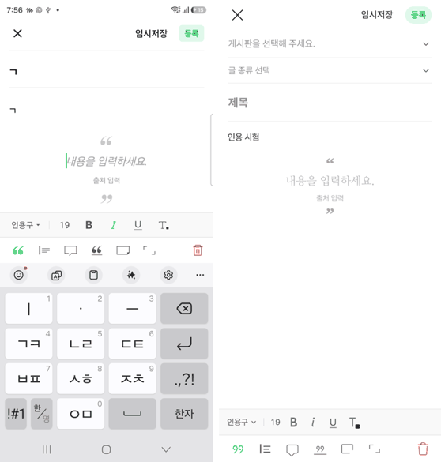
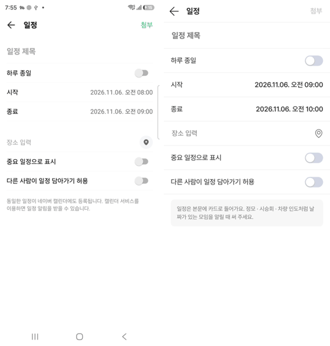
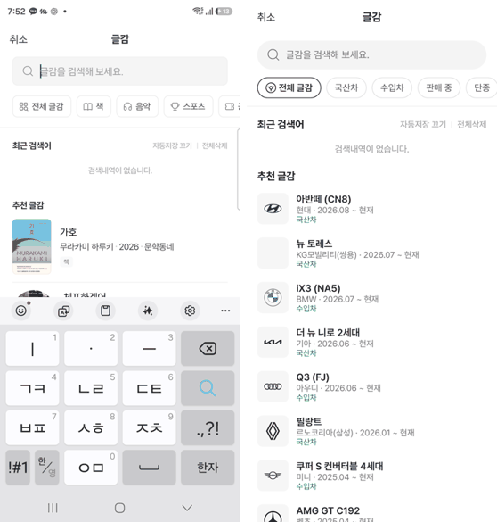
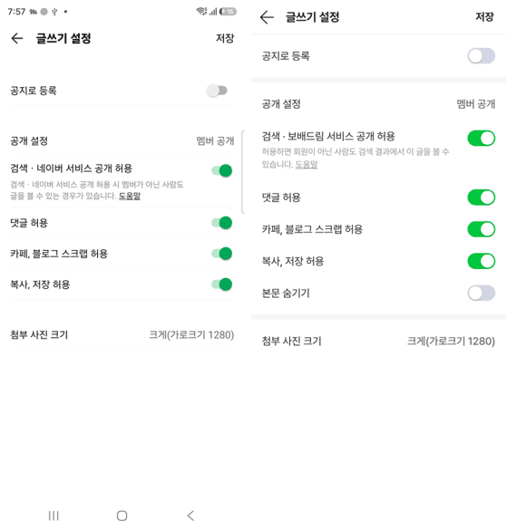
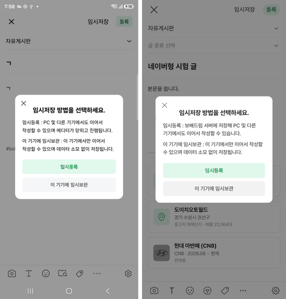

# 커뮤니티 글쓰기 · 네이버 카페 앱형

① 한 줄 요약: `?style=naver` 글쓰기를 네이버 카페 앱 글쓰기와 같은 화면 · 동작으로 새로 만들고, 치지직형 기능(글 종류 · 본문 숨기기 · 링크 카드 · 투표 사진)과 보배드림 기능(차량 글감 · 매매단지 장소)을 더했다. 아이콘은 레딧 원본이다.

② 과제 ID 없음 · 브랜치 `community-write-naver` · 커밋 7115afeb(보고서 커밋 별도) · PR 아직 없음(푸시가 GitHub 쪽 오류로 막힘) · 상태 로컬 커밋만, 병합 · 배포 안 함. PR #1171(보배드림 백엔드 연결) 위에 쌓여 있어 #1171이 먼저 병합되어야 한다.

③ 한 일
- 테스트 카페에서 네이버 카페 앱 글쓰기를 폰으로 눌러 보며 화면 25개를 찍고 384 CSS로 크기를 쟀다(사진 고르기는 휴대폰 사진첩이 보여 건너뜀).
- 새 화면 `components/write/naver/`: 머리줄(× · 임시저장 · 연초록 등록), 게시판 줄, 글 종류 줄, 제목, 본문, 태그 글자, 화면 아래 도구 줄(키보드 위에 붙음).
- T 서식 줄(글자 배경색 · 인용구 버튼 추가), 인용구 모양 줄, 스티커 판 · 더보기 판(인용구 · 구분선 · 링크 · 파일 · 장소 · 일정 · 투표)을 키보드 자리에 연다.
- 게시판 아래 시트, 태그 첨부, 일정, 장소, 글감, 글쓰기 설정, 임시저장 방법 고르기 창, 나가기 창을 네이버 모양으로 만들었다.
- 일정 · 장소 · 글감 · 파일은 본문에 카드로 들어간다. 글감은 차량 기준표 세대, 장소는 전국 매매단지 343곳에서 찾는다.
- 예전 웹형은 `?style=naver-web`로 남겼다. 치지직형은 바꾸지 않았다.

④ 원본과 비교(나란히 캡처, 왼쪽 네이버 앱 · 오른쪽 우리)
   
   

| 영역 | 맞춘 값 |
|---|---|
| 머리줄 | 높이 52, 등록 45.9×30(원본 45.5×30) · x 322(원본 322.5) |
| 도구 줄 | 높이 47, 칸 47.3, 첫 칸 x 9, 설정 오른쪽 끝 |
| 서식 줄 · 판 | 45 · 바탕 #F9F9F9, 판 높이 211, 더보기 4열 |

픽셀 차이 비율 표는 만들지 않았다(폰 캡처와 브라우저 글꼴 · 상태줄이 달라 눈으로 나란히 대조).

동작 점검(브라우저 자동 시험 384×798): 게시판 고르기 · 서식 줄 · 스티커 넣기 · 구분선 · 일정 카드 · 장소 카드 · 글감 카드 · 태그 · 본문 숨기기 · 이 기기에 임시보관 · 인용구 · 등록 완료 모두 통과, 콘솔 오류 0.

⑤ 검증: `pnpm typecheck` 통과, `pnpm test` 58/58, `pnpm generate` 성공, 치지직형 회귀 시험 51/51, 네이버형 시험 12/12. verify:qf · measure:qf는 퀵필터 화면을 건드리지 않아 돌리지 않았다.

⑥ 원본과 다르게 남긴 것
- 글감: 책 · 음악 대신 차량(국산차 · 수입차 · 판매 중 · 단종). 아이콘도 네이버 폴더+돋보기 대신 레딧 자동차 아이콘.
- 장소: 네이버 지도 검색 대신 매매단지 + 직접 입력(지도 API 없음).
- 글 종류 줄을 게시판 아래에 더해 제목이 44 아래로 내려갔다.
- 일정 · 투표 「첨부」는 제목 · 항목을 넣어야 켜진다(네이버는 늘 초록).
- 스티커는 네이버 캐릭터 스티커 대신 공용 이모지.
- 「임시등록」은 보배드림 서버 임시저장(?bbm=proxy일 때), 아니면 이 브라우저에 저장.

⑦ 못 한 것 · 다음
- GitHub 푸시가 「fatal error in commit_refs」로 모든 브랜치에서 막혀 PR을 못 열었다(빈 시험 브랜치도 같은 오류). 풀리면 푸시 · PR.
- 사진 · 동영상 고르기 화면은 사진첩 개인정보 때문에 원본을 보지 않았다.
- 테스트 카페 임시글에 내가 넣은 태그 #bobae #car · 인용구가 남아 있다.

⑧ 확인 링크(배포 후): 모바일 `nuxt-community/#/write?style=naver`, 비교 `#/write?style=naver-web`, 치지직형 `#/write`.
