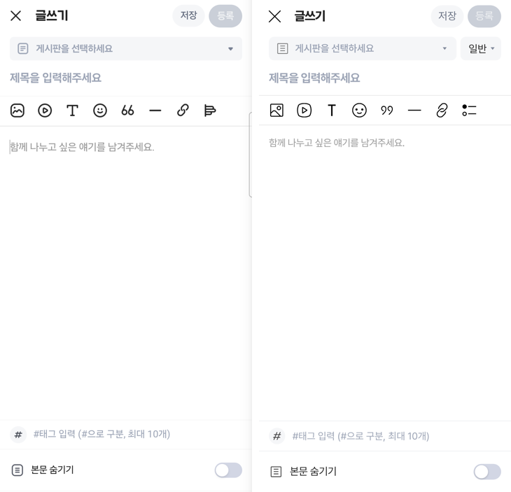
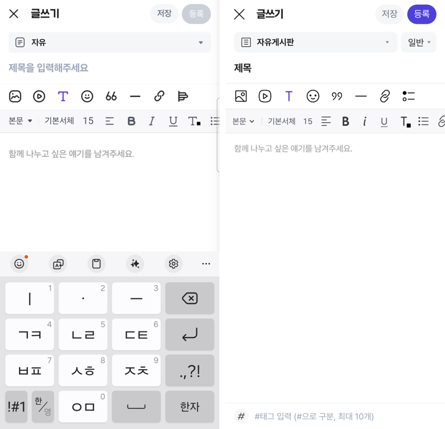
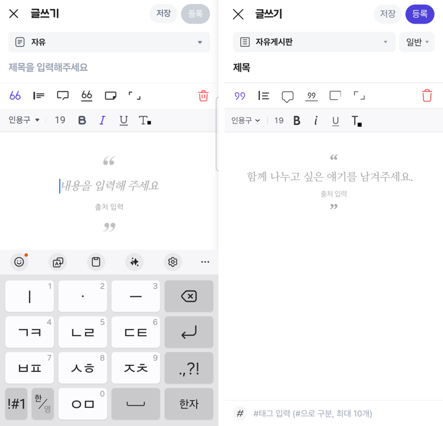
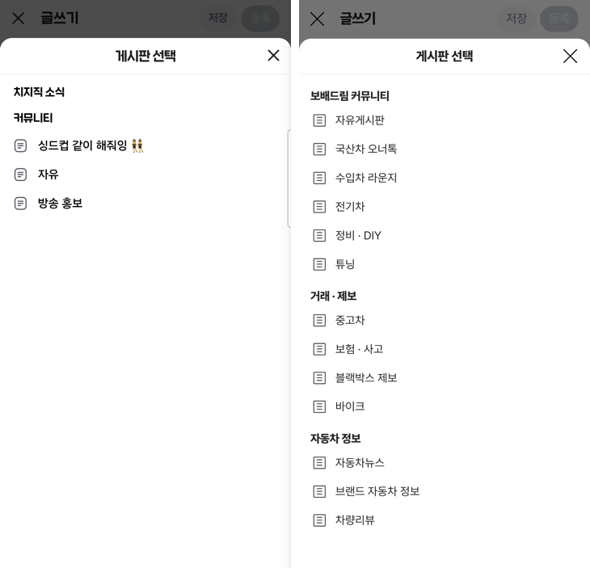
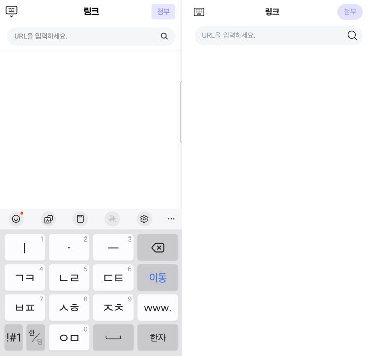
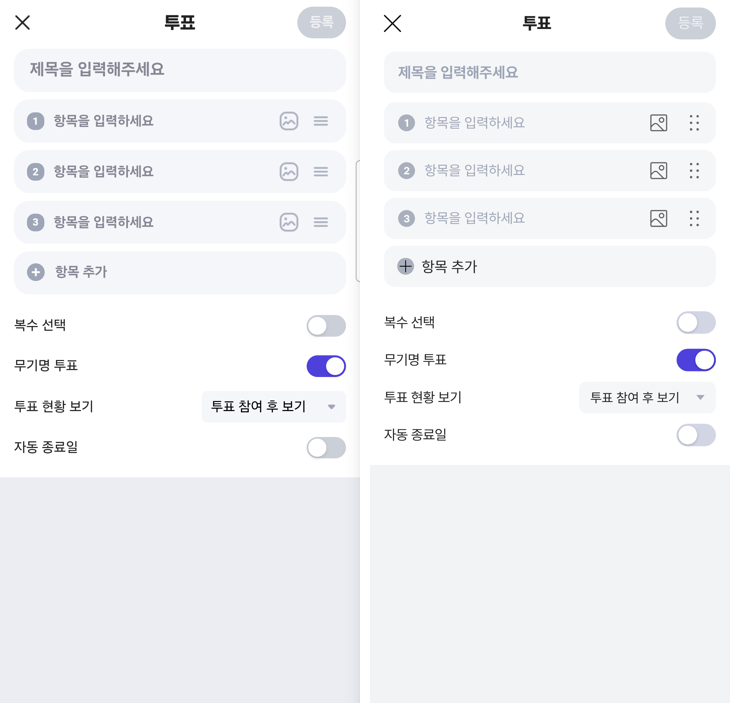
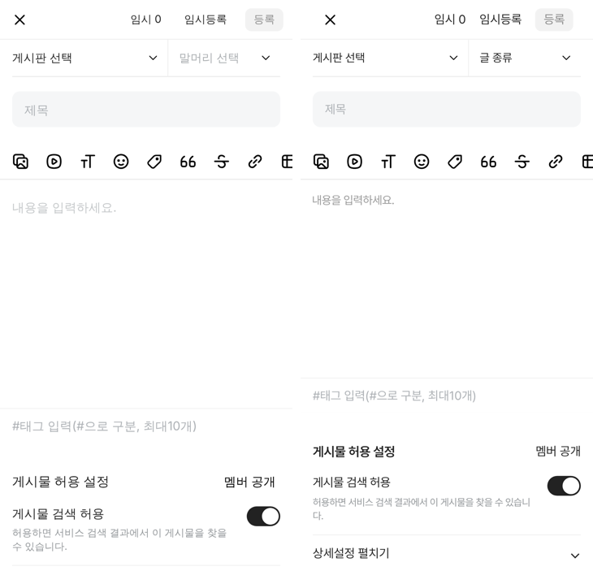
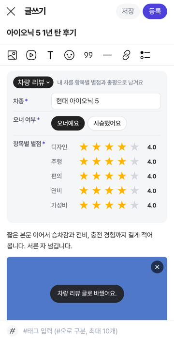

# 커뮤니티 글쓰기 — 치지직형 · 네이버 카페형 두 모양 + 글 종류(특수 글쓰기)

## ① 한 줄 요약
커뮤니티 글쓰기를 같은 기능의 두 모양으로 나눴습니다. 기본은 폰에 연결한 치지직 앱 글쓰기를 직접 눌러 보고 맞춘 치지직형이고, `?style=naver`는 네이버 카페형입니다. 동처띠식 특수 글쓰기(차량 리뷰 · 연비 · 전비 · 질문 · 내 차 팔기 · 구매가)는 「글 종류」로 넣었고, 목록 파일 하나에서 바꿀 수 있습니다.

## ② 과제 · 브랜치 · 커밋 · 상태
- 과제 ID: 없음 (지시: 「커뮤니티 글쓰기 메인은 치지직과 네이버 카페 2종류를 동일한 기능 추가해서 테스트 · 동처띠 같은 특수 형태의 글쓰기를 추가해서 커스텀 · 폰에 연결한 치지직 글쓰기와 UI UX 및 동일한 기능」)
- 브랜치: `community-write-variants`
  - `community-nuxt-1`(PR #1166, 커뮤니티 넉스트 이식) 위에서 만들었습니다. 그래서 PR의 기준 브랜치도 `community-nuxt-1`입니다.
- 커밋: 이 보고서와 같은 커밋
- 상태: 푸시 완료. 병합 · 배포는 승인을 기다립니다. #1166이 먼저 병합되어야 합니다.

## ③ 한 일
- **치지직 앱을 직접 확인했습니다.** 폰의 치지직 앱(네이버 게임) 글쓰기를 USB로 연결하고, 화면을 직접 눌러 보며 캡처 40장을 남겼습니다. 1080×2340 캡처를 384 CSS로 바꿔 쟀습니다. 확인한 곳:
  - 첫 화면과 게시판 선택
  - 텍스트 서식 줄과 그 안의 글꼴 · 크기 · 색 · 문단 목록
  - 인용구 6가지 모양, 구분선
  - 링크 화면(실패 안내 포함), 스티커, 투표(종료일 · 그만두기 확인)
  - 제목 없이 저장할 때 나오는 안내, 등록 버튼이 보라로 켜지는 조건, 닫기 동작
- **치지직형(기본, `/write`)을 새로 만들었습니다.** 머리줄 · 게시판 · 제목 · 도구 줄 8개 · 서식 줄 · 본문 · 태그 · 본문 숨기기의 위치와 크기를 치지직과 1~2px 안으로 맞췄습니다. 동작도 같습니다.
  - 서식 줄 안에서 글꼴 · 크기 · 색 목록으로 바뀌고, ‹ 로 돌아옵니다.
  - 정렬 버튼은 누를 때마다 왼쪽 → 가운데 → 오른쪽으로 바뀝니다.
  - 인용구 안에서는 도구 줄이 인용구 모양 6가지와 휴지통으로 바뀝니다.
  - 스티커 · 링크 · 투표는 화면 전체를 덮는 도구 화면입니다.
- **네이버 카페형(`/write?style=naver`)을 만들었습니다.** 겉모양은 예전 네이버 카페 대조본(`naver-write-parity`) 그대로입니다. 기능은 치지직형과 같습니다(같은 편집기 · 같은 도구 화면). 「말머리」 자리에서 글 종류를 고릅니다.
- **글 종류를 넣었습니다.** 일반 · 차량 리뷰 · 연비 · 전비 · 질문 · 내 차 팔기 · 구매가 6종입니다.
  - 고르면 본문 위에 그 글에 필요한 칸이 생깁니다(차종, 별점, 연비 · 전비, 희망가 등). 본문 안내 문구도 바뀝니다.
  - 등록을 누를 때 조건을 확인하고 빠진 곳을 알려 줍니다(필수 칸, 본문 글자 수, 사진 장수, 구매가 금액 등).
  - 종류 · 칸 · 조건은 `composables/write/postTypes.ts` 목록 하나에 있습니다. 여기를 바꾸면 두 모양에 함께 반영됩니다.
- **예전 간결형 글쓰기는 비교용으로 남겼습니다** (`/write?style=legacy`).

## ④ 원본과 비교

### 치지직 앱(왼쪽)과 우리 치지직형(오른쪽)

### 위치 대조 (384 CSS 기준, 치지직 앱 → 우리)
| 영역 | 치지직 앱 | 우리 | 차이 |
|---|---|---|---|
| 닫기 × 가운데 | x 24 | x 24 | 0 |
| 「글쓰기」 시작 | x 54.8 | x 54 | 0.8 |
| 「저장」 알약 | 263~312, 높이 34 | 262~312, 높이 34 | 1 안쪽 |
| 「등록」 알약 | 318~369 | 318~369 | 0 |
| 게시판 칸 | y 56~92 | y 56~92 | 0 |
| 제목 아래 선 | y 146.8 | y 146 | 0.8 |
| 도구 줄 아이콘 가운데 | 26.5부터 42 간격 | 26.5부터 42 간격 | 0 |
| 도구 줄 아래 선 | y 191.6 | y 191 | 0.6 |
| 태그 줄 위 선 | y 639.6 | y 641 | 1.4 |
| 본문 숨기기 스위치 | 327~369 × 705~728 | 327~369 × 707~731 | 2 |

- 화면 픽셀 차이 비율은 재지 않았습니다. 글꼴(치지직 전용 글꼴과 우리 Pretendard)과 아이콘(치지직 아이콘과 우리 레딧 원본)이 달라서, 비율 숫자가 위치 차이를 보여 주지 못합니다. 대신 위 표처럼 칸 위치를 직접 쟀습니다.

### 네이버 카페 대조본(왼쪽)과 우리 네이버 카페형(오른쪽)

### 글 종류(차량 리뷰)

### 동작 점검 (치지직 앱에서 해 본 것을 우리 화면에서 똑같이)
| 동작 | 치지직 앱 | 우리 |
|---|---|---|
| 제목을 넣으면 등록 버튼이 보라로 켜짐 | 예 | 같음 |
| 제목 없이 「저장」 | 「제목을 입력해주세요.」 + 초록 확인 | 같음 |
| 텍스트(T) → 서식 줄, T가 보라로 바뀜 | 예 | 같음 |
| 본문▾ → 본문 · 소제목 · 인용구 고르기 | 가운데 목록 창 | 같음 |
| 글꼴 · 크기 · 색 → 줄이 목록으로 바뀌고 ‹ 로 돌아옴 | 예 | 같음 |
| 정렬 버튼을 누를 때마다 정렬이 바뀜 | 예 | 같음 |
| 인용구 → 도구 줄이 6가지 모양 + 휴지통, 서식 줄은 인용구▾ · 19 | 예 | 같음 |
| 인용구 모양 바꾸기 · 지우기 | 예 | 같음 |
| 구분선 → 짧은 선 | 예 | 같음 |
| 링크: 입력 중 키보드 내리기 → 내리면 뒤로가기 · 실패 안내 두 줄 · 「첨부」 | 예 | 같음(유튜브는 미리보기 → 첨부 → 본문 임베드) |
| 투표: 무기명 기본 켜짐 · 투표 현황 3가지 · 자동 종료일 → 날짜 · 시간 | 예 | 같음 |
| 투표 닫기 → 「투표 작성을 그만두시겠어요?」 취소 / 그만두기 | 예 | 같음 |
| 게시판 시트: 위까지 올라오고 가운데 제목 · 오른쪽 × | 예 | 같음 |
| 닫기 × → 확인 없이 나감 | 예 | 같음 |
| 본문을 쓰는 동안 「본문 숨기기」 줄 숨김 | 예 | 같음 |
| 글 종류 고르기 → 칸 생김 · 안내 문구 바뀜 · 등록할 때 조건 확인 | (우리 추가) | 됨 |
| 임시저장 → 다시 열면 「이어서 쓸까요?」 | (우리 추가) | 됨 |

## ⑤ 검증
- `nuxt-community`: `pnpm typecheck` · `pnpm test`(52개, 글 종류 시험 5개 추가) · `pnpm generate` 통과
- 콘솔 오류: 치지직형 · 네이버 카페형 · 예전 간결형 모두 0
- 등록 흐름 끝까지 확인했습니다. 결과는 `localStorage bbm.community.latestPost.v2`에 들어갑니다.
  - 확인한 값: 게시판 「전기차」, 글 종류 「차량 리뷰」, 요약 「차종 현대 아이오닉 5 · 오너 여부 오너예요 · 항목별 별점 평균 4.0」, 사진 1장
- 퀵필터 규격(`measure:qf`) · `verify:qf`: 리액트 시안을 건드리지 않아 다시 재지 않았습니다.

## ⑥ 원본과 다르게 남긴 것과 이유
- **아이콘:** 치지직 아이콘 대신 레딧 원본 아이콘(reddit/devvit-docs e2fe9c1, 수정 없이 복사)을 씁니다. 커뮤니티 아이콘은 레딧으로 맞추기로 한 규칙을 따랐고, 치지직 아이콘 파일은 얻을 수 없습니다. 밑줄만 글자 「U」입니다(레딧에 밑줄 아이콘이 없음).
- **스티커:** 치지직 스티커 그림은 치지직 것이라 쓰지 않았습니다. 공용 이모지를 묶음 탭으로 보여 줍니다.
- **글꼴:** 치지직 전용 글꼴 대신 Pretendard입니다.
- **사진 · 동영상 권한:** 치지직은 카메라 권한을 먼저 묻습니다. 웹은 파일 고르기 창을 바로 엽니다. 폰 시험에서는 카메라 권한을 허용하지 않아, 치지직의 사진 고르기 화면 자체는 보지 못했습니다.
- **추가한 것:** 「글 종류」 칸(게시판 옆 회색 칸)과 임시저장 이어 쓰기 창은 치지직에 없는 우리 기능입니다.
- **문단 고르기 창:** 치지직은 안드로이드 기본 고르기 창(초록 동그라미)을 씁니다. 우리는 같은 모양으로 그렸습니다.

## ⑦ 못 한 것 · 다음에 할 것
- **네이버 카페 앱 실측:** 폰에 네이버 카페 앱이 깔려 있습니다. 하지만 이번 지시는 치지직 화면이었으므로, 네이버형은 예전 대조본 모양을 따랐습니다. 네이버 카페 앱 글쓰기를 열어 두시면 같은 방법으로 맞추겠습니다.
- **상세 화면:** 글 종류 요약 줄(예: 「차량 리뷰 · 별점 평균 4.0」)을 상세 · 목록 화면에 보여 주는 일은 다음 단계입니다. 지금은 저장만 됩니다.
- **운영 연결:** 글 종류 목록을 Laravel API(`GET /community/post-types`)로 내려받아 운영자가 바꾸게 하는 일은 다음 단계입니다. 글 저장도 아직 브라우저에만 합니다.
- **치지직 링크 미리보기:** 치지직이 링크를 성공적으로 불러온 화면은 보지 못했습니다(폰 키보드가 한글이라 주소 입력이 깨짐). 성공 화면은 우리 방식(미리보기 카드)으로 만들었습니다.

## ⑧ 확인 링크 (병합 · 배포 뒤)
- 치지직형: https://bobaekimboae.github.io/bobaedream/nuxt-community/#/write
- 네이버 카페형: https://bobaekimboae.github.io/bobaedream/nuxt-community/#/write?style=naver
- 글 종류를 골라서 열기(예: 차량 리뷰): https://bobaekimboae.github.io/bobaedream/nuxt-community/#/write?type=review
- 예전 간결형(비교용): https://bobaekimboae.github.io/bobaedream/nuxt-community/#/write?style=legacy
