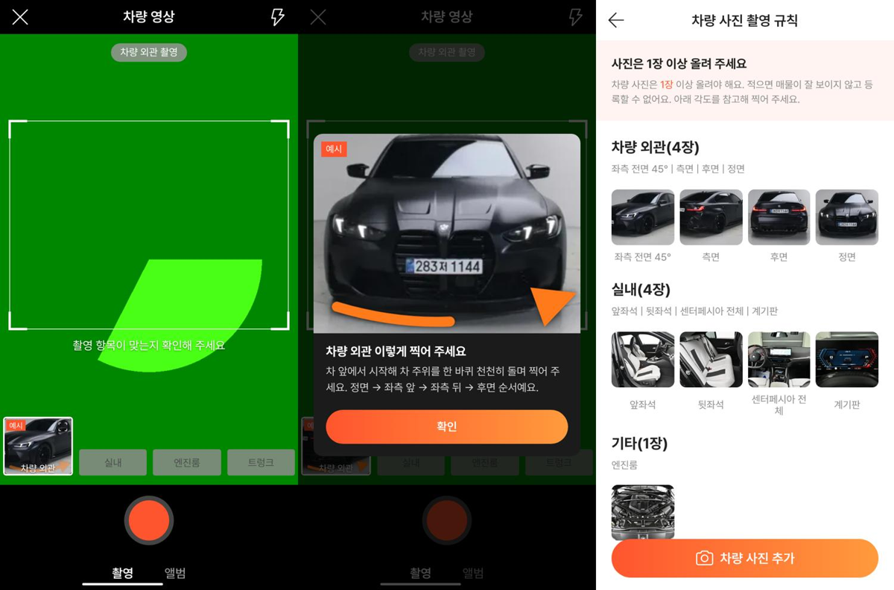

# PR #1000 · #1001 58 촬영 영상 예시·촬영 규칙 실사화

## ① 한 줄 요약
영상 촬영 단계 예시와 촬영 규칙 그림을 그림 대신 실제 차량 사진(BMW M3 실매물)으로 바꿨고, 예시를 누르면 크게 보며 촬영 방법을 읽을 수 있습니다.

## ② 과제 정보
- 과제 ID: 없음(사용자 지시 「영상 촬영 템플릿도 원본처럼 실사적으로, 그래야 촬영팀 알지」)
- 브랜치: `fix/shoot-58-survey`(#1000) · `fix/shoot-arrow-reveal`(#1001)
- 커밋: `da15c12` · `9ade875`
- PR: https://github.com/bobaekimboae/bobaedream/pull/1000 · https://github.com/bobaekimboae/bobaedream/pull/1001
- 상태: 병합·배포 완료(v=`9ade875`, 번들 `main-DeF2LUF6.js`)
- 함께 들어간 과제: 없음

## ③ 한 일
- 58 예시 영상은 58 저작물이라 그대로 쓰지 않고, 우리 저장소에 있는 서울오토갤러리 BMW M3 스튜디오 촬영 사진으로 예시를 만들었습니다.
- 외관: 정면 → 좌측 앞 → 좌측 뒤 → 후면 사진이 1.4초마다 바뀌며 카메라가 옆으로 움직이는 것처럼 보입니다.
- 실내: 앞좌석 → 대시보드 → 핸들·계기판 → 뒷좌석. 엔진룸은 왼쪽→오른쪽 훑기, 트렁크는 위→아래로 내리기.
- 주황 화살표(카메라 이동 방향)와 「예시」 표시는 그대로이고, 화살표 머리가 선에 붙은 채 꼬리부터 그려지게 고쳤습니다.
- 펼친 예시 칸을 누르면 크게 보기 창이 열리고 「차량 외관 이렇게 찍어 주세요」 안내 문장이 나옵니다(촬영팀용).
- 촬영 규칙 화면 9각도도 같은 M3 실사 사진으로 바꿨습니다.

## ④ 원본과 비교

| 항목 | 작업 전 | 작업 후 |
|---|---|---|
| 영상 단계 예시 | 그림(SVG) | 실사 사진 장면 전환 + 카메라 이동 |
| 예시 크게 보기 | 없음 | 4:3 예시 + 촬영 안내 문장 |
| 촬영 규칙 9각도 | 그림 | 실사 사진 |

## ⑤ 검증
- `npm run verify:qf`: 통과
- 콘솔 오류: 모바일 384 영상 촬영·크게 보기·촬영 규칙 화면 0개(배포본 포함)
- 퀵필터 규격은 바꾸지 않았습니다(레일 96 · 카드 80×72 · 이미지 56×28 · 트림 칩 32, 필터 선택지 303개 · 시트 마감 6 · 광고기간 「전체」 유지).

## ⑥ 원본과 다르게 남긴 것과 이유
- 58의 예시는 흰색 차 실사 영상이지만, 저작권 때문에 우리 매물 사진(검정 M3)으로 대신했습니다. 영상 파일이 아니라 사진 4장 전환이라 실제 영상보다 덜 매끄럽습니다.
- 매장 벽 로고가 보이지 않게 사진 위쪽을 잘랐고, 번호판은 원본 그대로 둡니다(테스트 시안 기준).

## ⑦ 못 한 것 · 다음에 할 것
- 촬영팀이 직접 찍은 짧은 예시 영상(단계별 5~8초)을 주면 사진 전환 대신 그 영상으로 바꿀 수 있습니다.
- 사진·영상 수정·삭제 전체 점검(자르기 모서리 크기 조절, 영상 칸 눌러 다시 찍기·표지 바꾸기 등)은 이어서 진행합니다.

## ⑧ 확인 링크
- 촬영 흐름: https://bobaekimboae.github.io/bobaedream/?register=shoot&v=9ade875
- 모바일: https://bobaekimboae.github.io/bobaedream/?qf=guazi&v=9ade875
- PC: https://bobaekimboae.github.io/bobaedream/?qf=guazi&v=9ade875&pc=1
