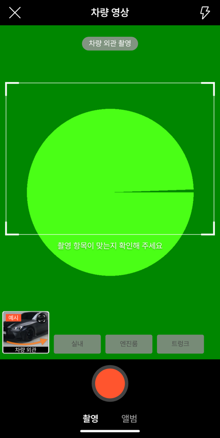
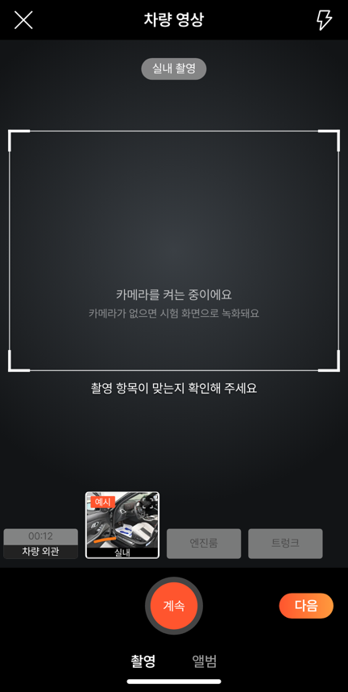
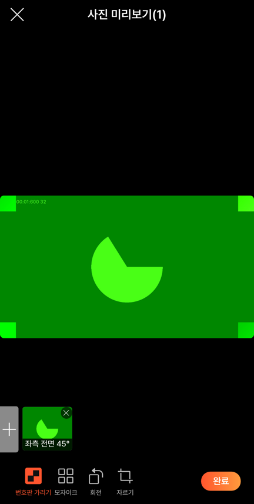
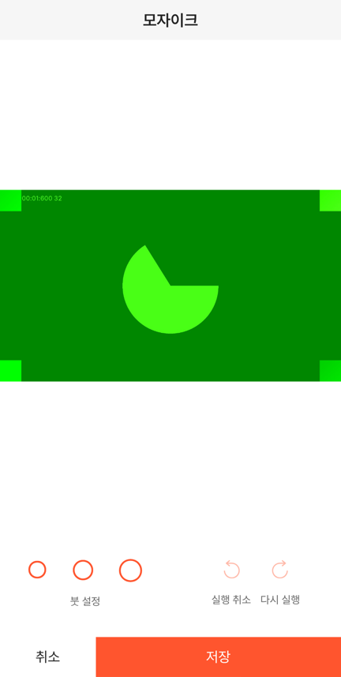
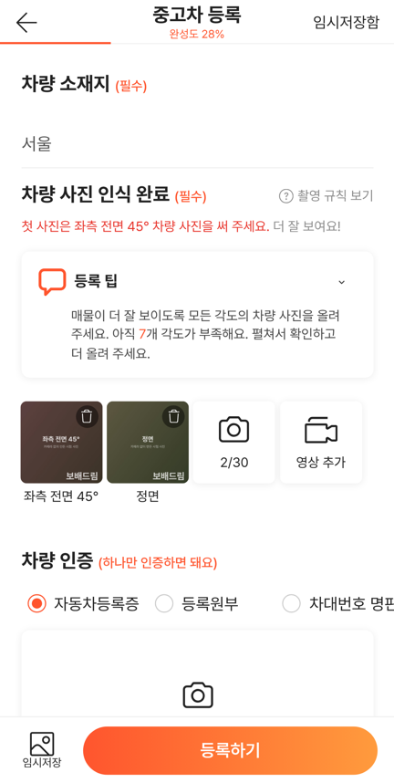

# PR #1003 · #1004 · #1005 — 58 촬영 QA 10배 대조

## ① 한 줄 요약
영상 촬영 부위 칸이 펼친 칸 때문에 옆으로 밀리던 문제를 58과 같은 4칸 고정 배치로 고쳤습니다. 등록·촬영·앨범·미리보기·편집 화면 위치도 58 실측값 ±2(432 단위) 안으로 맞췄고, 영상 편집(다시 찍기·표지 바꾸기·삭제)과 자르기 모서리 조절을 넣었습니다.

## ② 과제 · 브랜치 · 커밋 · 상태
- 과제 ID: 없음(사용자 지시 「10배 더 강화된 QA」 · 「영상 슬롯 촬영 부위도 틀어지고 원본 디자인 기능 완벽하게」)
- 브랜치: `fix/shoot-qa-x10` → PR [#1003](https://github.com/bobaekimboae/bobaedream/pull/1003)(병합 `006f2cb`)
- 이어서 고친 것: `fix/shoot-qa-x10-radios` → [#1004](https://github.com/bobaekimboae/bobaedream/pull/1004)(`a2f044c`), `fix/shoot-radios-fit` → [#1005](https://github.com/bobaekimboae/bobaedream/pull/1005)(`c6ffd9c`)
- 상태: 병합 · 배포 완료, v=`c6ffd9c`, 번들 `assets/main-B1J3yHjc.js`
- 이번 병합으로 main에 함께 들어간 과제: 없음

## ③ 한 일
1. 58 폰에서 영상 촬영 화면을 다시 열고, 1단계를 끝까지 찍은 상태와 2단계를 찍는 중인 상태를 덤프(요소 위치)와 캡처로 재었습니다.
2. 촬영 부위 칸을 화면 폭의 23.46% 간격 4칸으로 고정했습니다. 빈 칸은 92×38, 펼친 칸은 92×84입니다. 이제 펼친 칸이 바뀌어도 다른 칸이 밀리지 않습니다.
3. 셔터·녹화 버튼 판, 탭 줄, 화면 가운데 흰 막대, 앨범 4열, 미리보기 사진 칸·도구·완료, 편집 화면 버튼, 모자이크 붓, 자르기 버튼, 등록 화면의 줄 간격·사진 칸·인증 서류·등록하기를 58 값으로 맞췄습니다.
4. 기능:
   - 미리보기 제목이 지금 보는 사진 번호를 보여 줍니다.
   - 새 사진은 각도 순서대로 끼워 넣고, 새로 올린 사진만 「업로드 중」으로 표시합니다.
   - 자르기 틀은 네 모서리로 크기를 바꿀 수 있습니다(비율 유지).
5. 영상 편집:
   - 영상은 단계마다 파일 하나로 녹화하고 순서대로 이어서 재생합니다.
   - 등록 화면의 영상 칸을 누르면 다시 찍기 · 표지 바꾸기 · 삭제를 고를 수 있습니다.
6. 등록 화면에서 뒤로 가면 58처럼 「저장 안 함 / 저장하고 나가기」 확인 창이 뜹니다.
7. 배포본을 폰 크롬에서 열어 보니 「차대번호 명판」이 화면 밖으로 잘렸습니다. 글자 크기를 화면 폭에 맞추는 방식으로 바꿔 잘림이 없는 것을 확인했습니다(#1004·#1005).

## ④ 원본과 비교 (432 단위, 영역별)
| 화면 | 항목 | 58 | 작업 전 | 작업 후 |
| --- | --- | --- | --- | --- |
| 영상 촬영 | 부위 칸 x | 4·106·207·308 | 5·115·222·329 | 4·106·207·308 |
| 영상 촬영 | 칸 크기 | 92×38 / 92×84 | 98×38 / 101×86 | 92×38 / 92×84 |
| 영상 촬영 | 안내 문구 y | 519 | 540 | 519 |
| 촬영 공통 | 셔터·녹화 y | 764 | 769 | 763 |
| 촬영 공통 | 흰 막대 | 가운데 117×6 | 탭 아래 104×3 | 가운데 104×5 |
| 사진 촬영 | 첫 칸 · 번호판 가리기 | 4,663 · 43,784 | 0,660 · 18,793 | 4,663 · 43,787 |
| 앨범 | 칸 · 탭 · 개수 | 4열 108×140 · 88/164 · 245 | 3열 142 · 81/157 · 266 | 4열 106×140 · 88/164 · 245 |
| 미리보기 | 사진 칸 · 완료 | 38,742 85 · 342,852 68×32 | 47,729 95 · 338,846 77×36 | 38,741 85 · 342,851 68×32 |
| 모자이크 | 붓 x · 실행 취소/다시 실행 | 36·92·151 · 293/355 | 32·90·153 · 290/373 | 36·92·151 · 293/355 |
| 편집 | 아래 버튼 | 취소 121 · 높이 51 | 135 · 63 | 121 · 51 |
| 등록 | 첫 제목 · 값 · 둘째 제목(잉크) | 129.6 · 196.8 · 251.2 | 140 · 192.4 · 266 | 130 · 197.2 · 251.2 |
| 등록 | 사진 칸 · 셋째 제목 · 등록하기 | 90×90 · 484.4 · 91,844 324×53 | 88×88 · 490.8 · 90,839 324×56 | 90×90 · 485.2 · 91,844 323×53 |

동작 점검표(자동 시험 31개 · 모두 통과):

| 동작 | 결과 |
| --- | --- |
| 미리보기 제목 (1)/(2) | 통과 |
| 번호판 스티커 사진에 합치기 · 재편집 | 통과 |
| 모자이크 실행 취소 · 다시 실행 · 저장 | 통과 |
| 자르기 모서리 축소 311→247, 비율 4:3 유지 | 통과 |
| 회전 + 자르기 결과 사진 4:3 | 통과 |
| 미리보기에서 빼기 → 다시 올리기 · 삭제 | 통과 |
| 휴지통 삭제 | 통과 |
| 영상 11초 → 계속·다음 → 미리보기 → 표지 8장 | 통과 |
| 영상 칸 → 편집(다시 찍기·표지 바꾸기·삭제) | 통과 |
| 다시 찍기로 실내 추가 → 단계 2개 이어 보기, 길이 00:23 | 통과 |
| 편집 화면에서 삭제 | 통과 |
| 콘솔 오류 | 0 |

## ⑤ 검증
- `npm run verify:qf`: 통과
- 콘솔 오류: PC·모바일(384) 0건
- 폰 크롬 배포본(`v=c6ffd9c`): 영상 촬영 부위 칸 4·106·207·308 확인, 인증 서류 3칸 잘림 없음 확인
- 화면 폭 360 · 384 · 412에서 가로 스크롤 없음
- measure:qf 퀵필터 규격: 이번 작업은 `?register=shoot` 화면만 바꿔 퀵필터(레일 96 · 카드 80×72 · 이미지 56×28 · 트림 칩 32)와 개발 시안형 필터 선택지 303개 · 시트 마감 6 · 광고기간 「전체」에 영향 없음

## ⑥ 원본과 다르게 남긴 것과 이유
- 영상 칸 편집: 58은 영상 칸을 눌러도 아무 반응이 없고, 찍은 단계를 다시 찍을 수도 없습니다. 「수정 삭제까지 완벽하게」 지시에 따라 우리만 편집 기능을 넣었습니다.
- 모자이크 붓: 58은 처음 화면에서 세 붓 모두 테두리만 보입니다. 우리도 같게 두고, 누른 붓만 채워 보이게 했습니다.
- 인증 서류 글자: 한국어 이름이 길어서 좁은 폰에서는 글자 크기를 화면 폭의 3.6%(최대 16px)로 줄입니다.
- 58 원본 캡처는 이 작업 환경으로 옮길 수 없어 보고서 사진은 우리 화면만 넣었습니다. 숫자 비교는 ④ 표에 있습니다.

## ⑦ 못 한 것 · 다음에 할 것
- 58에서 영상 삭제를 「确定」으로 눌러도 지워지지 않았습니다(58 버그로 보임). 그래서 녹화 중 X를 누를 때의 동작은 이번에도 확인하지 못했습니다.
- 스티커를 끌어 옮기기와 모자이크 그리기는 adb 입력이 58에 먹지 않아, 사람이 직접 손가락으로 해 봐야 비교할 수 있습니다.

## ⑧ 확인 링크
- 촬영 화면: https://bobaekimboae.github.io/bobaedream/?register=shoot&v=c6ffd9c
- 모바일: https://bobaekimboae.github.io/bobaedream/?qf=guazi&v=c6ffd9c
- PC: https://bobaekimboae.github.io/bobaedream/?qf=guazi&v=c6ffd9c&pc=1
