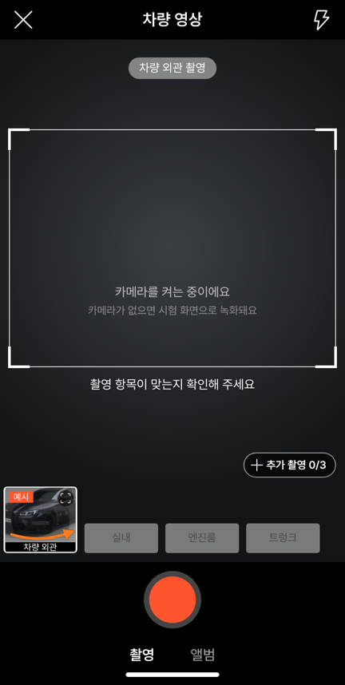
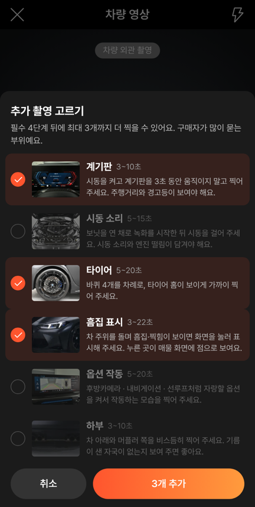
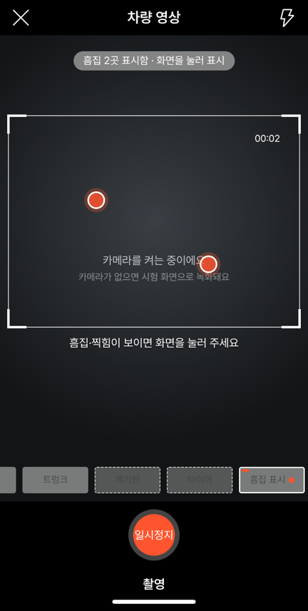
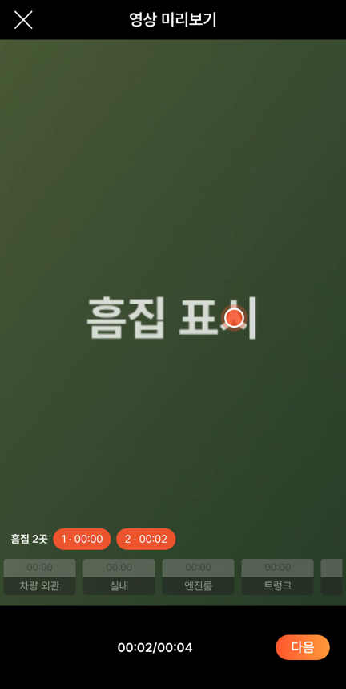

# PR #1007 · #1008 — 58 영상 촬영 추가 부위 시안 (CARS24식)

## ① 한 줄 요약
영상 촬영 화면에 CARS24처럼 부위별 추가 촬영(계기판·시동 소리·타이어·흠집 표시·옵션 작동·하부)을 고르는 시안을 만들었습니다. 흠집은 녹화 중 화면을 눌러 위치를 표시하고, 미리보기에서 그 장면으로 바로 이동합니다.

## ② 과제 · 브랜치 · 커밋 · 상태
- 과제 ID: 없음(사용자 지시 「카스24처럼 영상 촬영 부위 더 추가하는 아이디어」 → 「시안은」)
- 브랜치·PR:
  - `feat/shoot-extra-stages` → [#1007](https://github.com/bobaekimboae/bobaedream/pull/1007)(`0f38f34`)
  - `fix/shoot-extra-pill` → [#1008](https://github.com/bobaekimboae/bobaedream/pull/1008)(`6727f16`)
- 상태: 병합 · 배포 완료.
  - #1008 배포는 바로 뒤 다른 병합(`57c15aa`)에 밀려 취소됐고, `57c15aa` 배포에 함께 들어갔습니다.
  - 배포 v=`57c15aa`, 번들 `assets/main-LeNi8k0y.js`
- 이번 병합으로 main에 함께 들어간 과제: `57c15aa feat: connect desktop and mobile community menus`(다른 작업)

## ③ 한 일
1. 시안은 `?register=shoot&vstage=plus`에서만 보입니다. 기본 주소는 58과 같은 4단계 그대로입니다.
2. 필수 4단계 칸은 58 자리(4·106·207·308)에 그대로 두고, 칸 줄 위 오른쪽에 `＋ 추가 촬영 0/3` 버튼을 띄웠습니다. 폰 폭에서는 다섯째 칸이 화면 밖으로 밀려 버튼으로 바꿨습니다(#1008).
3. 고르기 시트에서는 6개 부위 중 최대 3개를 고릅니다. 행마다 예시 사진, 촬영 길이, 찍는 법이 있고, 이미 찍은 부위는 `찍음`으로 잠깁니다.
4. 고른 부위는 필수 4칸 뒤에 같은 크기의 칸으로 붙고 옆으로 넘겨 봅니다. 아직 찍지 않은 추가 칸은 점선 테두리입니다. 부위마다 최소·최대 길이가 다릅니다(계기판 3~10초 등).
5. 흠집 표시 단계에서 녹화 중 화면을 누르면 주황 점과 시각이 저장됩니다.
   - 미리보기와 영상 편집 화면에 `흠집 2곳 · 1 · 00:00 · 2 · 00:02` 버튼이 생깁니다.
   - 버튼을 누르면 그 장면으로 이동하고, 그 무렵에 점을 다시 보여 줍니다.
   - 등록 화면 영상 칸 아래에 `흠집 N곳`이 붙습니다.
6. 추가 부위 예시는 서울오토갤러리 BMW M3 실매물 사진을 잘라 썼습니다(`public/assets/shoot-templates/opt-*.webp`).

## ④ 원본과 비교
CARS24 매물(벤츠 C200)의 구성과 시안을 대조했습니다.

| CARS24 | 시안 |
| --- | --- |
| 외관 8각도 사진 | 필수 「차량 외관」 한 바퀴 영상(58 그대로) |
| 우측 앞바퀴 사진 | 추가 「타이어」(바퀴 4개) |
| 주행거리계 · 대시보드 사진 | 추가 「계기판」 |
| 보닛 열고 엔진 사진 | 필수 「엔진룸」 + 추가 「시동 소리」 |
| Premium Features(선루프·크루즈·후방카메라) | 추가 「옵션 작동」 |
| Car imperfections(흠집 표시) | 추가 「흠집 표시」(누른 자리·시각 저장, 장면 이동) |
| 없음 | 추가 「하부」(누유·머플러) |

58과 같은 부분(자동 시험으로 확인): 필수 4칸 위치 4·106·207·308. 기본 주소는 4칸만 있고 추가 버튼이 없습니다.

| 동작 점검 | 결과 |
| --- | --- |
| 기본 4칸 + 추가 버튼, 4칸 위치 58과 같음 | 통과 |
| 고르기 시트 6개, 3개 고르면 나머지 잠김 | 통과 |
| 단계 7개로 늘고 첫 추가 단계로 이동 | 통과 |
| 흠집 단계에서 화면 두 번 누름 → 점 2개 · 안내 「2곳」 | 통과 |
| 흠집 최소 3초 뒤 멈춤 | 통과 |
| 미리보기 흠집 버튼 2개 → 누르면 2.7초로 이동 | 통과 |
| 등록 화면 영상 칸 「흠집 2곳」 | 통과 |
| 기본 주소는 4칸만 | 통과 |
| 기존 촬영·편집 시험 31개 | 통과 |

## ⑤ 검증
- `npm run verify:qf`: 통과
- 콘솔 오류: 0건(384px 모바일)
- 폰 크롬 배포본 `?register=shoot&vstage=plus&v=57c15aa`: 추가 버튼과 고르기 시트 표시를 확인했습니다.
- measure:qf 퀵필터 규격: 이번 작업은 `?register=shoot` 화면만 바꿔 퀵필터(레일 96 · 카드 80×72 · 이미지 56×28 · 트림 칩 32)와 개발 시안형 필터 선택지 303개 · 시트 마감 6 · 광고기간 「전체」에 영향이 없습니다.

## ⑥ 원본과 다르게 남긴 것과 이유
- 58에는 추가 단계가 없습니다. 그래서 시안은 별도 주소(`vstage=plus`)에만 넣고, 기본 화면은 58과 똑같이 두었습니다.
- 추가 버튼을 칸이 아닌 띄운 버튼으로 바꿨습니다. 폰 폭에서는 다섯째 칸이 보이지 않기 때문입니다.
- 「하부」 예시는 M3 매물 사진에 차 밑 사진이 없어, 뒤쪽 아래 머플러 부분 사진으로 대신했습니다.

## ⑦ 못 한 것 · 다음에 할 것
- 매물 상세 화면에 흠집 점을 차 윤곽 그림 위에 보여 주는 부분(노션 제안 C안)은 아직 만들지 않았습니다.
- 외관 영상에서 8각도 사진을 자동으로 뽑는 기능(A안)은 장면을 알아보는 기능이 필요해 다음 단계로 남깁니다.
- 정해 주실 것: 추가 단계 최대 개수(지금 3개), 영상 전체 길이 상한, 하부 예시 사진.

## ⑧ 확인 링크
- 시안: https://bobaekimboae.github.io/bobaedream/?register=shoot&vstage=plus&v=57c15aa
- 기본(58과 같음): https://bobaekimboae.github.io/bobaedream/?register=shoot&v=57c15aa
- 모바일: https://bobaekimboae.github.io/bobaedream/?qf=guazi&v=57c15aa
- PC: https://bobaekimboae.github.io/bobaedream/?qf=guazi&v=57c15aa&pc=1
