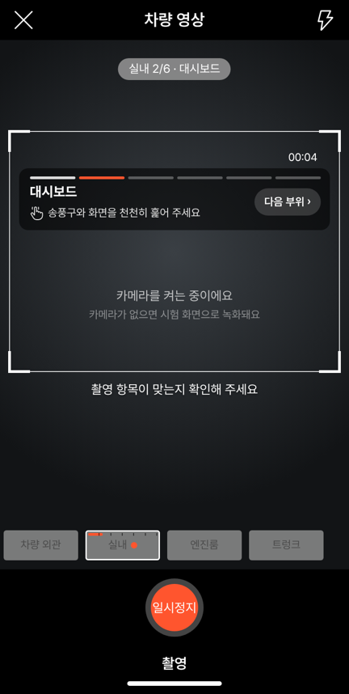
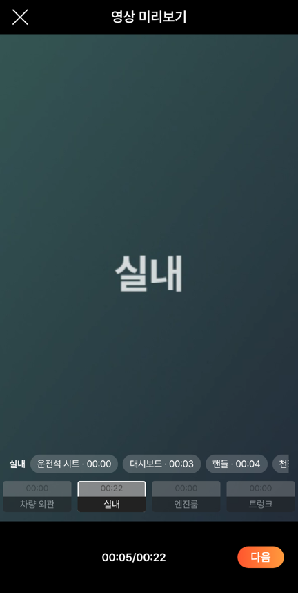
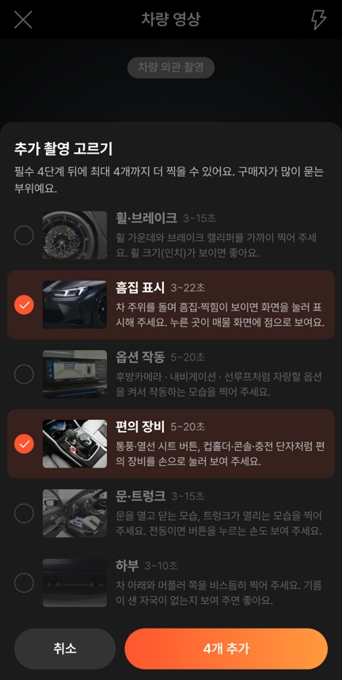

# PR #1012 — 58 영상: 실내 세부 순서 · 손 안내 · 추가 후보 확대

## ① 한 줄 요약
인스타 @nasserhessien 릴스의 실내 촬영 순서를 영상 촬영 「실내」 단계에 넣었습니다. 순서 카드와 손 안내가 뜨고, 미리보기에서 부위별로 이동합니다. 추가 촬영 후보는 9개로 늘렸습니다.

## ② 과제 · 브랜치 · 커밋 · 상태
- 과제 ID: 없음(사용자 지시 「릴스가 차량 세부 실내를 촬영 체계적으로 하거든 파악해봐라」 → 「추가해봐라」)
- 브랜치: `feat/shoot-interior-steps` → PR [#1012](https://github.com/bobaekimboae/bobaedream/pull/1012)(`af3cd75`)
- 상태: 병합 · 배포 완료(뒤이어 #1013 「58 비교 화면에서 실내 순서 카드 빼기」 포함), v=`cb47d46`, 번들 `assets/main-rY7dO0qE.js`
- 이번 병합으로 main에 함께 들어간 과제: 바로 뒤 다른 작업 커밋 `cb47d46`가 같은 배포에 들어갔습니다.

## ③ 한 일
1. 릴스 2개(롤스로이스 고스트 · AMG ONE)를 폰에서 1.5~2초 간격으로 24장씩 찍어 순서를 봤습니다. 공통 규칙은 셋입니다.
   - 손으로 누르고 잡으며 부위를 보여 줍니다.
   - 실내는 늘 같은 순서로 찍습니다.
   - 숫자는 큰 글자로 띄웁니다.
2. 실내 녹화 중 틀 위쪽에 순서 카드를 띄웁니다.
   - 순서: 운전석 시트 → 대시보드 → 핸들 → 천장 → 뒷좌석 → 편의 장비
   - 6칸 진행 막대, 부위 이름, 손 안내 한 줄(레딧 `tap-outline` 원본 아이콘)
   - 3.5초마다 자동으로 넘어가고, `다음 부위 ›`로 먼저 넘길 수 있습니다.
3. 안내 알약은 `실내 2/6 · 대시보드`, 실내 칸 진행 막대에는 6칸 눈금을 넣었습니다.
4. 부위 시작 시각을 저장합니다. 미리보기·영상 편집에서 `실내 · 운전석 시트 00:00 · 대시보드 00:03 …`을 누르면 그 장면으로 갑니다.
5. 실내 예시 사진은 같은 순서 6장으로 바꿨습니다(M3 실매물).
6. 추가 촬영 후보에 휠·브레이크, 편의 장비, 문·트렁크를 더해 9개로 늘렸고, 최대 4개까지 고릅니다.

## ④ 원본과 비교
| 릴스(@nasserhessien) | 우리 실내 단계 |
| --- | --- |
| 시트를 손으로 눌러 가죽 보여 주기 | 1 운전석 시트 · 「시트를 손으로 눌러 가죽을 보여 주세요」 |
| 송풍구·화면 근접 | 2 대시보드 · 「송풍구와 화면을 천천히 훑어 주세요」 |
| 운전석에서 핸들 잡기 | 3 핸들 · 「핸들을 잡고 버튼을 보여 주세요」 |
| 천장(스타라이트) | 4 천장 · 「고개를 들어 천장·선루프를 보여 주세요」 |
| 뒷좌석 쿠션 누르기 | 5 뒷좌석 · 「뒷좌석 쿠션을 손으로 눌러 주세요」 |
| 뒷좌석 냉장고·잔 | 6 편의 장비 · 「컵홀더·콘솔·충전 단자를 열어 보여 주세요」 |
| 컷 1.5~2초 | 부위당 약 3.5초(실내 최대 22초 안에 6부위) |

| 동작 점검 | 결과 |
| --- | --- |
| 실내 예시 사진 6장 | 통과 |
| 녹화 중 순서 카드, 3.5초 뒤 대시보드 | 통과 |
| `다음 부위` → 핸들, 손 안내 문구 | 통과 |
| 미리보기 실내 부위 버튼 → 그 시각(5.7초)으로 이동 | 통과 |
| 추가 후보 9개, 4개 고르면 나머지 잠김 | 통과 |
| 기존 촬영·편집 31개, 추가 촬영 14개 | 통과 |

## ⑤ 검증
- `npm run verify:qf`: 통과
- 콘솔 오류: 0건
- 폰 크롬 배포본(`v=f9f012f`): 실내 녹화 중 `실내 1/6 · 운전석 시트` 카드와 손 안내가 뜨는 것을 확인했습니다.
- measure:qf 퀵필터 규격: `?register=shoot` 화면만 바뀌어 퀵필터(레일 96 · 카드 80×72 · 이미지 56×28 · 트림 칩 32), 필터 선택지 303개 · 시트 마감 6 · 광고기간 「전체」에 영향이 없습니다.

## ⑥ 원본과 다르게 남긴 것과 이유
- 58에는 순서 카드가 없습니다. 58과 같은 화면은 `?vstage=58`에서 순서 카드 없이 봅니다.
- 「천장」 예시는 M3 매물에 천장 사진이 없어, 룸미러·앞유리 위쪽 사진으로 대신했습니다.
- 부위당 시간은 릴스(1.5~2초)보다 깁니다. 딜러가 손으로 보여 줄 시간을 고려했습니다.

## ⑦ 못 한 것 · 다음에 할 것
- 숏폼 제작기에서 마력·주행거리·휠 인치·가격을 큰 글자로 띄우는 것(릴스의 숫자 자막)은 아직 넣지 않았습니다.
- 외관 단계에도 같은 순서 카드(앞 → 좌측 45° → 옆 → 뒤 …)를 넣을 수 있습니다.

## ⑧ 확인 링크
- 촬영: https://bobaekimboae.github.io/bobaedream/?register=shoot&v=cb47d46
- 58 비교: https://bobaekimboae.github.io/bobaedream/?register=shoot&vstage=58&v=cb47d46
- 모바일: https://bobaekimboae.github.io/bobaedream/?qf=guazi&v=cb47d46
- PC: https://bobaekimboae.github.io/bobaedream/?qf=guazi&v=cb47d46&pc=1
