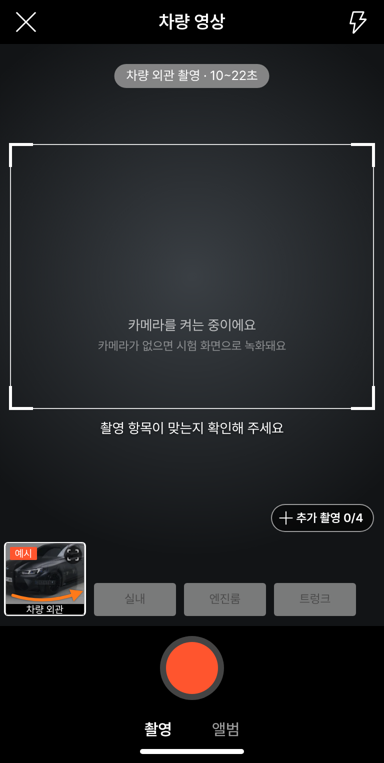
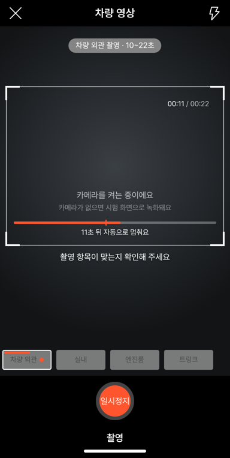
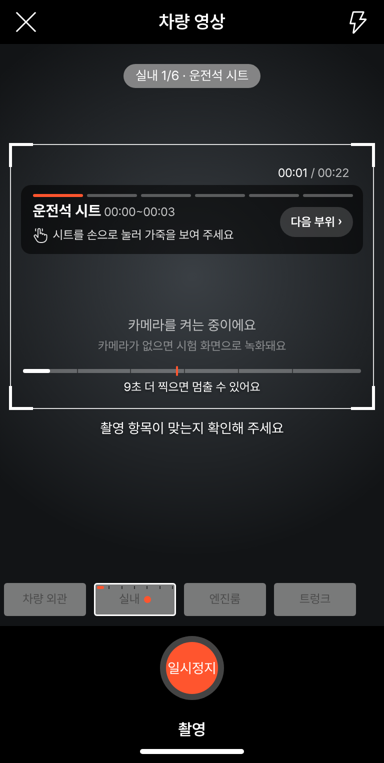

# PR #1015 — 58 촬영 최종 크로스체크 · 현장 대비 · 시간대 표시

## ① 한 줄 요약
촬영팀·중고차 딜러가 숏폼 영상을 찍을 때 막히는 지점을 점검해 고쳤고, 촬영 화면에 부위별 권장 시간과 녹화 중 남은 시간(시간대)을 보이게 했습니다.

## ② 과제 · 브랜치 · 커밋 · 상태
- 과제 ID: 없음(사용자 지시 「최종 크로스체크해봐라 촬영팀 또는 중고차딜러들이 영상 숏폼 촬영시 고려 사항 포함해서」 · 「시간대 촬영 화면에 노출하면 더 편하지 않을까」)
- 브랜치: `fix/shoot-field-ready` → PR [#1015](https://github.com/bobaekimboae/bobaedream/pull/1015)(병합 `2d63c0b`)
- 상태: 병합 · 배포 완료, v=`2d63c0b`, 번들 `assets/main-ChvkSmgh.js`
- 이번 병합으로 main에 함께 들어간 과제: 없음

## ③ 한 일
1. 시간대 표시: 기다릴 때 부위 이름 옆에 권장 길이(`차량 외관 촬영 · 10~22초`)를 씁니다.
2. 녹화 중에는 `00:07 / 00:22` 타이머와 틀 아래 시간 줄을 보여 줍니다. 주황 눈금이 「여기부터 멈출 수 있음」이고, 그 전에는 「N초 더 찍으면 멈출 수 있어요」, 넘으면 줄이 주황으로 바뀌고 「N초 뒤 자동으로 멈춰요」로 바뀝니다.
3. 실내는 시간 줄에 부위 경계 눈금 5개, 순서 카드에 지금 부위의 시간(`운전석 시트 00:00~00:03`)을 씁니다.
4. 폰을 가로로 돌리면 「휴대폰을 세로로 들어 주세요」 안내가 덮입니다(숏폼 9:16 그대로 쓰기 위함).
5. 녹화 중 화면이 꺼지지 않게 했고, 전화·앱 전환으로 화면을 나가면 최소 길이를 넘었으면 저장, 아니면 멈추고 다시 찍으라고 안내합니다.
6. 녹화 품질을 4Mbps(소리 128kbps, 약 30MB/분)로 정하고, 시동 소리 단계에서 마이크가 없으면 알립니다.
7. `?vstage=58` 비교 화면은 58 그대로 둡니다.

## ④ 원본과 비교 · 현장 점검표
58에는 시간대 표시가 없습니다(녹화 시간 숫자만 있음). 58 화면 배치는 바꾸지 않았고 비교 화면에서 확인했습니다.

| 촬영팀·딜러 고려 사항 | 상태 |
| --- | --- |
| 부위별 권장 시간·남은 시간 보기 | 넣음(이번) |
| 세로 9:16 유지 | 넣음(가로 안내) |
| 촬영 중 화면 꺼짐 | 넣음(화면 켜짐 유지) |
| 전화·앱 전환으로 끊김 | 넣음(저장 또는 다시 찍기 안내) |
| 영상 용량·화질 | 넣음(4Mbps, 약 30MB/분) |
| 시동 소리 녹음 | 넣음(마이크 없으면 알림) |
| 부위 순서·손 안내 | 이미 있음(실내 순서 카드) |
| 부위별 다시 찍기·흠집 표시 | 이미 있음 |
| 영상 속 번호판 가리기 | 못 함(58도 사진만 가림) |
| 손떨림·천천히 움직이기 안내 | 못 함(문구만 가능) |
| 숏폼 사양 글자(연식·주행) 얹기 | 못 함 |
| 외관 한 바퀴 순서 카드 | 못 함 |
| 모바일 데이터 업로드 용량 경고 | 못 함 |

| 동작 점검(자동 시험) | 결과 |
| --- | --- |
| 대기 중 `10~22초` 표시 | 통과 |
| 녹화 중 `00:02 / 00:22` | 통과 |
| 최소 전 「8초 더 찍으면…」 → 최소 뒤 「11초 뒤 자동으로 멈춰요」 · 주황 | 통과 |
| 실내 눈금 5개 · 부위 시간 `00:00~00:03` | 통과 |
| 시간 줄이 틀 안에 있음 | 통과 |
| 58 비교 화면은 시간 표시 없음 | 통과 |
| 가로 회전 안내 · 화면 이탈 처리 · 마이크 알림 등 5개 | 통과 |
| 기존 시험(편집 31 · 추가 부위 14 · 실내 8) | 모두 통과 |

## ⑤ 검증
- `npm run verify:qf`: 통과
- 배포본(`v=2d63c0b`)에서 시간대 시험 10개 다시 실행: 모두 통과, 콘솔 오류 0
- measure:qf 퀵필터 규격: `?register=shoot` 화면만 바꿔 퀵필터(레일 96 · 카드 80×72 · 이미지 56×28 · 트림 칩 32)와 필터 선택지 303개 · 시트 마감 6 · 광고기간 「전체」에 영향 없음

## ⑥ 원본과 다르게 남긴 것과 이유
- 시간 줄·권장 길이는 58에 없지만, 딜러가 「얼마나 더 찍어야 하나」를 바로 알 수 있게 우리만 넣었습니다(58 비교 화면에는 없음).
- 시간 줄은 틀 아래쪽 안에 두어 아래 부위 칸·안내 문구와 겹치지 않게 했습니다.

## ⑦ 못 한 것 · 다음에 할 것
- ④ 점검표의 「못 함」 5개. 특히 영상 번호판 가리기와 숏폼 사양 글자 얹기는 영상 편집 기능이 필요해 다음 단계로 남깁니다.
- 폰 실기기 확인은 이번에는 하지 않았습니다(헤드리스 배포본 시험만).

## ⑧ 확인 링크
- 촬영 화면: https://bobaekimboae.github.io/bobaedream/?register=shoot&v=2d63c0b
- 58 비교: https://bobaekimboae.github.io/bobaedream/?register=shoot&vstage=58&v=2d63c0b
- 모바일: https://bobaekimboae.github.io/bobaedream/?qf=guazi&v=2d63c0b
- PC: https://bobaekimboae.github.io/bobaedream/?qf=guazi&v=2d63c0b&pc=1
