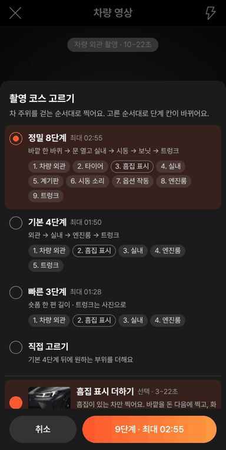
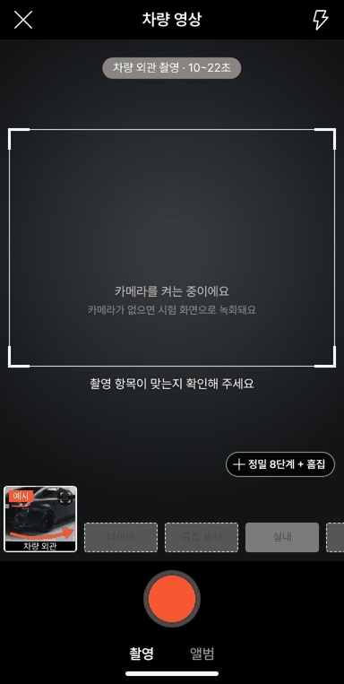
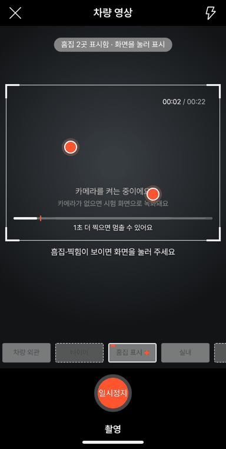

# PR #1017 — 58 촬영 코스 · 흠집 표시 선택

## ① 한 줄 요약
영상 촬영에서 딜러가 촬영 순서를 코스로 고를 수 있게 했습니다(정밀 8단계 · 기본 4단계 · 빠른 3단계 · 직접 고름). 흠집 표시는 어느 코스에서나 따로 켜고 끄는 선택 항목입니다.

## ② 과제 · 브랜치 · 커밋 · 상태
- 과제 ID: 없음(사용자 지시 「촬영 부위 순서를 정하면 좋겠는데 ~ 8개 3개」 → 「흠집표시는 선택으로 하자」)
- 브랜치·PR: `feat/shoot-course` → [#1017](https://github.com/bobaekimboae/bobaedream/pull/1017)
- 커밋: `697ab7e`
- 상태: 병합 · 배포 완료(v=`697ab7e`, 번들 `assets/main-CmD_jQGd.js`)
- 이번 병합으로 main에 함께 들어간 과제: 없음

## ③ 한 일
1. 칸 줄 위 오른쪽 버튼이 이제 지금 코스 이름(`기본 4단계`, `정밀 8단계 + 흠집` 등)을 보여 주고, 누르면 `촬영 코스` 시트가 열립니다.
2. 코스는 4가지입니다. 시트의 각 줄에는 촬영 순서가 번호 알약으로 보이고, `최대 mm:ss` 길이도 나옵니다.
   - 정밀 8단계: 외관 → 타이어 → 실내 → 계기판 → 시동 소리 → 옵션 작동 → 엔진룸 → 트렁크
   - 기본 4단계: 58과 같습니다.
   - 빠른 3단계: 외관 → 실내 → 엔진룸
   - 직접 고름: 추가 부위를 최대 4개까지 고릅니다.
3. 흠집 표시는 시트 아래 따로 둔 `흠집 표시 더하기 · 선택` 줄에서 켭니다. 기본은 꺼져 있습니다.
   - 켜면 타이어 다음에 들어가고, 타이어가 없는 코스에서는 외관 다음에 들어갑니다.
4. 이미 찍은 부위가 빠지는 코스는 고를 수 없게 막고 `찍은 부위가 빠져요`라고 알려 줍니다. 찍은 영상은 코스를 바꿔도 부위별로 그대로 남습니다.
5. 기본 화면은 그대로 기본 4단계입니다. `vstage=58` 비교 화면도 바뀌지 않았습니다.

## ④ 원본과 비교
58에는 코스가 없습니다. 기본 4단계 칸 위치는 58과 같습니다(4·106·207·308).

| 동작 점검(배포본 `697ab7e`) | 결과 |
| --- | --- |
| 기본 4칸 + 코스 버튼, 칸 위치 58과 같음 | 통과 |
| 버튼에 지금 코스 `기본 4단계` | 통과 |
| 코스 4개, 흠집은 기본 꺼짐 | 통과 |
| 빠른 3단계 순서 외관·실내·엔진룸 | 통과 |
| 정밀 순서 알약 8개 | 통과 |
| 흠집 켜면 `9단계 · 최대 02:55`, 타이어 다음에 흠집 | 통과 |
| 버튼 이름 `정밀 8단계 + 흠집` | 통과 |
| 흠집 단계 녹화 중 점 2개 → 미리보기 이동 → 등록 화면 `흠집 2곳` | 통과 |
| `vstage=58`은 4칸만 | 통과 |
| 콘솔 오류 | 0건 |

## ⑤ 검증
- `npm run verify:qf`: 통과
- 촬영 시험: 로컬과 배포본 모두 t13 18/18 통과. 기존 시험 t6 · t9 · t11 · t12도 통과했습니다.
- 콘솔 오류: 0건(384px 모바일)
- measure:qf 퀵필터 규격: 이번 작업은 `?register=shoot` 화면만 바꿨습니다. 그래서 다음 항목에는 영향이 없습니다.
  - 퀵필터 규격(레일 96 · 카드 80×72 · 이미지 56×28 · 트림 칩 32)
  - 개발 시안형 필터 선택지 303개 · 시트 마감 6 · 광고기간 「전체」

## ⑥ 원본과 다르게 남긴 것과 이유
- 코스 선택은 58에 없는 기능입니다. 다만 기본을 58과 같은 4단계로 두어 처음 화면은 58과 똑같습니다.
- 흠집 표시는 모든 차에 필요하지 않아 코스에 넣지 않았습니다. 따로 켜는 선택 항목으로 뒀습니다.

## ⑦ 못 한 것 · 다음에 할 것
- 마지막으로 고른 코스를 딜러별로 기억하는 기능은 아직 없습니다. 지금은 새로 열면 기본 4단계로 시작합니다.
- 정해 주실 것: 기본 코스를 정밀 8단계로 바꿀지 여부, 빠른 3단계에서 트렁크를 사진으로 대신할지 여부.

## ⑧ 확인 링크
- 촬영: https://bobaekimboae.github.io/bobaedream/?register=shoot&v=697ab7e
- 58 비교: https://bobaekimboae.github.io/bobaedream/?register=shoot&vstage=58&v=697ab7e
- 모바일: https://bobaekimboae.github.io/bobaedream/?qf=guazi&v=697ab7e
- PC: https://bobaekimboae.github.io/bobaedream/?qf=guazi&v=697ab7e&pc=1
