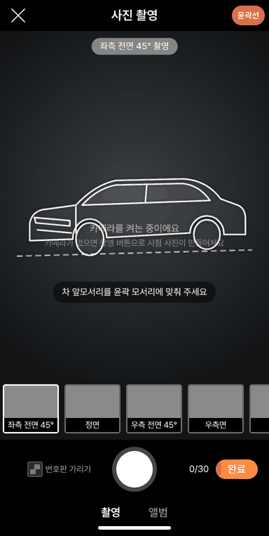
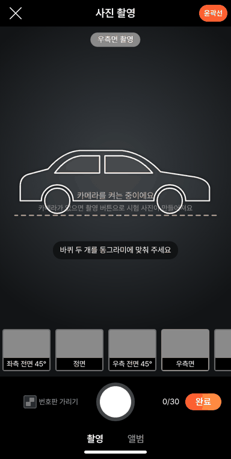
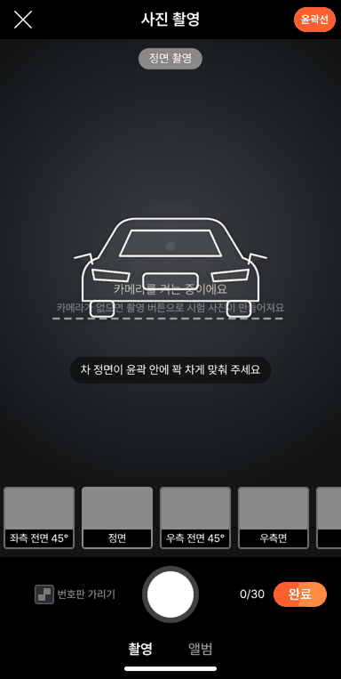
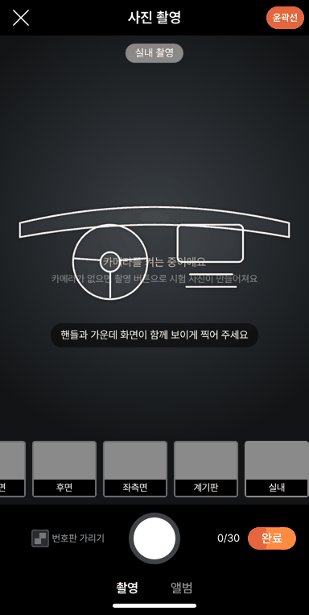

# PR #1019 — 58 사진 촬영 윤곽선 안내 시안

## ① 한 줄 요약
촬영 앱 벤치마킹(PhotoFairy · Car Studio AI · AOS)을 바탕으로, 사진 촬영 화면에 각도마다 반투명 차 윤곽선과 수평 안내를 까는 시안을 만들었습니다.

## ② 과제 · 브랜치 · 커밋 · 상태
- 과제 ID: 없음(사용자 지시 「촬영하는 영상 앱 찾아봐라 · 우리 벤치마킹하게」 → 「시안 만들어봐라」)
- 브랜치·PR: `feat/shoot-outline-guide` → [#1019](https://github.com/bobaekimboae/bobaedream/pull/1019)(`2f668b7`)
- 상태: 병합 · 배포 완료.
  - #1019 배포는 바로 뒤 다른 병합(`86ef30a`)에 밀려 취소됐고, `86ef30a` 배포에 함께 들어갔습니다.
  - 배포 v=`86ef30a`, 번들 `assets/main-DKUL_kUX.js`
- 이번 병합으로 main에 함께 들어간 과제: `86ef30a feat: align community header with main`(다른 작업)

## ③ 한 일
1. `?register=shoot&guide=on`에서만, 사진 촬영 화면 가운데(안내 알약 아래, 칸 줄 위)에 고른 칸의 흰 선 윤곽과 안내 문구를 깔았습니다.
2. 칸마다 윤곽이 바뀝니다.
   - 좌·우측 전면 45°: 3/4 차
   - 정면 · 후면
   - 좌·우측면: 바퀴 동그라미와 점선 바닥
   - 계기판, 실내(대시보드·핸들·가운데 화면), 엔진룸(열린 보닛), 트렁크(열린 트렁크)
   - 기타: 네 모서리 괄호
   - 우측 각도는 좌측 그림을 좌우로 뒤집습니다.
3. 휴대폰 기울기 센서가 있으면 외관 칸에 수평 막대를 보입니다. 기울기가 ±3° 안이면 초록 `수평이 맞았어요`가 뜹니다(Impel 실시간 안내 참고).
4. 머리줄 오른쪽 빈자리에 `윤곽선` 버튼을 두어 끄고 켤 수 있습니다.
5. 윤곽은 보배드림이 새로 그린 단순 선 그림입니다(`src/prototype/register/shoot/guides.tsx`). 파라미터가 없으면 58과 같은 화면 그대로입니다.

## ④ 원본과 비교
| 벤치마킹 앱 | 방식 | 시안 |
| --- | --- | --- |
| PhotoFairy | 반투명 차 윤곽 | 칸별 흰 선 윤곽 |
| Car Studio AI | 외관 8각도 윤곽 + 실내 | 외관 6칸 + 계기판 · 실내 · 엔진룸 · 트렁크 |
| AOS AutoCAPTURE | 고스트 가이드 | 같은 방식 |
| Impel | 수평·속도·방향 실시간 색 안내(영상) | 사진에 수평 막대만 |

| 동작 점검(배포본 `86ef30a`) | 결과 |
| --- | --- |
| `윤곽선` 버튼 켜짐, 첫 칸 3/4 윤곽 | 통과 |
| 윤곽이 안내 알약과 칸 줄 사이, 버튼이 화면 안 | 통과 |
| 칸 10개 윤곽 순서 맞음 | 통과 |
| 끄면 사라짐, 찍으면 다음 칸 윤곽 | 통과 |
| 기본 주소는 58 그대로 | 통과 |
| 콘솔 오류 | 0건 |

## ⑤ 검증
- `npm run verify:qf`: 통과
- 촬영 시험: t14(윤곽선) 9/9가 로컬과 배포본에서 모두 통과했습니다. 기존 시험 t6 · t9 · t13도 통과했습니다.
- 콘솔 오류: 0건(384px 모바일)
- measure:qf 퀵필터 규격: 이번 작업은 `?register=shoot` 화면만 바꿔 퀵필터(레일 96 · 카드 80×72 · 이미지 56×28 · 트림 칩 32)와 개발 시안형 필터 선택지 303개 · 시트 마감 6 · 광고기간 「전체」에 영향이 없습니다.

## ⑥ 원본과 다르게 남긴 것과 이유
- 58에는 윤곽선이 없습니다. 그래서 시안 주소(`guide=on`)에만 넣고 기본 화면은 58과 같게 두었습니다.
- 다른 앱의 윤곽 그림은 그 앱의 저작물이라 쓰지 않고 새로 그렸습니다. 세단 기준 그림이라 SUV·트럭은 모양이 다릅니다.
- 배경 바꾸기 · 반사 지우기 같은 AI 보정은 사진을 고치지 않는다는 원칙 때문에 넣지 않았습니다.

## ⑦ 못 한 것 · 다음에 할 것
- 차종(세단 · SUV · 트럭)별 윤곽, 외관 한 바퀴 영상의 실시간 속도·방향 안내, 한 바퀴 자동 종료는 다음 단계입니다.
- 아이폰은 기울기 센서를 쓰려면 권한 요청이 필요해 지금은 수평 막대가 안 보일 수 있습니다.

## ⑧ 확인 링크
- 시안: https://bobaekimboae.github.io/bobaedream/?register=shoot&guide=on&v=86ef30a
- 기본(58과 같음): https://bobaekimboae.github.io/bobaedream/?register=shoot&v=86ef30a
- 모바일: https://bobaekimboae.github.io/bobaedream/?qf=guazi&v=86ef30a
- PC: https://bobaekimboae.github.io/bobaedream/?qf=guazi&v=86ef30a&pc=1
