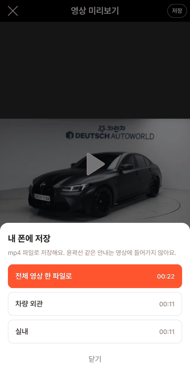
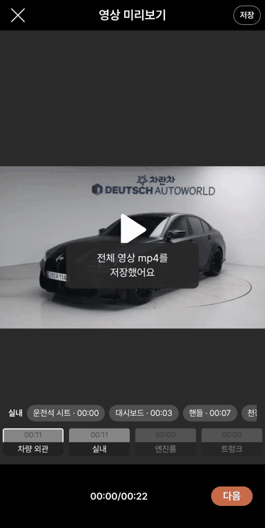

# PR #1021 — 58 촬영 영상 mp4 내 폰에 저장

## ① 한 줄 요약
영상 미리보기와 등록 화면의 영상 편집에 `저장` 버튼을 두었습니다. 찍은 영상을 전체 한 파일로, 또는 부위별로 mp4로 만들어 내 폰에 저장할 수 있습니다.

## ② 과제 · 브랜치 · 커밋 · 상태
- 과제 ID: 없음(사용자 지시 「촬영앱으로 만들어서 mp4 저장은 어떨까」 → 「배포해봐라」)
- 브랜치·PR: `feat/shoot-save-mp4` → [#1021](https://github.com/bobaekimboae/bobaedream/pull/1021)(`9df34d9`)
- 상태: 병합 · 배포 완료.
  - #1021 배포는 바로 뒤 다른 병합(`495ab99`)에 밀려 취소됐고, `495ab99` 배포에 함께 들어갔습니다.
  - 배포 v=`495ab99`, 번들 `assets/main-BtsSwlpD.js`
- 이번 병합으로 main에 함께 들어간 과제: `495ab99 style: flatten community board backgrounds`(다른 작업)

## ③ 한 일
1. 영상 미리보기와 등록 화면 영상 편집의 머리줄 오른쪽에 `저장` 알약을 두었습니다(윤곽선 버튼과 같은 모양).
2. 누르면 아래에서 `내 폰에 저장` 시트가 올라옵니다.
   - `전체 영상 한 파일로`(주황): 부위가 2개 이상일 때만 나옵니다.
   - 부위별 줄: 이름과 길이를 함께 보여 줍니다.
3. mp4는 브라우저 안에서 만듭니다(`save-mp4.ts`, 서버 없음).
   - 단계 영상들의 압축 설정이 같으면 다시 인코딩하지 않고 그대로 이어 붙입니다. 빠르고 화질 손실이 없습니다.
   - 설정이 다르거나 mp4에 넣을 수 없는 형식이면 H.264로 다시 인코딩합니다. 그동안 `○○ mp4로 만드는 중 N%`가 보입니다.
4. 휴대폰은 공유창을 엽니다. 아이폰은 「동영상 저장」을 누르면 사진첩에 들어갑니다. 공유창이 없으면 다운로드합니다.
5. 파일 이름은 영문입니다: `bobae_shoot_all_20261024_1931.mp4`.
6. 윤곽선 · 안내 글자 · 흠집 점은 영상에 넣지 않습니다. 카메라에 찍힌 그대로만 저장합니다.

## ④ 원본과 비교
58에는 내 폰에 저장하는 기능이 없습니다. 이번에 새로 더한 기능이라 비교 대상이 없습니다.

| 동작 점검(배포본 `495ab99`) | 결과 |
| --- | --- |
| 미리보기 저장 버튼 | 통과 |
| 시트 항목: 전체 + 외관 + 실내 + 닫기 | 통과 |
| 전체 저장 → `bobae_shoot_all_….mp4`, 22.6초 | 통과 |
| 외관만 저장 → `bobae_shoot_exterior_….mp4`, 11.3초 | 통과 |
| 저장 안내 문구 | 통과 |
| 콘솔 오류 | 0건 |
| 윤곽선 시험 t14 | 통과(회귀 없음) |

## ⑤ 검증
- `npm run verify:qf`: 통과
- 시험 t15(외관 11초 + 실내 11초 녹화 → 저장)를 로컬과 배포본에서 돌렸고, ffprobe로 받은 파일을 확인했습니다.
- 콘솔 오류: 0건(384px 모바일)
- measure:qf 퀵필터 규격: 이번 작업은 촬영 화면만 바꿔 퀵필터(레일 96 · 카드 80×72 · 이미지 56×28 · 트림 칩 32)와 개발 시안형 필터 선택지 303개 · 시트 마감 6 · 광고기간 「전체」에 영향이 없습니다.

## ⑥ 원본과 다르게 남긴 것과 이유
- 시험 환경의 크롬은 H.264로 녹화하지 못해 vp9로 녹화됐습니다. 그래서 저장 파일도 vp9 영상 + opus 소리 mp4로 나왔습니다.
- 실제 아이폰과 최신 크롬 안드로이드는 H.264 mp4로 녹화하므로 H.264 mp4로 저장될 것으로 봅니다.
- vp9 mp4가 아이폰에서 재생되는지는 실기기로 확인해야 합니다.

## ⑦ 못 한 것 · 다음에 할 것
- 사진첩에 바로 저장하기와 자동 백업은 앱(Flutter)에서 할 일입니다.
- 사진 묶음 저장(zip)은 넣지 않았습니다.
- 실기기 확인이 남았습니다: 아이폰 공유창 「동영상 저장」, 안드로이드 다운로드.

## ⑧ 확인 링크
- 촬영: https://bobaekimboae.github.io/bobaedream/?register=shoot&v=495ab99
- 윤곽선 시안: https://bobaekimboae.github.io/bobaedream/?register=shoot&guide=on&v=495ab99
- 모바일: https://bobaekimboae.github.io/bobaedream/?qf=guazi&v=495ab99
- PC: https://bobaekimboae.github.io/bobaedream/?qf=guazi&v=495ab99&pc=1
