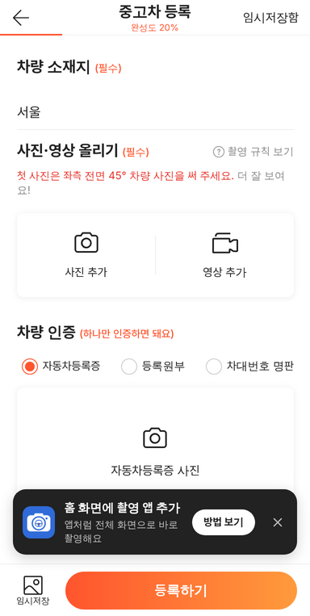

# PR #1023 보배드림 촬영 앱 — 홈 화면 설치형

## ① 한 줄 요약
58 촬영 화면을 `/shoot/` 주소로 따로 떼어, 폰 홈 화면에 아이콘으로 설치해 앱처럼 쓰게 만들었다.

## ② 과제 · 브랜치 · 커밋 · 상태
- 과제: 「촬영앱은」 → 「홈 화면 설치형 앱」 (과제 ID 없음)
- 브랜치: `feat/shoot-app`
- 커밋: `182907d` (squash)
- PR: https://github.com/bobaekimboae/bobaedream/pull/1023
- 상태: 병합 · 배포 완료, v=`182907d`
- 이번 병합으로 main에 함께 들어간 과제: 없음

## ③ 한 일
- `/shoot/` 독립 주소를 만들었다. `/bike/` · `/truck/`과 같은 방식이고, 화면은 `?register=shoot`과 같은 58 촬영 흐름이다(기존 주소도 그대로).
- 홈 화면 설치용 설정 파일(매니페스트)을 넣었다. 이름 `보배드림 촬영`, 세로 고정, 주소창 없는 전체 화면, 검정 바탕.
- 앱 아이콘을 새로 그렸다. 보배드림 파랑 바탕에 흰 카메라, 렌즈 안에 보배드림 핸들 심볼.
- 홈 화면에서 열지 않았으면 등록 화면 아래에 `홈 화면에 촬영 앱 추가` 안내 카드를 띄운다. 안드로이드 크롬은 `설치`로 바로 설치, 아이폰은 「Safari 공유 → 홈 화면에 추가」를 안내한다. ×를 누르면 다시 뜨지 않는다.
- 사이트 공용 서비스 워커(화면을 저장해 두지 않는 방식)를 등록해 설치 조건을 맞췄다.
- 빌드 설정(`vite.config.ts`)에 `/shoot/` 입구를 추가하고 런타임 잠금값을 갱신했다.

## ④ 원본과 비교
원본(58) 화면은 바꾸지 않았다. 앱 아이콘과 설치 안내만 새로 생겼다.

| 항목 | 전 | 후 |
|---|---|---|
| 촬영 화면 주소 | `?register=shoot`만 | `/shoot/` 추가(기존 유지) |
| 홈 화면 설치 | 보배드림 전체 앱만 | `보배드림 촬영` 따로 설치 |
| 설치 안내 | 없음 | 하단 검정 카드(촬영 중에는 숨김) |

 

## ⑤ 검증
- `npm run verify:qf` 통과(런타임 검사 · 타입 검사 · 빌드), `dist/client/shoot/` 생성 확인
- 배포본 자동 시험 9개 모두 통과: 제목 · 등록 화면 · 설치 안내 · 매니페스트와 아이콘 3개(200) · 서비스 워커 등록 · 촬영 화면에서 안내 숨김 · 404 없음 · 콘솔 오류 없음 · ×를 누르면 다시 뜨지 않음
- 퀵필터 화면은 바꾸지 않아 measure:qf는 생략했다.

## ⑥ 원본과 다르게 남긴 것
- 왼쪽 위 뒤로 버튼은 그대로 뒀다. 홈 화면 앱에서는 돌아갈 화면이 없어 눌러도 아무 일이 없다.

## ⑦ 못 한 것 · 다음에 할 것
- 실제 아이폰 · 안드로이드에 설치해 카메라와 mp4 저장이 되는지 확인해야 한다.
- 사진첩에 바로 저장하기와 자동 백업은 웹앱으로는 안 되고, Flutter 앱에서 해야 한다.

## ⑧ 확인 링크
- 촬영 앱: https://bobaekimboae.github.io/bobaedream/shoot/?v=182907d
- 모바일: https://bobaekimboae.github.io/bobaedream/?qf=guazi&v=182907d
- PC: https://bobaekimboae.github.io/bobaedream/?qf=guazi&v=182907d&pc=1
- 번들: `assets/shoot-By1uU-9h.js` (촬영 앱), `assets/main-BnwraYOd.js` (메인)
