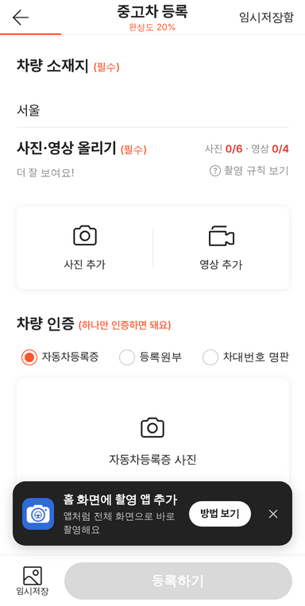
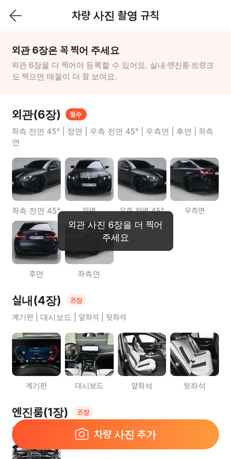
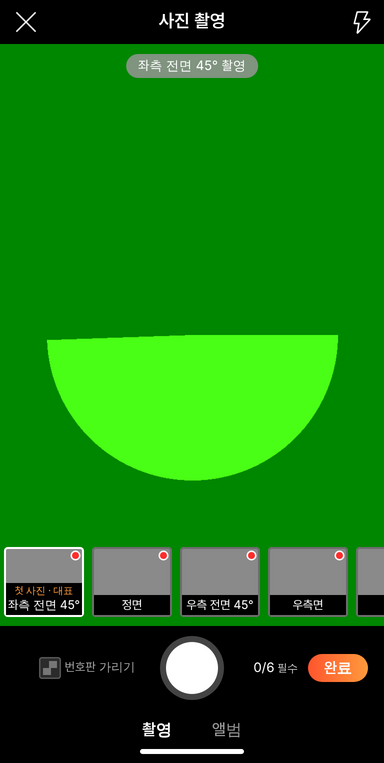
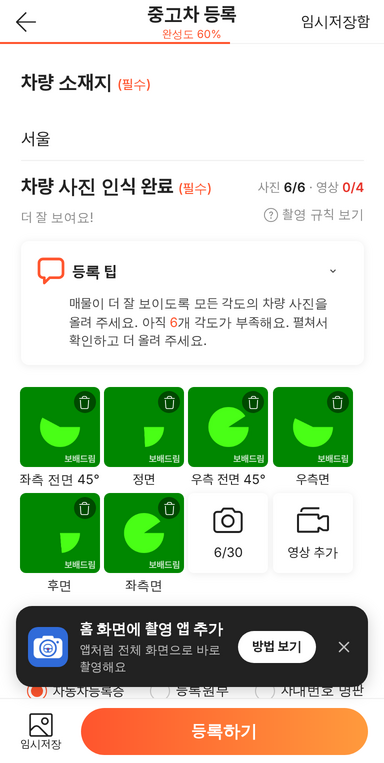
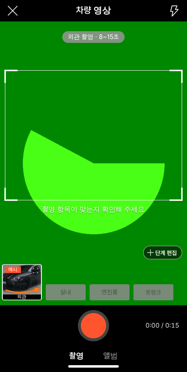
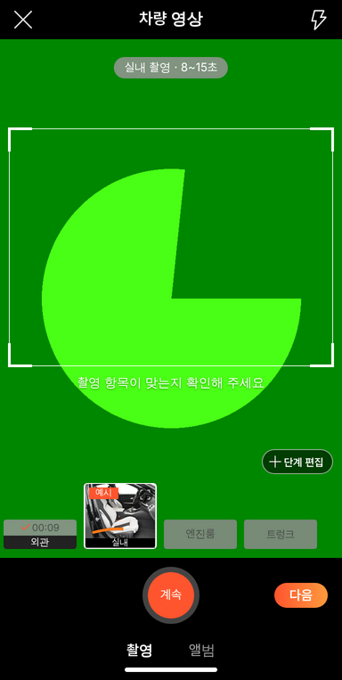

# PR #1026 58 촬영 항목 하나로 통일 (shoot-items.json)

## ① 한 줄 요약
촬영 규칙 · 사진 칸 · 영상 단계가 각자 다른 목록을 쓰던 것을 `shoot-items.json` 하나로 합쳐, 규칙대로 찍을 수 있게 했다.

## ② 과제 · 브랜치 · 커밋 · 상태
- 과제: 「중고차 등록 촬영 화면 촬영 항목 통일」 지시문 (과제 ID 없음)
- 브랜치: `feat/shoot-items-json`
- 커밋: `aebb91e` (squash)
- PR: https://github.com/bobaekimboae/bobaedream/pull/1026
- 상태: 병합 · 배포 완료, v=`aebb91e`
- 이번 병합으로 main에 함께 들어간 과제: PR #1025(영상 완성도 +8)는 먼저 병합됐고, 이번 PR의 새 완성도 계산이 그것을 대체한다.

## ③ 한 일
- 지시문의 「첨부 JSON」이 실제로는 오지 않았다. 그래서 노션 「등록 촬영 사진·영상 컨설팅 (58동성 비교)」과 기존 58 칸 순서를 바탕으로 `src/prototype/data/shoot-items.json`을 직접 만들었다. 그룹은 외관 필수 6 · 실내 권장 4 · 엔진룸 · 트렁크 권장 · 기타 선택이고, `photo` 6/30, `video.perStageSec` 8~15다.
- 규칙 레이어, 사진 칸, 영상 단계 칩, 윤곽선 안내, 앨범 우선 각도, 등록 팁 부족 각도를 모두 이 파일에서 읽게 했다. 화면 코드에서 항목 이름을 다 뺐다.
- 규칙 제목은 `외관 6장은 꼭 찍어 주세요`로 바꾸고, 그룹마다 필수·권장·선택 배지를 붙였다.
- 사진 칸은 필수 칸에 빨간 점을 찍고, 카운터를 `0/6 필수` → `6/30`으로 바꿨다. 첫 칸에 `첫 사진 · 대표` 안내를 넣고, 머리줄에 플래시 버튼을 넣었다.
- 메인 화면에 `사진 0/6 · 영상 0/4` 카운터를 넣고 완성도에 반영했다. 등록하기는 외관 6장 전에는 회색이고, 누르면 사진 칸으로 스크롤한다.
- 영상 화면은 `8~15초`, `0:00 / 0:15`, `단계 편집`, 완료 체크·길이를 넣었다.

## ④ 원본과 비교 · 동작 점검표
| 항목 | 전 | 후 |
|---|---|---|
| 규칙 항목 | 9개(사진 칸과 다름) | 13개 = 사진 칸 13개 |
| 사진 칸 | 12개 | 13개(이름·순서 규칙과 같음) |
| 영상 단계 | 차량 외관 · 실내 · 엔진룸 · 트렁크 | 외관 · 실내 · 엔진룸 · 트렁크(그룹 이름) |
| 단계 길이 | 10~22초 | 8~15초 |
| 사진 카운터 | 0/30 | 0/6 필수 → 6/30 |
| 등록하기 | 늘 켜짐 | 외관 6장 전 회색 |

     

## ⑤ 검증
- `npm run verify:qf` 통과(런타임 검사 · 타입 검사 · 빌드)
- 배포본 자동 시험 22개 모두 통과(`?register=shoot`과 `/shoot/` 둘 다):
  - 규칙 13 = 사진 칸 13(이름·순서 일치)
  - 영상 칩 = 그룹 이름 4개
  - 배지 필수·권장·권장·권장·선택
  - 빨간 점 6 → 0
  - 카운터 0/6 필수 → 6/30, 메인 6/6, 완성도 60%
  - 등록하기 회색 → 켜짐, 누름 안내
  - 8~15초 · 0:00 / 0:15 · 단계 편집 · 완료 체크
  - 플래시 버튼, 콘솔 오류 0
- 퀵필터 목록 화면은 바꾸지 않아 measure:qf는 생략했다.

## ⑥ 원본과 다르게 남긴 것
- 우측 전면 45° · 우측면 규칙 사진은 우측 실사가 없어 좌측 사진을 좌우로 뒤집어 썼다. 번호판 글자도 뒤집혀 보인다.
- 기타 규칙 사진은 점선 빈 칸이다.
- 실내는 사진 칸이 2개(계기판 · 실내)였지만 규칙 쪽 4개(계기판 · 대시보드 · 앞좌석 · 뒷좌석)에 맞췄다.
- 추가 촬영 단계(계기판 · 시동 소리 등)와 실내 세부 순서도 JSON으로 옮겼다. 추가 단계 길이 상한은 15초로 맞췄다.

## ⑦ 못 한 것 · 다음에 할 것
- 첨부 JSON이 오면 이 파일을 그대로 바꿔 넣으면 된다(화면 코드는 고치지 않아도 됨).
- 우측 실사 규칙 사진이 필요하다.

## ⑧ 확인 링크
- 촬영 화면: https://bobaekimboae.github.io/bobaedream/?register=shoot&v=aebb91e
- 촬영 앱: https://bobaekimboae.github.io/bobaedream/shoot/?v=aebb91e
- 모바일: https://bobaekimboae.github.io/bobaedream/?qf=guazi&v=aebb91e
- PC: https://bobaekimboae.github.io/bobaedream/?qf=guazi&v=aebb91e&pc=1
- 번들: `assets/main-CKm6XeiC.js`, `assets/shoot-CkjR9Yf4.js`
