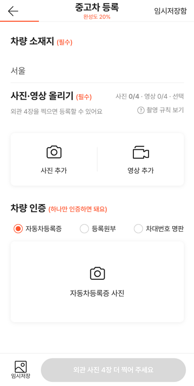
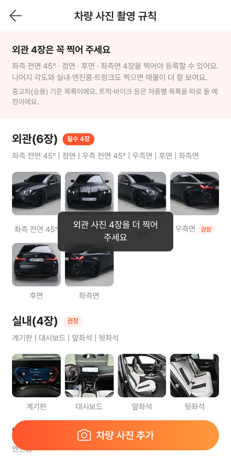
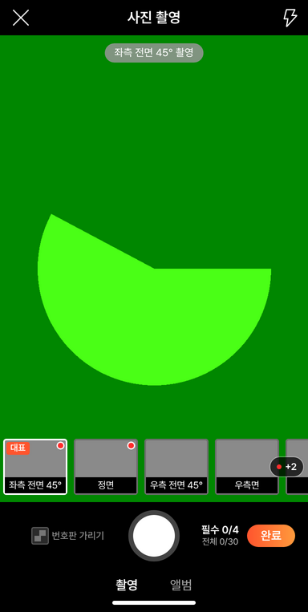
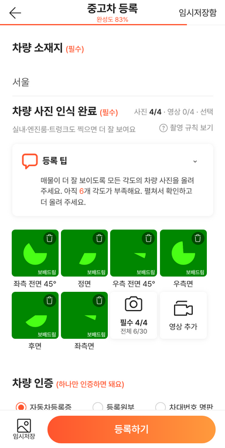
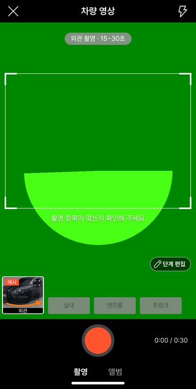

# PR #1028 · 58 촬영 컨설팅 2건 반영

## ① 한 줄 요약
Claude와 건설기계 마스터의 촬영 화면 컨설팅을 합친 판단대로, 필수 사진을 외관 4장으로 낮추고 영상은 선택으로 보이게 했으며 숫자·버튼·안내 문구를 다듬었다.

## ② 과제 · 브랜치 · 커밋 · PR · 상태
- 과제: 58 촬영 화면 컨설팅 반영(사용자 「수정해라」)
- 브랜치: `feat/shoot-consult-fixes` · 커밋 `6303864` → main `c240d44`
- PR: https://github.com/bobaekimboae/bobaedream/pull/1028
- 상태: 병합 · 배포 v=`c240d44`
- 함께 들어간 과제: 없음

## ③ 한 일
1. 필수 사진을 외관 4장(좌측 전면 45° · 정면 · 후면 · 좌측면)으로 바꾸고, 우측 2장은 권장으로 내렸다. 촬영 규칙에 `필수 4장` 배지, 우측 2장에 `권장` 딱지, 중고차(승용) 기준이라는 안내를 붙였다.
2. 영상은 `영상 0/4 · 선택`으로 회색 표시하고, 완성도에서 영상 비중을 40에서 10으로 줄였다(소재지 20 + 필수 사진 60 + 권장 사진 10 + 영상 10).
3. 사진 숫자는 처음엔 회색이고, 등록하기를 눌렀는데 모자랄 때만 빨간색이 된다. 회색 등록하기 버튼에 `외관 사진 N장 더 찍어 주세요`를 쓰고, 안내 문구를 `외관 4장을 찍으면 등록할 수 있어요`로 고쳤다.
4. 사진 카운터를 `필수 N/4 · 전체 N/30` 두 줄로 바꾸고, 첫 칸에 「대표」 딱지를 달았다. 칸 줄 오른쪽 밖에 남은 필수 칸이 있으면 `+N`을 띄우고, 누르면 그 칸으로 간다.
5. 영상 길이를 단계별로 나눴다(외관 15~30초, 실내 10~20초, 엔진룸 · 트렁크 8~15초). 실내 영상 순서는 사진 항목과 같은 계기판 → 대시보드 → 앞좌석 → 뒷좌석이다.
6. `단계 편집` 아이콘을 레딧 원본 연필로 바꾸고, 카메라 시험 문구를 권한 안내로 바꿨다. 우측 규칙 사진은 번호판을 흐리게 한 사본을 쓴다.

## ④ 원본과 비교
| 항목 | 작업 전 (aebb91e) | 작업 후 |
|---|---|---|
| 필수 사진 | 외관 6장 | 외관 4장 (우측 2장 권장) |
| 영상 표시 | `영상 0/4` 빨강 | `영상 0/4 · 선택` 회색 |
| 사진 6장 찍은 뒤 완성도 | 60% | 83% |
| 처음 숫자 색 | 빨강 | 회색 (누른 뒤 빨강) |
| 회색 등록하기 | `등록하기` | `외관 사진 4장 더 찍어 주세요` |
| 사진 카운터 | `0/6 필수` → `6/30` | `필수 0/4 · 전체 0/30` |
| 외관 영상 | 8~15초 | 15~30초 |
| 실내 영상 | 6부위 | 사진 항목과 같은 4부위 |

    

## ⑤ 검증
- verify:qf 통과 (런타임 확인 · TypeScript · 빌드)
- Playwright 384폭 24항목 통과, 콘솔 오류 0 (모바일)
- 배포본(v=c240d44)에서도 같은 24항목 통과. 번들 `assets/main-CMGCrgkr.js` · `assets/shoot-DtTN38Uj.js`
- 퀵필터·목록 화면은 바꾸지 않아 measure:qf 대상 없음

## ⑥ 원본과 다르게 남긴 것
- 임시저장은 메인 아래 `임시저장` 버튼으로 이미 언제든 할 수 있어 새로 만들지 않았다.
- 차종별 목록(트럭 · 바이크)은 구조만 표시(`vehicleType: "car"`)하고 목록은 아직 하나다.

## ⑦ 못 한 것 · 다음에 할 것
- 실제 휴대폰 카메라로 일시정지 · 다시 찍기 · 외관 30초 녹화 확인
- 트럭 · 바이크용 촬영 항목 목록

## ⑧ 확인 링크
- 촬영: https://bobaekimboae.github.io/bobaedream/?register=shoot&v=c240d44
- 촬영 앱: https://bobaekimboae.github.io/bobaedream/shoot/?v=c240d44
- 모바일: https://bobaekimboae.github.io/bobaedream/?qf=guazi&v=c240d44
- PC: https://bobaekimboae.github.io/bobaedream/?qf=guazi&v=c240d44&pc=1
