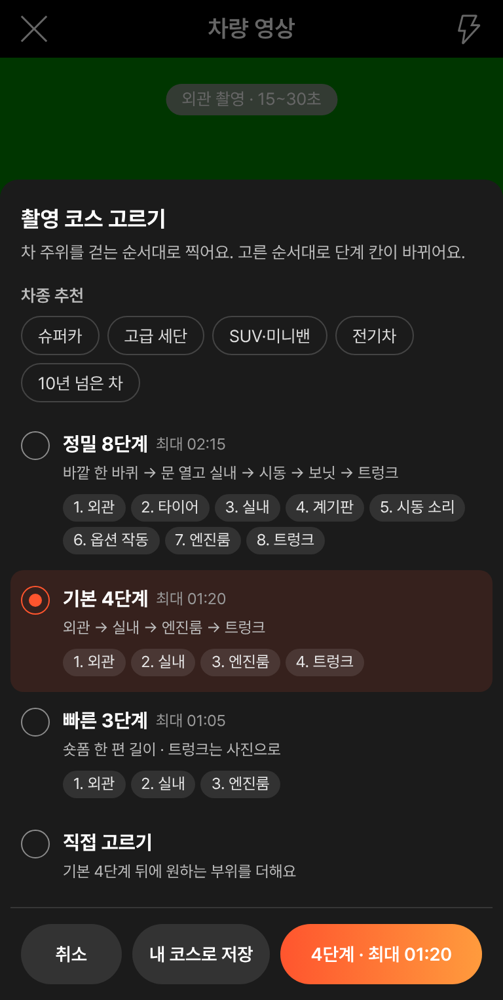
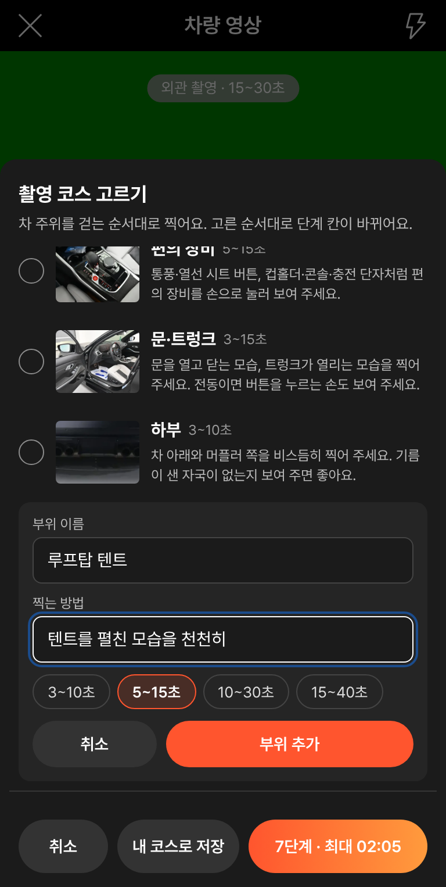
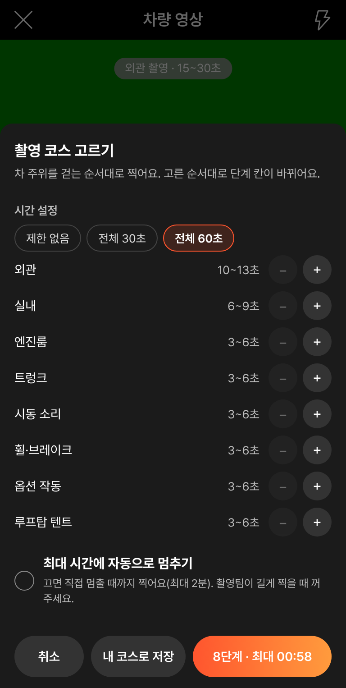
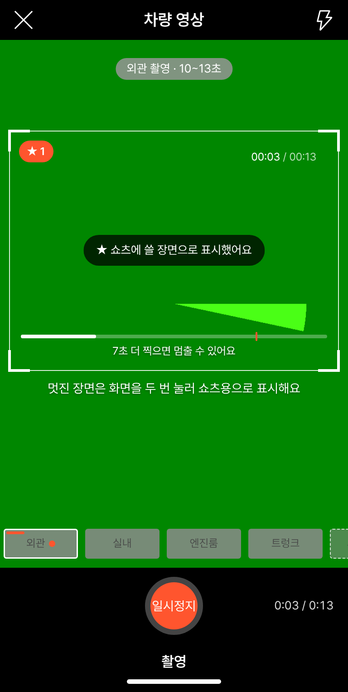
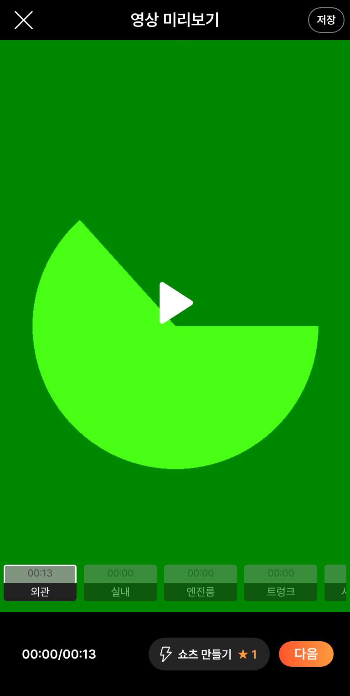
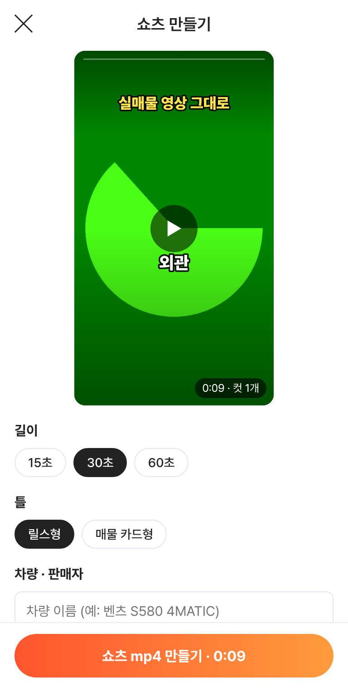
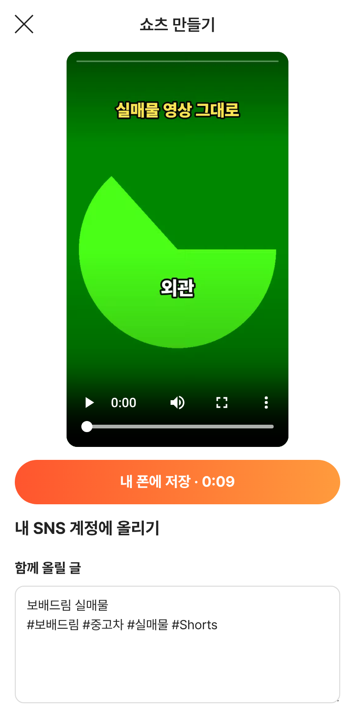

# PR #1031 · 촬영 쇼츠 키트 분리 주소 `?register=shootkit`

## ① 한 줄 요약
영상 촬영에 시트 단계 · 차종 추천 · 내 부위 · 시간 설정 · 쇼츠 장면 표시 · 자동 쇼츠를 넣고, 다른 작업창이 먼저 올린 `?register=shoot`(촬영 코스 · 숏폼 스튜디오)과 겹치지 않게 **`?register=shootkit`** 으로 분리했습니다.

## ② 과제 · 브랜치 · 커밋 · PR · 상태
- 과제: 「영상에서 시트 독립 촬영 · 부위 추천 · 직접 부위 생성 · 시간 설정 · 자동 쇼츠」 → 「반영해봐라」 → 「너 작업을 분리하자, 그 작업은 고유하게 두고 너 작업을 다른 주소로」
- PR #1031 `feat/shoot-kit-separate` → main `92a8ab0` (병합)
- PR #1032 `fix/shoot-inline-css` → main `5d072ed` (병합): #1031의 lazy 분리 때문에 배포본에서 두 촬영 화면이 안 뜨던 문제 고침
- PR #1033 `fix/preload-guard` → main `1db05df` (병합 · 배포 v=1db05df): 배포본에서 mp4 만들기가 멈추던 미리 불러오기 404 보정
- PR #1030 `feat/shoot-shorts-kit`: 다른 작업창 결과와 겹쳐 닫음(#1031로 대체)
- 함께 main에 있는 다른 과제: 다른 작업창의 촬영 코스·자동 쇼츠(26f3655c 등) · 숏폼 스튜디오(90ea6991) — 그대로 둠
- 번들: `assets/main-Cy_jDVrd.js` · 촬영 앱 `assets/shoot-CWYahNtw.js`

## ③ 한 일
- 추가 부위에 `시트`(운전석 → 조수석 → 뒷좌석 → 시트 기능 → 가죽 상태 순서 카드)를 넣고, 세부 순서 카드를 실내 말고도 쓸 수 있게 했습니다.
- 코스 고르기 맨 위에 `차종 추천` 5개(슈퍼카 · 고급 세단 · SUV·미니밴 · 전기차 · 10년 넘은 차): 누르면 추천 부위를 켜고 `추천` 딱지를 답니다.
- `＋ 내 부위 만들기`(이름 · 찍는 방법 · 시간 4가지), `시간 설정`(전체 30 · 60초 맞춤, 단계별 −/＋ 5초, 자동 멈춤 끄기 최대 2분), `내 코스로 저장`. 설정은 이 브라우저에만 기억합니다.
- 녹화 중 진동(최소 시간 · 자동 멈춤 3초 전), 화면을 두 번 누르면 쇼츠 장면으로 표시(`★ N`).
- 미리보기·영상 편집의 `쇼츠 만들기`: 부위별 영상에서 밝고 덜 흔들린 구간(또는 표시한 장면)을 골라 15 · 30 · 60초 mp4를 만들고, 내 폰 저장 · SNS 앱 공유로 이어집니다. 딜러 숏폼 제작기 그리기를 그대로 씁니다.
- 분리: 화면 파일 `register/shoot-kit/`, 데이터 `shoot-items-kit.json`. 두 화면 스타일은 화면이 떠 있을 때만 들어가서 섞이지 않습니다.

## ④ 원본과 비교
58에는 없는 보배드림 확장이라 원본 대조표는 없습니다. 아래 캡처는 배포본(v=1db05df) 384px입니다.

| 코스 · 추천 | 내 부위 | 시간 설정 | 장면 표시 |
|---|---|---|---|
|  |  |  |  |

| 미리보기 | 쇼츠 만들기 | 완성 |
|---|---|---|
|  |  |  |

## ⑤ 검증
- `npm run verify:qf` 통과(런타임 보호 파일 변경 없음 · TypeScript · 빌드).
- 배포본 `?register=shootkit` 자동 점검 20항목 통과: 추천 5개 · 추천 딱지 3 · 시트 단계 · 내 부위 추가 · 8단계 · 60초 맞춤(최대 0:58) · 자동 멈춤 끔 · 설정 기억 · 두 번 눌러 표시 · `★ 1` · 끈 안내 문구 · 미리보기 `쇼츠 만들기 ★ 1` · 쇼츠 컷 · 표시 장면 컷 · mp4 완성 · 콘솔 오류 0.
- 배포본 `?register=shootkit` 기존 PR #1028 점검 24항목 통과.
- 배포본 `?register=shoot` · `&studio=1`(다른 작업창 화면) 정상, 키트 스타일 0개, 콘솔 오류 0.
- 숏폼 스튜디오 모델 테스트 8개 통과.

## ⑥ 원본과 다르게 남긴 것과 이유
- 같은 기능을 다른 작업창이 `?register=shoot`에 먼저 배포해서, 지시대로 그 화면은 고치지 않고 이 키트를 다른 주소에 두었습니다. 두 화면이 서로 영향을 주지 않도록 공용으로 손댄 것은 ① 촬영 화면 스타일을 화면이 떠 있을 때만 넣는 한 줄, ② 미리보기 404 보정 한 줄입니다.
- 시간 맞춤은 비율 계산이라 합계가 목표보다 조금 짧을 수 있습니다(60초 → 0:58).

## ⑦ 못 한 것 · 다음에 할 것
- 실제 휴대폰에서 진동 · 두 번 누르기 · 시동 소리 살리기는 직접 확인하지 못했습니다(헤드리스 브라우저 확인).
- 두 촬영 화면(`shoot` · `shootkit`) 중 무엇을 남길지 정해 주시면 하나로 합치겠습니다.
- 미리보기 404 보정은 임시 처리입니다. 근본 해결은 배포 설정의 기본 경로 지정(보호 파일 `vite.config.ts`)이 필요합니다.

## ⑧ 확인 링크
- 쇼츠 키트: https://bobaekimboae.github.io/bobaedream/?register=shootkit&v=1db05df
- 다른 작업창 촬영: https://bobaekimboae.github.io/bobaedream/?register=shoot&v=1db05df · 숏폼 스튜디오 `&studio=1`
- 모바일: https://bobaekimboae.github.io/bobaedream/?qf=guazi&v=1db05df
- PC: https://bobaekimboae.github.io/bobaedream/?qf=guazi&v=1db05df&pc=1
