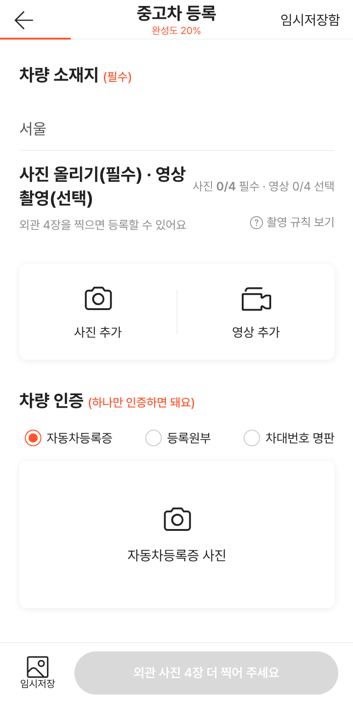
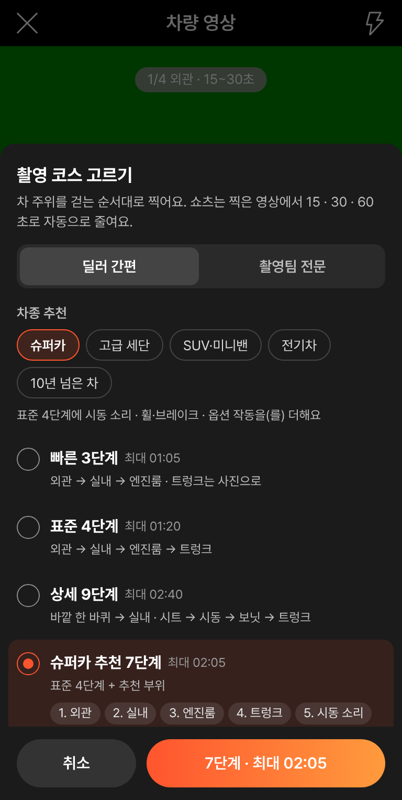
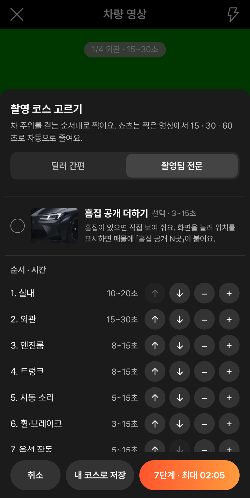
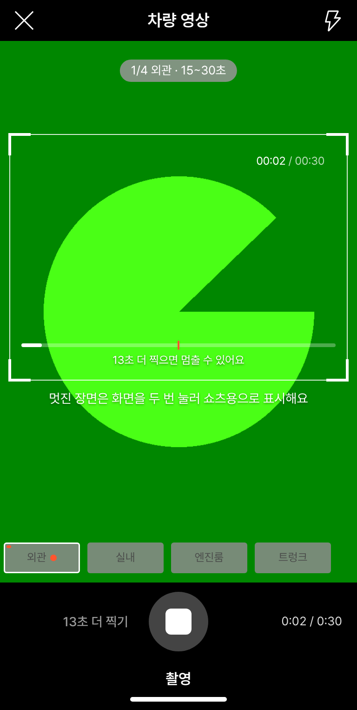
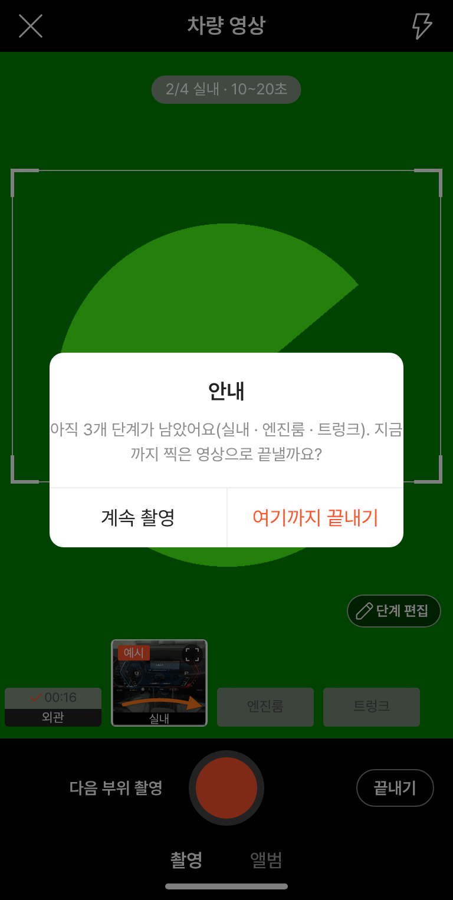
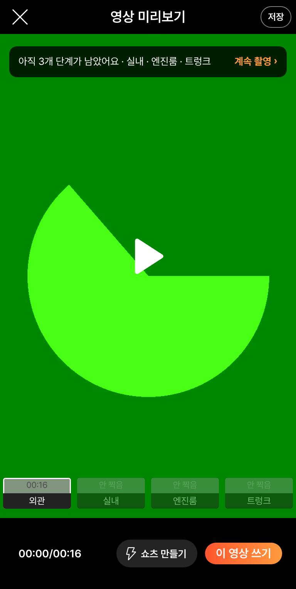
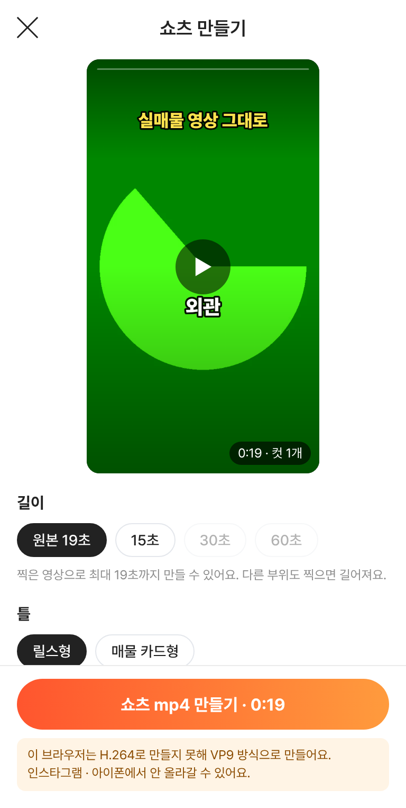
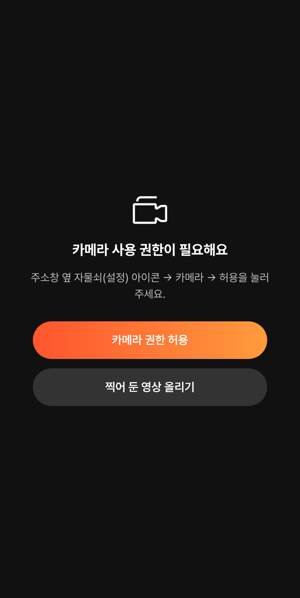

# PR #1035 — 촬영 쇼츠 키트 컨설팅 4건 반영

## ① 한 줄 요약
`?register=shootkit`에 컨설팅 4건(자체 · 시안 작업 마스터 · 외부 · 건설기계 마스터)을 합친 우선순위를 반영했다. 바뀐 것: 녹화 버튼 이름, 끝내기 전 누락 확인, 카메라 권한 화면, 딜러 간편/촬영팀 전문 코스, 찍은 분량에 맞춘 쇼츠 길이.

## ② 과제 · 브랜치 · 커밋 · PR · 상태
- 과제 ID: 없음(사용자 지시 「수정해라」)
- 브랜치: `feat/shootkit-consult`
- 커밋: `cb48467b` → main `c1acabd`
- PR: https://github.com/bobaekimboae/bobaedream/pull/1035
- 상태: 병합 · 배포 완료, v=`c1acabd`
- 번들: `assets/main-2lvsLHVs.js`, 촬영 앱 `assets/shoot-hZRK9W2y.js`
- 이번 병합으로 main에 함께 들어간 과제: 없음

## ③ 한 일
- 녹화 버튼 왼쪽에 지금 할 일을 글자로 보여 준다: 촬영 시작 · N초 더 찍기 · 촬영 완료 · 다음 부위 촬영 · 다시 찍기. 오른쪽은 보조 버튼 `끝내기`다.
- 안 찍은 단계가 남은 채 끝내면 「아직 N개 단계가 남았어요」로 한 번 더 묻는다. 미리보기에서도 안 찍은 칩에 `안 찍음`을 표시하고, `계속 촬영` 줄을 둔다.
- 카메라 권한이 없으면 전용 화면을 띄운다: `카메라 권한 허용`(다시 묻기)과 `찍어 둔 영상 올리기`. 안내 문구는 지금 쓰는 환경(홈 화면 앱인지 브라우저인지)에 맞춘 한 가지만 보여 준다.
- 코스 고르기를 `딜러 간편 / 촬영팀 전문` 두 화면으로 나눴다.
  - 간편: 빠른 3 · 표준 4 · 상세 9단계와 차종 추천.
  - 전문: 직접 고르기, 내 부위 만들기, 순서·시간 조정, 자동 멈춤, 내 코스로 저장.
- 쇼츠 길이는 `원본 N초 · 15 · 30 · 60초` 중 고른다. 찍은 분량으로 못 채우는 길이는 막고, 같은 장면을 되풀이해 늘리지 않는다.
  - 표시한 장면은 `★ 빼기`로 뺄 수 있다.
  - H.264로 못 만드는 브라우저면 경고를 띄운다.
  - SNS 직접 연결은 `고급`으로 접었다.
- 등록 화면 문구를 바꿨다: `사진 올리기(필수) · 영상 촬영(선택)`, `흠집 공개 N곳`.

## ④ 원본과 비교
| 영역 | 작업 전 | 작업 후 |
|---|---|---|
| 녹화 버튼 | 아이콘만, 다음 할 일 불분명 | 왼쪽에 할 일 글자 + 오른쪽 끝내기 |
| 누락 단계 | 그냥 끝남 | 끝내기 · 미리보기 · 쇼츠 전 확인 |
| 권한 거부 | 검은 화면 + 긴 안내 | 전용 화면 · 버튼 2개 · 환경별 안내 1개 |
| 코스 | 한 화면에 모든 설정 | 간편 / 전문 분리 |
| 쇼츠 길이 | 15·30·60 고정(분량 부족해도 선택) | 원본 + 가능한 길이만 |

| 메인 | 간편 코스 | 전문 코스 | 녹화 중 |
|---|---|---|---|
|  |  |  |  |

| 끝내기 확인 | 미리보기 | 쇼츠 | 권한 화면 |
|---|---|---|---|
|  |  |  |  |

## ⑤ 검증
- `npm run verify:qf` 통과(runtime check · TypeScript · Vite build)
- 동작 점검(배포본 v=c1acabd): t22 29개 · t21k 19개 · t20k 24개 모두 통과
- 콘솔 오류: PC · 모바일 0
- `?register=shoot`(다른 작업창 화면)과 `&studio=1` 정상 확인
- 퀵필터 규격(레일 96 · 카드 80×72 · 이미지 56×28 · 트림 칩 32 · 선택지 303개 · 시트 마감 6 · 광고기간 「전체」)은 이번에 손대지 않은 영역이라 바뀌지 않았다.

## ⑥ 원본과 다르게 남긴 것과 이유
- 배경음악 · 번호판 흐림은 넣지 않았다(사진·영상을 고치지 않는다는 원칙).
- 결과 영상에 「외관」이 두 번 보이는 것은 시험용 가짜 카메라 화면 글자다. 실제 카메라에는 없다.
- 촬영 쪽 `전체 30 · 60초` 목표 길이는 쇼츠 길이와 헷갈려서 뺐다.

## ⑦ 못 한 것 · 다음에 할 것
- 진동과 화면 두 번 누르기는 실제 폰에서 확인해야 한다.
- preload 가드는 임시 처치다. 근본 수정은 보호 파일 `vite.config.ts`를 고쳐야 해서 지시가 필요하다.
- `?register=shoot`과 `?register=shootkit`을 합칠지는 아직 정하지 않았다.

## ⑧ 확인 링크
- 키트: https://bobaekimboae.github.io/bobaedream/?register=shootkit&v=c1acabd
- 촬영(기존): https://bobaekimboae.github.io/bobaedream/?register=shoot&v=c1acabd
- 모바일: https://bobaekimboae.github.io/bobaedream/?qf=guazi&v=c1acabd
- PC: https://bobaekimboae.github.io/bobaedream/?qf=guazi&v=c1acabd&pc=1
