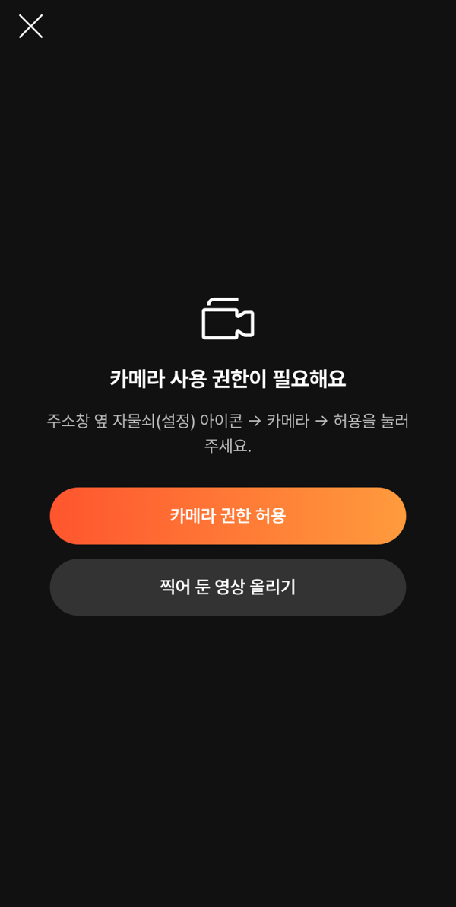
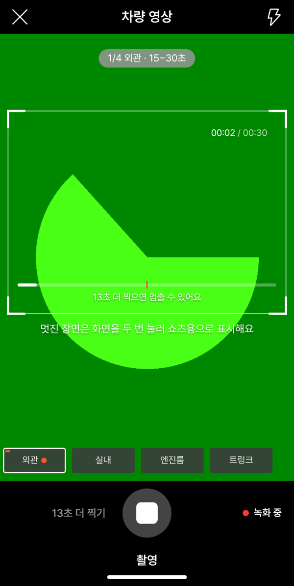
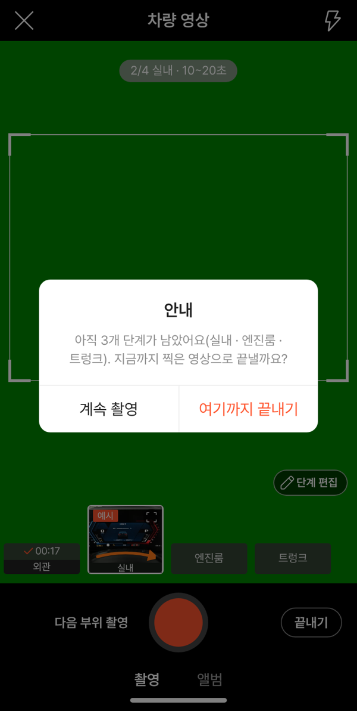
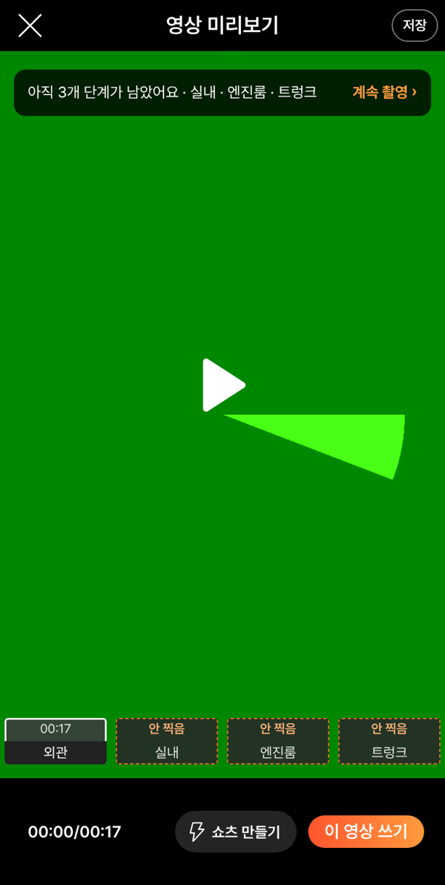
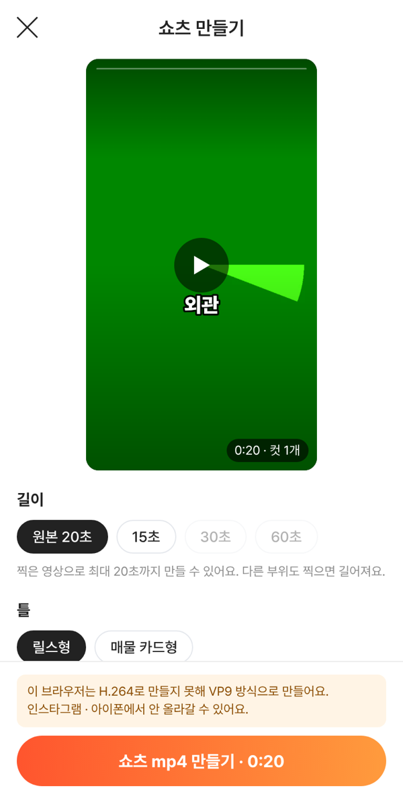

# PR #1037 — 촬영 쇼츠 키트 배포본 컨설팅 반영

## ① 한 줄 요약
배포본(v=c1acabd)을 폭 384에서 다시 써 보고 찾은 오류 3건과 개선 5건을 `?register=shootkit`에 고쳤다.

## ② 과제 · 브랜치 · 커밋 · PR · 상태
- 과제 ID: 없음(사용자 지시 「컨설팅」 → 「수정해」)
- 브랜치: `fix/shootkit-consult2`
- 커밋: `94a48742` → main `1727e9d`
- PR: https://github.com/bobaekimboae/bobaedream/pull/1037
- 상태: 병합 · 배포 완료, v=`1727e9d`
- 번들: `assets/main-D9UfGtPE.js`, 촬영 앱 `assets/shoot-hZRK9W2y.js`(바뀌지 않음)
- 이번 병합으로 main에 함께 들어간 과제: 커뮤니티 홈 탭(2451adea), 해외 자동차 뉴스 갱신 2건(다른 작업창)

## ③ 한 일
- 확인창 본문에 좌우 여백 20을 넣었다. 글자가 창 가장자리에 붙던 문제다.
- 카메라 권한 화면 왼쪽 위에 닫기 X를 두었다. 누르면 등록 화면으로 돌아간다. 전에는 빠져나갈 방법이 없었다.
- 코스 창 설명에서 지난 규칙(「15·30·60초로 자동으로 줄여요」)을 뺐다.
- 쇼츠 첫 화면 문구와 카드형 차명은 딜러가 쓴 것만 넣는다. 자동으로 들어가던 「○○ 실매물 영상」 · 「보배드림 실매물」은 없앴다.
- 녹화 중 아래 오른쪽에 있던 시간(틀 안과 중복)을 지우고, 그 자리에 깜빡이는 빨간 점과 `녹화 중`을 넣었다.
- 단계 칩 글자를 밝게 했다. 미리보기의 안 찍은 단계는 주황 점선과 주황 `안 찍음`으로 보인다.
- 전문 코스 순서 줄에서 ↑↓와 −＋ 사이를 20으로 넓혔다. 쇼츠 H.264 경고는 만들기 버튼 위로 옮겼다.

## ④ 원본과 비교(작업 전 → 후)
| 영역 | 작업 전 | 작업 후 |
|---|---|---|
| 확인창 본문 | 좌우 여백 0 | 20 |
| 권한 화면 | 닫기 없음 | 왼쪽 위 X |
| 녹화 중 시간 | 3곳(틀 안 · 아래 오른쪽 · 막대) | 틀 안 · 막대, 아래 오른쪽은 `● 녹화 중` |
| 단계 칩 글자 대비 | 회색 바탕에 회색 글자(약 1.6:1) | `#E6E6E6`(약 8:1) |
| 안 찍은 단계 | 투명도 0.45로 흐리게 | 투명도 1 · 주황 점선 |
| 순서 버튼 ↓ → − | 6 | 20 |
| 쇼츠 첫 화면 | 비워도 「실매물 영상」 자동 | 비우면 문구 없음 |

| 권한 화면 | 녹화 중 | 끝내기 확인 | 미리보기 | 쇼츠 |
|---|---|---|---|---|
|  |  |  |  |  |

## ⑤ 검증
- `npm run verify:qf` 통과
- 새 점검 t23 10개 통과(로컬 · 배포본 v=1727e9d)
- 기존 점검 t22 29 · t21k 19 · t20k 24 통과. t20k의 `0:00 / 0:30` 항목은 이번 변경에 맞게 「아래 시간 자리 비움」으로 바꿨다.
- 콘솔 오류: 모바일 `?qf=guazi` 0 · PC `&pc=1` 0 · `?register=shoot` 0
- 퀵필터 규격(레일 96 · 카드 80×72 · 이미지 56×28 · 트림 칩 32 · 선택지 303 · 시트 마감 6 · 광고기간 「전체」)은 손대지 않은 영역이라 바뀌지 않았다.

## ⑥ 원본과 다르게 남긴 것과 이유
- 컨설팅 8번(흠집 공개 줄이 순서 목록을 가림)은 다시 확인해 보니 창이 스크롤된 상태를 잘못 읽은 것이었다. 순서는 이미 `코스 → 내 부위 → 흠집 공개 → 순서 · 시간`이라 바꾸지 않았다.
- `?register=shootkit&vstage=58`(58 원본 재현)은 단계 칩 색을 바꾸지 않았다(`is-kit`일 때만 적용).

## ⑦ 못 한 것 · 다음에 할 것
- 진동과 화면 두 번 누르기는 실제 폰에서 확인해야 한다.
- preload 가드는 임시 처치다. 근본 수정에는 `vite.config.ts`를 고쳐야 한다.
- shoot · shootkit 합칠지 결정이 필요하다.

## ⑧ 확인 링크
- 키트: https://bobaekimboae.github.io/bobaedream/?register=shootkit&v=1727e9d
- 촬영(기존): https://bobaekimboae.github.io/bobaedream/?register=shoot&v=1727e9d
- 모바일: https://bobaekimboae.github.io/bobaedream/?qf=guazi&v=1727e9d
- PC: https://bobaekimboae.github.io/bobaedream/?qf=guazi&v=1727e9d&pc=1
