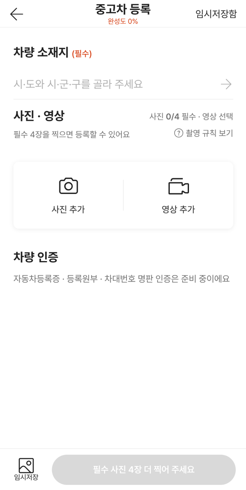
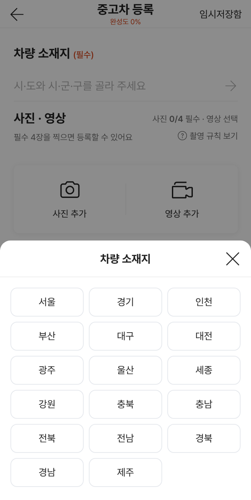
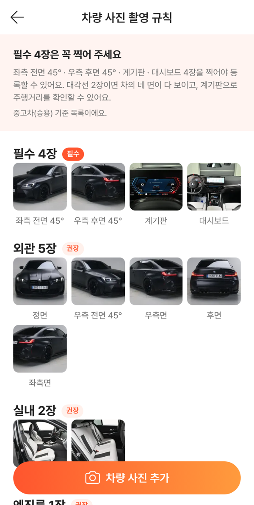
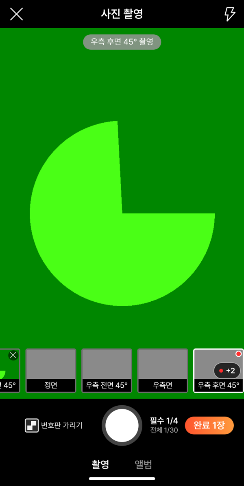
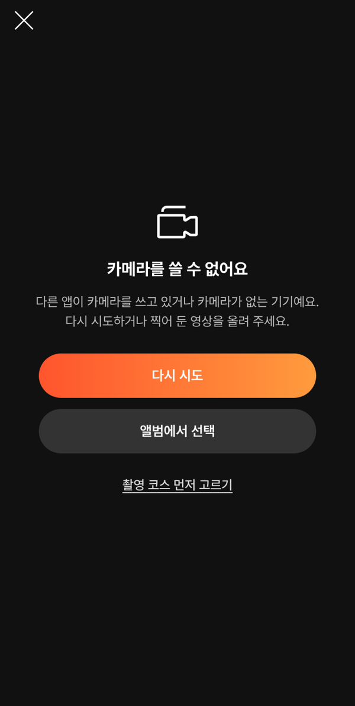
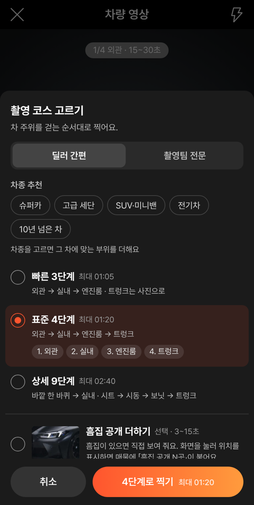
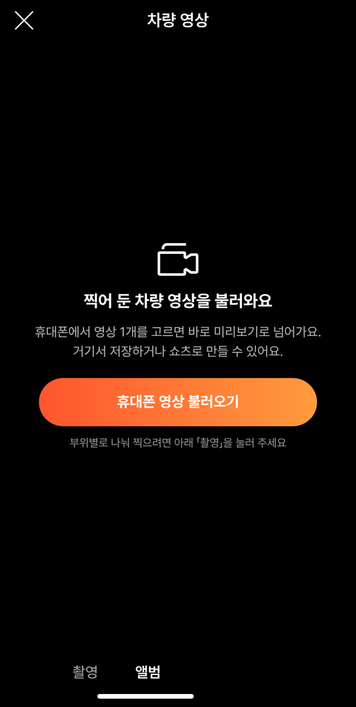

# PR #1039 — 촬영 쇼츠 키트 컨설팅 6건 통합 반영

## ① 한 줄 요약
컨설팅 6건을 지금 코드와 대조해 이미 있거나 맞지 않는 지적은 빼고, 필수 4장 구성 · 소재지 선택 · 카메라 실패 대처 등 남은 것을 판단해 고쳤다.

## ② 과제 · 브랜치 · 커밋 · PR · 상태
- 과제 ID: 없음(사용자 지시 「니가 판단해서 수정해라」)
- 브랜치: `fix/shootkit-consult3`
- 커밋: `4f222c58` → main `dbc4b1f`
- PR: https://github.com/bobaekimboae/bobaedream/pull/1039
- 상태: 병합 · 배포 완료, v=`dbc4b1f`
- 번들: `assets/main-Cgpndepr.js`, 촬영 앱 `assets/shoot-hZRK9W2y.js`(바뀌지 않음)
- 이번 병합으로 main에 함께 들어간 과제: PR #1037 보고서(#1038)

## ③ 한 일
- 필수 사진 4장을 좌측 전면 45° · 우측 후면 45° · 계기판 · 대시보드로 바꿨다. 대각 2장이면 차의 네 면이 다 보이고, 계기판으로 주행거리를 확인할 수 있다.
  - 외관은 차를 시계 방향으로 도는 순서로 바꿨다.
  - 우측 후면 45° 예시 사진은 기존 M3 좌측 뒤 사진을 좌우로 뒤집고 번호판을 흐리게 만든 사본이다.
- 촬영 규칙 화면 맨 위에 `필수 4장`을 모으고, 그룹에는 나머지(권장·선택)만 둔다.
- 등록 화면:
  - 제목을 `사진 · 영상`으로 줄이고, 영상은 찍기 전에 숫자 없이 `선택`만 보여 준다.
  - 차량 소재지는 기본값 없이 시·도 → 시·군·구 시트에서 고른다.
  - 완성도는 사용자가 한 것만 세서 0%부터 시작한다.
  - 동작하지 않던 차량 인증 버튼 3개는 「준비 중」 한 줄로 줄였다.
  - 작은 글자 버튼의 터치 영역을 44로 넓혔다. 회색·주황 작은 글자는 더 진하게 해 대비를 높였다.
- 사진 촬영:
  - 번호판 가리기가 기본으로 켜져 있다.
  - 0장이면 완료를 막고, 1장부터는 `완료 N장`으로 보여 준다.
  - 한 장 찍으면 남은 필수 칸으로 먼저 넘어간다.
- 영상 촬영:
  - 카메라 권한을 거절했거나, 카메라가 없거나 5초 넘게 화면이 안 뜨면 덮는 화면을 띄운다.
  - 그 화면에서 다시 시도 · 앨범 · `촬영 코스 먼저 고르기`를 고를 수 있고, Esc로 닫으며 포커스는 그 화면 안에서만 돈다.
  - 코스 버튼은 `4단계로 찍기`, 전문 모드 저장 버튼은 `코스 저장`으로 바꿨다.
  - 영상 앨범 빈 화면에 큰 불러오기 버튼과 다음 할 일 안내를 넣었다.
- 쇼츠: 길이·틀·만들기를 먼저 보여 주고, 자막·정보는 `자막 · 정보 고치기`로 접었다.

## ④ 원본과 비교(작업 전 → 후)
| 영역 | 작업 전 | 작업 후 |
|---|---|---|
| 필수 사진 | 좌측 전면 45° · 정면 · 후면 · 좌측면(오른쪽 면 · 주행거리 없음) | 좌측 전면 45° · 우측 후면 45° · 계기판 · 대시보드 |
| 소재지 | 「서울」 고정 | 기본값 없음 · 시·도 → 시·군·구 |
| 처음 완성도 | 20%(아무것도 안 해도) | 0% |
| 권한 거절 · 카메라 없음 | 거절만 안내, 코스 못 고름, Esc 안 됨 | 둘 다 안내 · 코스 먼저 고르기 · Esc · 포커스 가두기 |
| 코스 확정 버튼 | `4단계 · 최대 01:20` | `4단계로 찍기 최대 01:20` |
| 번호판 가리기 | 꺼짐 | 켜짐 |
| 사진 0장 완료 | 눌림 | 막힘 |
| 작은 글자 대비 | 회색 3.4:1 · 주황 3.2:1 | 5.0:1 · 4.6:1 |

| 등록 화면 | 소재지 | 촬영 규칙 | 사진 촬영 |
|---|---|---|---|
|  |  |  |  |

| 카메라 없음 | 코스 먼저 고르기 | 영상 앨범 |
|---|---|---|
|  |  |  |

## ⑤ 검증
- `npm run verify:qf` 통과
- 새 점검 t24 28개 · t25 6개 통과(로컬 · 배포본 v=dbc4b1f)
- 기존 점검 t22 29 · t23 10 · t21k 19 · t20k 25 통과. 바뀐 규칙(필수 4장 구성 · 문구 · 소재지 · 자막 접기)에 맞춰 기대값을 고쳤다.
- 콘솔 오류: 모바일 `?qf=guazi` 0 · PC `&pc=1` 0 · `?register=shoot` 0
- 퀵필터 규격(레일 96 · 카드 80×72 · 이미지 56×28 · 트림 칩 32 · 선택지 303 · 시트 마감 6 · 광고기간 「전체」)은 손대지 않은 영역이다.

## ⑥ 원본과 다르게 남긴 것과 이유
- **카메라 권한 묻는 시점:** 화면을 열 때 묻는 지금 방식을 유지했다. 각도를 맞추려면 찍기 전부터 화면이 보여야 하고, 58도 같다. 대신 권한이 없어도 코스를 먼저 고를 수 있게 했다.
- **빠른 3단계를 60초 이하로:** 받아들이지 않았다. 찍는 시간과 쇼츠 길이는 따로다.
- **쇼츠 배경음악 · 번호판 흐림:** 원본 그대로 쓰는 원칙이라 넣지 않았다.
- **시안 안내 문구 숨기기(개발 표시):** 하지 않았다. 「실제로 등록하지 않아요」는 사실이라 검수자에게 그대로 보이는 게 맞다.
- **AI 문구 · 숏폼 스튜디오 진입 통합:** 다른 작업창의 `?register=shoot` 화면 이야기라 손대지 않았다.
- **58 원본 재현 화면(`&vstage=58`):** 소재지 「서울」, 번호판 꺼짐, 원문을 그대로 두고 유지한다.
- **소재지 범위:** 시·군·구까지 받는다. 매물 카드 위치 표기가 「시도 구군」이라서다.

## ⑦ 못 한 것 · 다음에 할 것
- 실제 폰에서 권한 거절 → 설정 → 복귀, 진동, 화면 두 번 누르기를 확인해야 한다.
- 우측 후면 45° 예시 사진은 좌측 사진을 뒤집은 사본이다. 실제 우측 후면 사진이 오면 바꾼다.
- 사진 화면 윤곽선 안내(`&guide=on`)의 우측 후면 윤곽은 3/4 앞 윤곽을 뒤집어 쓴 임시값이다.
- 제목 단계(H1 → H2) 정리는 스타일 영향이 커서 이번에 하지 않았다.
- preload 가드 근본 수정(`vite.config.ts`)과 shoot · shootkit 합치기 결정이 남아 있다.

## ⑧ 확인 링크
- 키트: https://bobaekimboae.github.io/bobaedream/?register=shootkit&v=dbc4b1f
- 촬영(기존): https://bobaekimboae.github.io/bobaedream/?register=shoot&v=dbc4b1f
- 모바일: https://bobaekimboae.github.io/bobaedream/?qf=guazi&v=dbc4b1f
- PC: https://bobaekimboae.github.io/bobaedream/?qf=guazi&v=dbc4b1f&pc=1
