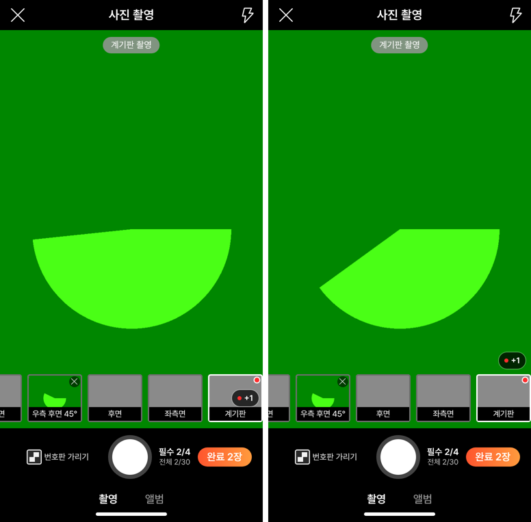
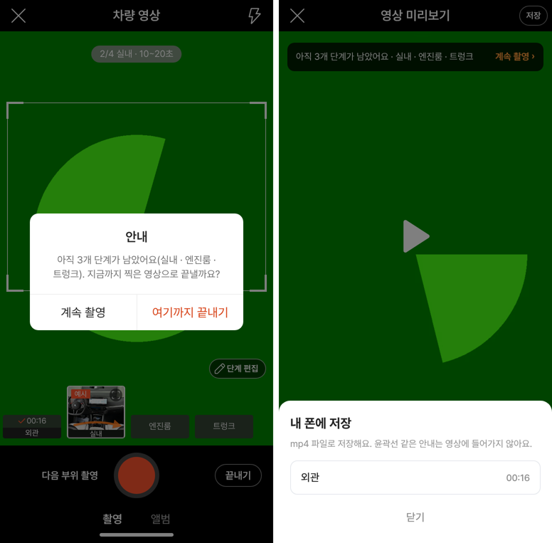

# PR #1041 촬영 쇼츠 키트 최종 크로스체크

## ① 한 줄 요약
제가 만든 촬영 쇼츠 키트(`?register=shootkit`) 배포본 dbc4b1f를 처음부터 끝까지 다시 써 보고 4건을 찾아 3건은 고쳐 배포했고, 1건(배포 설정)은 PR #1042로 따로 올려 승인을 기다립니다.

## ② 과제 · 브랜치 · 커밋 · 상태
- 과제 ID: 없음(사용자 지시 「너가 만든건 최종 크로스체크해라」)
- 브랜치: `fix/shootkit-crosscheck` → main 4df026d (PR https://github.com/bobaekimboae/bobaedream/pull/1041, 병합 · 배포 v=4df026d)
- 따로 올린 PR: https://github.com/bobaekimboae/bobaedream/pull/1042 (`fix/pages-preload-path`, 배포 설정 1줄, 미병합 — 승인 필요)
- 이번 병합으로 main에 함께 들어간 과제: `data: refresh overseas automotive news`(다른 작업창)

## ③ 한 일
- 자동 시험 6묶음 117개를 배포본에 다시 돌렸다(전부 통과).
- 폭 360×640 · 384 · 412 · PC 1280에서 등록 → 소재지 → 촬영 규칙 → 사진 촬영 → 영상 촬영 → 코스(간편 · 전문) → 내 부위 → 녹화 → 끝내기 확인 → 미리보기 → 저장 시트 → 쇼츠까지 22개 화면을 넘침 · 글자 잘림 · 작은 버튼 · 겹침 · 깨진 이미지 · 콘솔 오류 기준으로 점검했다.
- 사진 촬영의 「● +N」 알약이 마지막 칸(빨간 점 · 사진)을 덮어 칸 줄 바로 위 오른쪽으로 올렸다.
- 번호판 가리기(22) · 칸 지우기 ×(16) · +N 알약(24)은 보이는 크기 그대로 누르는 곳만 44 · 32 · 40으로 넓혔다.
- 확인창 · 저장 시트 · 촬영 예시 창이 Esc로 안 닫히고 Tab이 창 밖으로 나가던 것을 다른 창과 같게 고쳤다(겹친 창은 맨 위만 반응).
- 배포본 `/assets/ShootRegister-*` 404 3건의 원인(미리 불러오기 함수 `return`/`+e`가 배포 글자 바꾸기에 안 걸림)을 찾고 배포 설정 보정 한 줄을 PR #1042로 냈다.

## ④ 원본과 비교 · 동작 점검표

| 점검 | 전 | 후 |
|---|---|---|
| +N 알약이 칸을 덮음 | 덮음 | 칸 위 8 |
| 작은 버튼(28 미만) | 3종 | 누르는 곳 32~44 |
| Esc로 닫히는 창 | 3/6 | 6/6 |
| 확인창 Tab 가두기 | 없음 | 있음 |
| 배포본 404 | 3건 | 3건(PR #1042 병합 시 0, 모의 배포 0 확인) |

## ⑤ 검증
- verify:qf 통과
- 배포본 v=4df026d: t20k 25 · t21k 19 · t22 29 · t24 28 · t25 6 통과
- 모의 배포(/bobaedream/ 경로 + sed 2개): 117개 통과, 콘솔 오류 0(shootkit · shoot · vstage=58 · /shoot/ · qf 모바일 · PC)
- Esc 시험: 사진 지우기 확인창 열기 → 포커스 확인 버튼 → Tab 3번 창 안 → Esc 닫힘 · 사진 유지
- 퀵필터 규격은 이번 변경 범위 밖이라 측정 생략

## ⑥ 원본과 다르게 남긴 것
- 코스 목록이 머리 · 아래 버튼 밑으로 딱 잘려 스크롤되는 것: 정상 동작이라 그대로.
- 녹화 15초 직전에 누르면 「녹화 시간이 부족해요」: 정상.
- 쇼츠 VP9 경고: 시험 브라우저에 H.264가 없어서 나옴(실제 폰 크롬 · 사파리는 H.264).
- 등록 화면에서 「필수 사진 N장 부족」이 팁 카드 · 안내 줄 · 버튼에 겹쳐 나옴: 58 원본 팁 카드라 이번엔 그대로.

## ⑦ 못 한 것 · 다음
- PR #1042(배포 설정) 승인 후 병합 → 404 0 확인.
- 차량 소재지: 딜러 단지 자동 입력안 결정 대기.
- 실제 폰 진동 · 두 번 누르기 · 권한 복귀 확인.

## ⑧ 확인 링크
- 키트: https://bobaekimboae.github.io/bobaedream/?register=shootkit&v=4df026d
- 모바일: https://bobaekimboae.github.io/bobaedream/?qf=guazi&v=4df026d
- PC: https://bobaekimboae.github.io/bobaedream/?qf=guazi&v=4df026d&pc=1
- 번들: assets/main-QCSvZpIO.js · 촬영 앱 assets/shoot-hZRK9W2y.js
