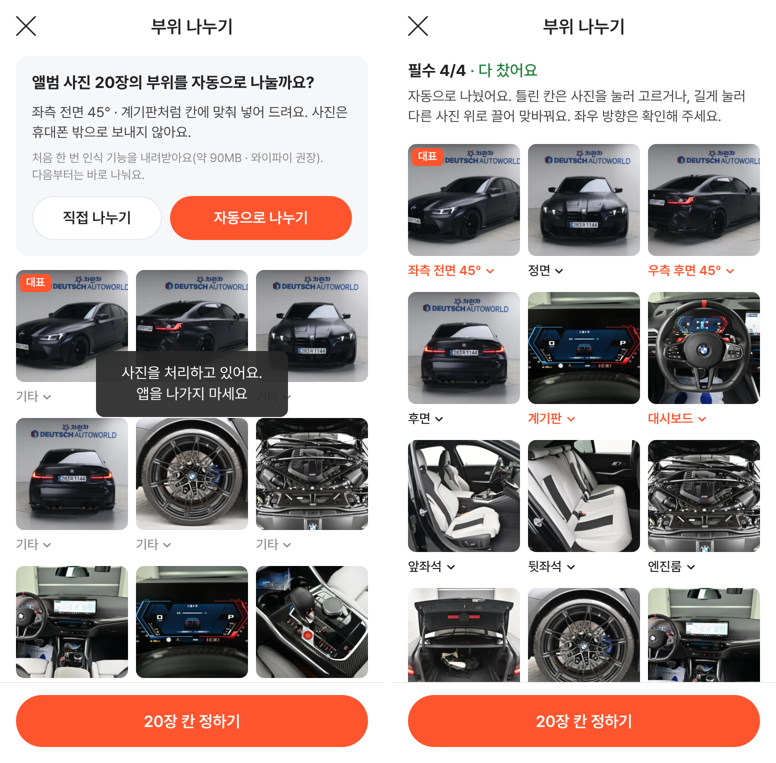
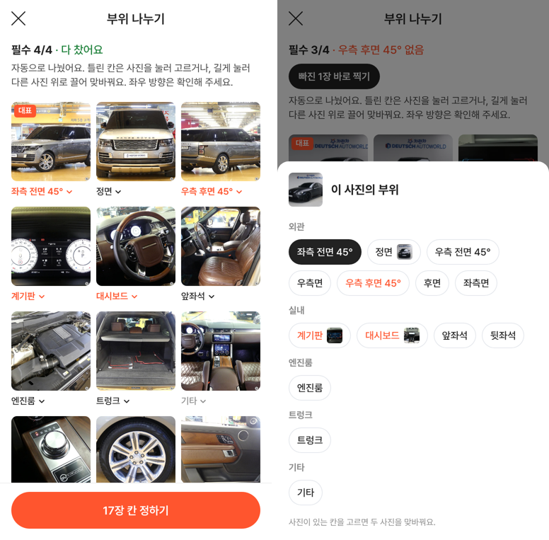

# PR #1044 촬영 쇼츠 키트 앨범 사진 부위 자동 선별 · 사진 끌어서 칸 바꾸기

## ① 한 줄 요약
앨범에서 올린 사진을 휴대폰 안에서 부위별로 자동으로 나눠 필수 4장을 바로 채우고, 틀린 칸은 누르거나 길게 눌러 끌어서 고치게 했습니다. 등록 화면 사진도 끌어서 칸을 바꿀 수 있습니다.

## ② 과제 · 브랜치 · 커밋 · 상태
- 과제 ID: 없음(사용자 지시 「사진 앨범에서 등록하면 부위별 자동 선별되는 스킬 추가하자」 · 「사진 드래그 이동도 안된다」 · 「실제 딜러들과 보배드림 촬영팀들이 사용하기 좋게 해라」)
- 브랜치: `feat/shootkit-autosort` → main e78d779 (PR https://github.com/bobaekimboae/bobaedream/pull/1044, 병합 · 배포 v=e78d779)
- 이번 병합으로 main에 함께 들어간 과제: 없음
- 승인 대기: PR #1042(배포본 미리 불러오기 404 보정, 배포 설정 변경)

## ③ 한 일
- 전에는 앨범 사진이 전부 「기타」로 들어가 앨범만으로는 필수 4장을 채울 수 없었습니다. 이제 앨범에서 고른 사진은 완료 뒤 `부위 나누기` 화면으로 갑니다.
- 처음 한 번만 동의를 받습니다. 인식 기능(약 90MB, 와이파이 권장)을 받은 뒤 사진마다 부위를 골라 칸을 채웁니다. 사진은 휴대폰 밖으로 나가지 않고, 다음부터는 묻지 않고 바로 나눕니다.
- 결과 화면에는 `필수 N/4 · 빠진 칸` 요약, `빠진 N장 바로 찍기`(그 칸부터 촬영), 자신 없는 칸의 `확인` 딱지, 첫 사진의 `대표` 딱지가 나옵니다.
- 사진을 누르면 부위 시트가 열립니다. 사진이 이미 있는 칸을 고르면 두 사진이 맞바뀝니다. 길게 눌러 다른 사진 위에 놓아도 맞바뀝니다.
- 등록 화면 사진도 길게(0.3초) 누르면(마우스는 끌면) 다른 사진과 칸을 맞바꿉니다. 짧게 누르면 지금처럼 편집 화면이 열립니다.
- 인식 방법: OpenAI CLIP ViT-B/32(MIT)로 사진 특징을 만들고 두 점수를 더합니다. 하나는 부위 설명 글과의 비슷함(30%), 다른 하나는 보배드림 실매물 사진 367장 중 가장 비슷한 3장(70%)입니다. 실매물 사진은 서울오토갤러리 · 도이치오토월드 · M3 · 레인지로버이고, 사진 대신 숫자로 된 특징값만 저장했습니다.

## ④ 원본과 비교 · 동작 점검표

| 점검 | 결과 |
|---|---|
| 앨범 사진으로 필수 4장 채우기 | 전 불가 → 자동 선별로 채움 |
| 처음 보는 스튜디오 외관 215장(도이치오토월드, 차를 하나씩 빼고 측정) | 84% 맞음 |
| 실내(표본 2대, 차를 하나씩 빼고 측정) | M3 10칸 중 7칸 · 레인지로버 8칸 중 5칸 |
| 좌우 방향 구분 | 안 함(시험에서 우연 수준 50%) → 안내 문구로 확인 요청 |
| 20장 나누는 시간(시험 컴퓨터) | 약 10초 |
| 등록 화면 · 부위 화면 길게 눌러 끌기(터치) · 마우스 끌기 | 통과 |
| 끈 뒤 편집 · 시트가 잘못 열림 | 없음 |
| 인식 기능을 못 받을 때 | `자동으로 나누지 못했어요` + 직접 나누기 · 다시 시도 |

## ⑤ 검증
- verify:qf 통과
- 기존 자동 시험 117개(t20k 25 · t21k 19 · t22 29 · t23 10 · t24 28 · t25 6) 통과, 새 시험 19개(동의 · 자동 선별 · 시트 · 끌기 · 실패 · PC 마우스) 통과
- 배포본 v=e78d779: 끌기 시험 9개 · t22 29 · t24 28 통과, 콘솔 오류 0
- 배포 주소 확인: 비교용 특징값 파일 200, 인식 모델(Hugging Face, 판 고정) 200, 실행 파일(jsDelivr, transformers 3.8.1) 200
- 퀵필터 규격은 이번 변경 범위 밖이라 측정 생략

## ⑥ 원본과 다르게 남긴 것
- 58 원본에는 자동 선별이 없습니다. 키트(`?register=shootkit`)에만 넣었고 58 재현(`&vstage=58`)과 `?register=shoot`는 그대로입니다.
- 좌우 방향은 구분하지 않습니다. 앞 3/4 사진은 좌측 전면 45° → 우측 전면 45° 순으로, 뒤 3/4 사진은 우측 후면 45°에 넣습니다.
- 인식 모델은 우리 사이트가 아니라 Hugging Face · jsDelivr에서 받습니다. 저장소 용량 때문이며, 처음 한 번 받은 뒤에는 브라우저에 남습니다.
- 더 작은 MobileCLIP은 Apple 연구용 사용 허가라 쓰지 않았습니다.

## ⑦ 못 한 것 · 다음
- 실내 비교 사진이 2대뿐이라 실내 정확도가 낮습니다. 실내 사진이 있는 실매물 세트(차당 계기판 · 대시보드 · 시트 포함)를 주시면 비교 사진에 더해 올릴 수 있습니다.
- 실제 폰 속도(사진당 0.3~1초로 예상)와 90MB 다운로드를 실제 폰으로 확인해야 합니다.
- PR #1042 병합(새로 생긴 나중에 불러오는 파일들도 같은 보정을 받습니다).

## ⑧ 확인 링크
- 키트: https://bobaekimboae.github.io/bobaedream/?register=shootkit&v=e78d779 (사진 추가 → 앨범 → 휴대폰 사진 불러오기 → 완료)
- 모바일: https://bobaekimboae.github.io/bobaedream/?qf=guazi&v=e78d779
- PC: https://bobaekimboae.github.io/bobaedream/?qf=guazi&v=e78d779&pc=1
- 번들: assets/main-CXkMavS-.js · 촬영 앱 assets/shoot-C7XVfTsX.js
