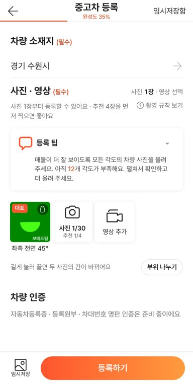

# PR #1046 촬영 키트: 필수 사진 강제 빼기

## ① 한 줄 요약
`?register=shootkit`에서 필수 4장이 등록을 막지 않게 했다. 사진 1장 + 차량 소재지면 등록할 수 있다.

## ② 과제 · 브랜치 · 커밋 · PR · 상태
- 과제 ID: 없음(사용자 지시 「필수 사진 강제를 일단은 빼자」)
- 브랜치 `feat/shootkit-no-required` · 커밋 6d08d71 → main 01efe3c
- PR: https://github.com/bobaekimboae/bobaedream/pull/1046 · 병합 · 배포 v=01efe3c
- 함께 들어간 과제: 없음

## ③ 한 일
- `shoot-items-kit.json`에 스위치 `photo.enforceRequired: false`와 `publishMin: 1`을 두었다.
- 좌측 전면 45° · 우측 후면 45° · 계기판 · 대시보드 4장은 이름만 「추천」으로 바꿔 안내에 남겼다.
- 등록하기: 사진 0장이면 「사진을 1장 이상 올려 주세요」, 1장부터 활성(소재지는 여전히 필요).
- 메인 머리 `사진 N장 · 영상 선택`, 사진 카운터 `사진 N/30` + 작은 `추천 N/4`.
- 사진 칸 빨간 점 · 칸 줄 `+N` 알약을 숨겼다. 촬영 규칙 맨 위는 「먼저 찍으면 좋은 4장 · 추천」.

## ④ 원본과 비교
| 항목 | 전 | 후 |
|---|---|---|
| 등록 조건 | 필수 4장 + 소재지 | 사진 1장 + 소재지 |
| 메인 카운터 | 사진 0/4 필수 | 사진 0장 |
| 사진 칸 표시 | 빨간 점 · +N | 없음 |

## ⑤ 검증
- verify:qf 통과. 새 시험 10/10(로컬 · 배포본). 끌기 · 쇼츠 회귀 시험 FAIL 0. 콘솔 오류 0(배포본 384).
- measure:qf 등 퀵필터 규격은 이번 변경과 무관(촬영 키트만 수정).

## ⑥ 원본과 다르게 남긴 것
- 사진 0장 등록은 막았다(빈 매물 방지). JSON `publishMin`을 0으로 바꾸면 사진 없이도 등록된다.

## ⑦ 다음
- 차량 소재지 필수 여부 결정 · PR #1042(배포 경로 수정) 승인 · 실제 폰 확인.

## ⑧ 확인 링크
- 촬영 키트 https://bobaekimboae.github.io/bobaedream/?register=shootkit&v=01efe3c
- 모바일 https://bobaekimboae.github.io/bobaedream/?qf=guazi&v=01efe3c · PC https://bobaekimboae.github.io/bobaedream/?qf=guazi&v=01efe3c&pc=1
