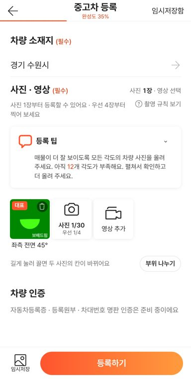
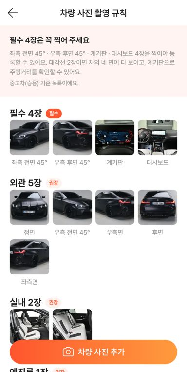

# PR #1048 촬영 키트 10배 기준 크로스체크

## ① 한 줄 요약
촬영 키트(`?register=shootkit`)의 기능·논리·가변 요소를 다시 점검해 결함 13건을 고쳤고, 58 재현 화면이 함께 바뀌던 문제도 막았다.

## ② 과제 · 브랜치 · 커밋 · PR · 상태
- 과제 ID: 없음(사용자 지시 「10배 강화된 기준으로 크로스체크 기능 및 논리 가변요소 등 다 체크해라」)
- 브랜치 `fix/shootkit-x10-crosscheck` → main 11df50b
- PR: https://github.com/bobaekimboae/bobaedream/pull/1048 · 병합 · 배포 v=11df50b
- 함께 들어간 과제: 없음

## ③ 한 일
- 별도 검토 에이전트로 코드를 따로 읽게 하고, 시험을 13묶음 + 새 시험 30개 + 쇼츠 계획 무작위 1,500회로 돌렸다.
- 58 재현(`&vstage=58`)은 다시 필수 4장으로 등록을 막는다(이전 작업에서 같이 풀려 있었음).
- 이름 「추천」 → 「우선」(영상 코스의 「차종 추천」 · 「권장」과 헷갈림).
- 같은 칸을 다시 찍으면 사진이 두 장 올라가던 문제, 빠른 연타 때 칸이 겹칠 수 있던 문제를 고쳤다.
- 올리는 중인 사진으로 등록되던 것을 막고(「사진을 올리고 있어요」), 빨간 경고는 장수가 바뀌면 끈다.
- 쇼츠 화면이 알림만 떠도 영상을 처음부터 다시 불러오던 문제, 같은 장면이 두 번 나올 수 있던 문제를 고쳤다.
- 지역 시트 키보드 포커스 · 선택 상태 읽기, 사진 삭제 버튼 누르는 곳(22 → 36px)을 고쳤다.

## ④ 점검 결과
| 항목 | 전 | 후 |
|---|---|---|
| 58 재현 등록 조건 | 사진 1장(잘못 풀림) | 필수 4장(원래대로) |
| 같은 칸 두 번 촬영 | 2장 올라감 | 1장 |
| 올리는 중 등록하기 | 눌림 | 「사진을 올리고 있어요」 |
| 쇼츠 화면 알림 뒤 | 영상 다시 불러옴 | 그대로 |
| 쇼츠 같은 장면 겹침(무작위 1,500회) | 생김 | 0 |
| 지역 시트 시·도 고른 뒤 Tab | 창 밖으로 나감 | 창 안 |

 

## ⑤ 검증
- verify:qf 통과.
- 회귀 시험 13묶음 FAIL 0(강제를 뺀 뒤 바뀐 기대값 9곳은 새 규칙으로 고침), 새 시험 tvar 20 · tfix 10 · tnoreq 10 통과(로컬 · 배포본), 콘솔 오류 0.
- 화면 4폭(360 · 384 · 412 · 1280) 넘침 없음.

## ⑥ 원본과 다르게 남긴 것
- 사진 0장 등록은 계속 막는다(`publishMin` 1).
- 시험 도구가 「겹침」으로 잡는 사진 위 삭제 버튼 · 코스 창 하단 버튼은 의도한 배치라 두었다.

## ⑦ 못 한 것 · 다음
- 쇼츠 화면 · 부위 나누기 화면(전체 화면 층)은 Esc · Tab 가두기가 아직 없다.
- 차량 소재지 필수 여부 결정 · PR #1042(배포 경로) 승인 · 실제 폰 확인.

## ⑧ 확인 링크
- 촬영 키트 https://bobaekimboae.github.io/bobaedream/?register=shootkit&v=11df50b
- 58 재현 https://bobaekimboae.github.io/bobaedream/?register=shootkit&vstage=58&v=11df50b
- 모바일 https://bobaekimboae.github.io/bobaedream/?qf=guazi&v=11df50b · PC https://bobaekimboae.github.io/bobaedream/?qf=guazi&v=11df50b&pc=1
