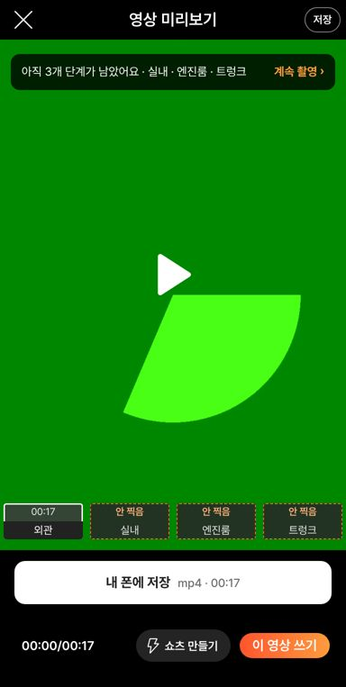
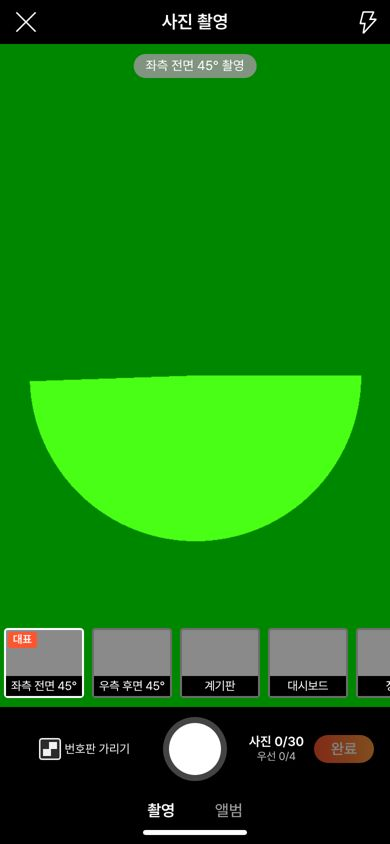
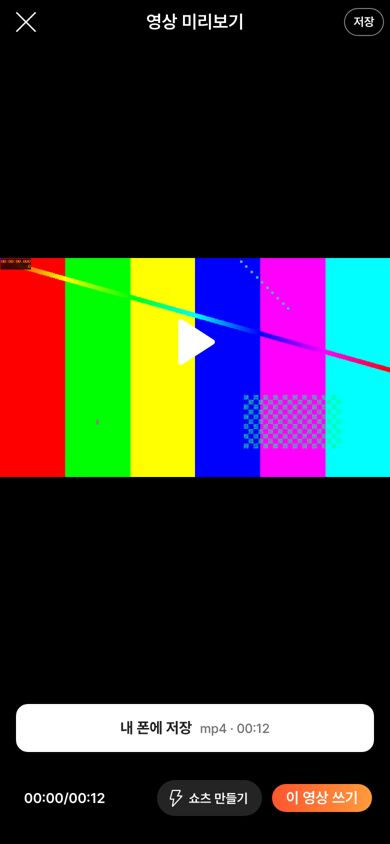
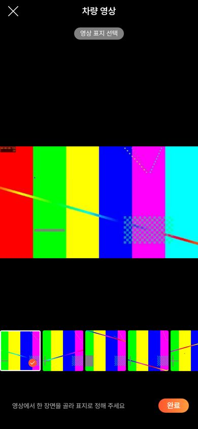
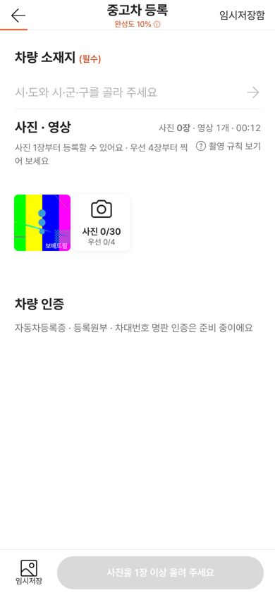
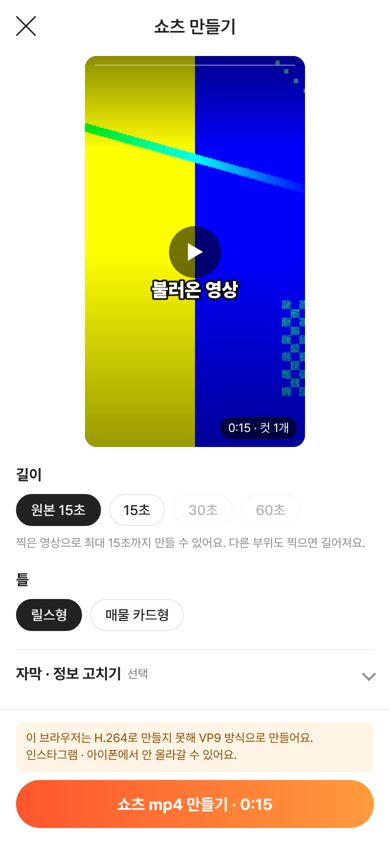

# PR #1051 촬영 쇼츠 키트 — 컨설팅 6건 크로스체크 반영

## ① 한 줄 요약
2026-10-26 v=11df50b 컨설팅 6건을 실제 화면과 코드로 하나씩 대조해, 맞는 지적은 고치고(불러온 영상 길이·개수·쇼츠·잘림, 우선 4장 순서, 원본 길이 표기, 녹화 전 안내, 완성도 설명, 규칙 대화상자, 코스 창 닫기), 틀린 지적·정책 결정이 필요한 지적은 이유와 함께 남겼다.

## ② 과제 · 브랜치 · 커밋 · PR · 상태
- 브랜치: `fix/shootkit-consult-1026` → main `760e95b`
- PR: https://github.com/bobaekimboae/bobaedream/pull/1051 (병합·배포 완료, v=760e95b)
- 이번에 함께 main에 들어간 과제: PR #1050 큰 「내 폰에 저장」 버튼(0d47015), PR #1042 배포본 나중 불러오는 파일 404 보정(030d1fb)

## ③ 한 일
1. 불러온 영상의 실제 길이를 먼저 읽어 미리보기·큰 저장 버튼·저장창·등록 화면이 같은 길이(`00:12`)를 쓴다. 등록 화면은 `영상 4/4` 대신 `영상 1개 · 00:12`.
2. 불러온 영상도 영상 미리보기를 먼저 열고 `내 폰에 저장` · `쇼츠 만들기`를 쓸 수 있다(편집 화면에도 쇼츠). 가로 원본은 미리보기·표지에서 자르지 않는다. 표지 후보 버튼 이름 `표지 후보 1~8`.
3. 사진 칸 레일을 규칙 화면과 같은 순서(우선 4장 → 나머지)로 바꿨다.
4. 코스 시간은 `원본 최대 01:20`, 안내에 「쇼츠는 찍은 뒤 15·30·60초로 따로 만들어요」. 코스 창 왼쪽 버튼 `취소` → `닫기`.
5. 녹화 전 가운데 문구를 부위별 한 줄 동작 안내로 바꿨다(예: 「차 앞에서 시작해 차 주위를 천천히 한 바퀴 돌아 주세요」).
6. `완성도 N%`를 누르면 계산 방법이 뜬다. 촬영 규칙 화면은 대화상자로 열려 포커스가 안에 머물고 Esc로 닫힌다.

## ④ 컨설팅 크로스체크 표
| 지적 | 출처 | 확인 결과 | 처리 |
| --- | --- | --- | --- |
| 불러온 영상 길이 0:00(저장창) | 촬영 도구 | 맞음 | 고침 |
| 영상 1개가 `영상 4/4` | 촬영 도구 | 맞음 | 고침 |
| 불러온 영상에서 쇼츠 못 만듦 | 촬영 도구 · 건설기계 | 맞음(불러온 영상만 막혀 있었음) | 고침 |
| 가로 원본이 잘려 보임 | 촬영 도구 | 맞음 | 고침(원본 보기) |
| 표지 후보 버튼 이름 없음 | 촬영 도구 | 맞음 | 고침 |
| 우선 4장과 사진 칸 순서 다름 | 등록·촬영 UX · Claude | 맞음 | 고침 |
| 촬영 시간이 쇼츠 길이로 오해 | 코덱스 UX · 촬영 도구 · 건설기계 | 맞음 | 고침(`원본 최대` + 안내) |
| 「촬영 항목이 맞는지 확인」은 안내가 아님 | Claude | 맞음 | 고침 |
| 완성도가 무엇으로 오르는지 모름 | Claude · 코덱스 UX · 등록 UX | 맞음 | 고침(누르면 설명) |
| 규칙 레이어 대화상자·포커스 없음 | 코덱스 UX | 맞음 | 고침 |
| 내 부위 만들기에 취소 2개 | 코덱스 UX | 맞음 | 고침(창 버튼 `닫기`) |
| 지시 반영 0건 · 서울 고정 · AI 문구 · 번호판 기본 꺼짐 · 우후45 없음 | 총괄 마스터 | 키트와 맞지 않음(다른 화면 `?register=shoot` 기준) | 키트 해당 없음 — 그 화면 담당 작업창에 전달 필요 |
| 숏폼 생성 화면 없음 | 건설기계 | 틀림(촬영 뒤 `쇼츠 만들기` 있음) | 없음 |
| 시트가 실내에 묶임 | 건설기계 | 틀림(추가 부위 `시트` 있음) | 없음 |
| 영상 15~30초 × 4 = 2분 | Claude | 틀림(외관 15~30 · 실내 10~20 · 엔진룸·트렁크 8~15, 최대 01:20) | 없음 |
| 등록 버튼 DOM disabled 아님 | 코덱스 UX | 의도(`aria-disabled`, 누르면 모자란 이유로 이동) | 없음 |
| 임시저장함 18px · 규칙 보기 15px | 코덱스 UX · 등록 UX | 보이는 크기는 맞지만 누르는 곳은 이미 넓힘(위아래 14px 밖에서도 눌림) | 없음 |
| 사진 0장 `완료` 눌림 | Claude | 틀림(0장은 disabled) | 없음 |
| 번호판 기본 켜짐 권장 | Claude · 총괄 | 키트는 이미 켜짐 | 없음 |
| 카메라 권한을 촬영 시작 때 | 코덱스 UX | 정책 결정 필요(지금은 각도 맞춤 화면 때문에 열 때 묻음) | 남김 |
| 제목·첫 화면 가치 문구, 사진 4장 보상, 기본 3단계, 딜러 빠른 부위 추가, 쇼츠 세로 맞춤 선택, 영상 번호판 블러(서버), 사진 가로 4:3, 임시저장 11px | 여러 건 | 정책·서버·58 원본 맞춤 영역 | 남김 |

## ⑤ 검증
- `npm run verify:qf` 통과
- 회귀 시험 14종(t20k·t21k·t22·t23·t24·t25·tdrag·tsort2·tesc·tnoreq·tas3·tvar·tfix·cross 4폭) 실패 0 — 사진 칸 순서·완성도 글자가 바뀐 4종은 새 규칙에 맞춰 기대값 갱신
- 새 시험: 불러온 영상 흐름 17개(로컬·배포본 모두 통과), 큰 저장 버튼 10개
- 배포본 영상 화면 404 0건(PR #1042 확인), 콘솔 오류 0
- 퀵필터 규격 측정은 이번 변경 범위 밖(촬영 키트만 수정)

캡처:      

## ⑥ 원본과 다르게 남긴 것
- 58 원본 재현(`&vstage=58`)은 사진 칸 순서·안내 문구·불러오기 흐름을 바꾸지 않았다.
- 카메라 권한은 영상 화면을 열 때 묻는다(각도 맞춤 화면이 먼저 보여야 해서).

## ⑦ 못 한 것 · 다음
- 정책 결정 대기: 권한 순서, 첫 화면 제목, 사진 보상, 기본 코스, 쇼츠 세로 맞춤 방식, 영상 번호판 블러(서버), 차량 소재지 필수 여부
- `?register=shoot`(다른 작업창) 지적은 그 창에 전달
- 실제 폰(아이폰 Safari · 안드로이드 Chrome) 확인

## ⑧ 확인 링크
- 촬영 키트: https://bobaekimboae.github.io/bobaedream/?register=shootkit&v=760e95b
- 모바일: https://bobaekimboae.github.io/bobaedream/?qf=guazi&v=760e95b
- PC: https://bobaekimboae.github.io/bobaedream/?qf=guazi&v=760e95b&pc=1
