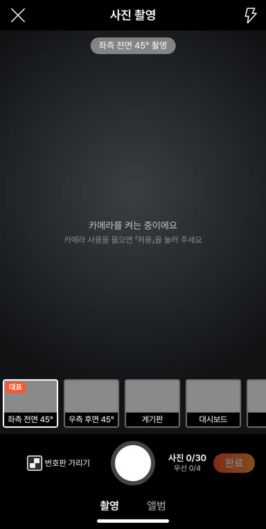
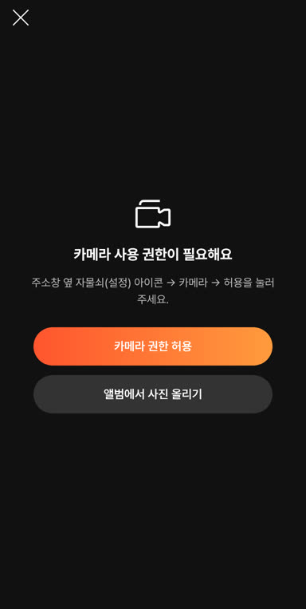
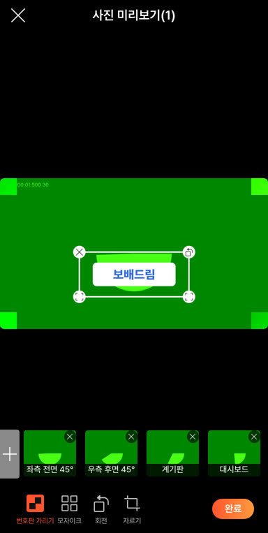
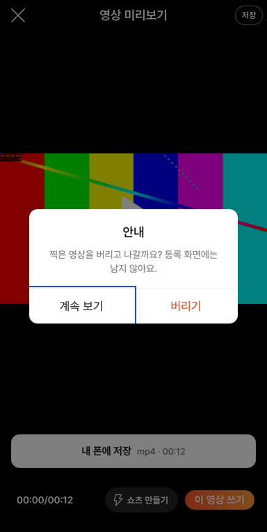

# PR #1053 촬영 쇼츠 키트 10배 실동작 크로스체크 반영

## ① 한 줄 요약
배포본(v=760e95b)을 별도 검수 담당이 실제로 조작해 찾은 문제를 고쳤다. 실제 문제 9건과 작은 문제들이며, 빠른 연속 촬영 칸 어긋남·번호판 가리기 미작동·권한 거절 안내·영상을 확인 없이 버리는 문제 등을 포함한다.

## ② 과제 · 브랜치 · 커밋 · 상태
- 과제 ID: 없음(사용자 지시 「10배 강화된 규칙으로 크로스체크 컨설팅 / 기능 / 디자인 / 오류 / 실제 동작까지」)
- 브랜치: fix/shootkit-x10-1026 → main
- 커밋: d25c52c (squash)
- PR: https://github.com/bobaekimboae/bobaedream/pull/1053
- 상태: 병합 · 배포 완료, v=d25c52c, 번들 `assets/main-DQBjqjnQ.js`
- 이번 병합으로 main에 함께 들어간 과제: 없음

## ③ 한 일
- 셔터를 빠르게 두 번 누를 때 칸 이름을 최신 값으로 읽게 했다. 이전에는 대시보드 사진이 2장 들어가고 정면이 빠졌다.
- 「번호판 가리기」(기본 켜짐)를 켜고 찍은 정면·후면·45° 사진에 가림을 바로 붙인다. 사진을 누르면 가림을 옮길 수 있다.
- 사진 촬영에서 권한을 거절하면 안내 화면이 뜬다(`앨범에서 사진 올리기`). 카메라 오류 이름을 그대로 넘기도록 고쳤다.
- 다음 경우에 확인창을 띄운다: 영상 미리보기·표지의 X, 찍어 둔 단계 위에 영상 불러오기. 카운트다운 중에 닫을 때 나던 녹화기 오류도 막았다.
- 링크로 바로 연 탭에서 나가기를 누르면 처음부터 다시 시작한다. 회색 등록 버튼 대비를 4.7:1로 올렸다.
- 「기타」 칸을 카메라로 찍으면 부위 나누기 화면이 뜨지 않게 했다. 나누기 결과는 실제로 나눈 장수만큼 알려 준다.
- 쇼츠: 「불러온 영상」 자막과 입력하지 않은 문구를 뺐다. 길이 안내를 고치고, VP9 저장 경고를 넣었다.
- 접근성: 전체 화면도 Esc로 닫힌다. 확인창 첫 포커스는 「취소」 쪽이고, 누르는 영역을 넓혔다.

## ④ 원본과 비교 (작업 전 → 후)
| 항목 | 전 | 후 |
|---|---|---|
| 연속 촬영 칸 | 대시보드 2장, 정면 빠짐 | 5칸 모두 다른 칸 |
| 번호판 가리기 | 동작 없음 | 정면·후면·45° 자동 가림 |
| 사진 권한 거절 | 「켜는 중」 + 대체 그림 업로드 | 권한 안내 화면 |
| 영상 X | 확인 없이 삭제 | 계속 보기 / 버리기 |
| 회색 버튼 대비 | 1.4:1 | 4.7:1 |
| 작은 누름 영역 | 18px | 40px |

| 작업 전(권한 거절) | 작업 후 |
|---|---|
|  |  |

| 번호판 가림 | 영상 버리기 확인 |
|---|---|
|  |  |

## ⑤ 검증
- `npm run verify:qf` 통과
- 회귀 시험 17묶음 FAIL 0, 화면 폭 360·384·412·1280 가로 넘침 0
- 새 실동작 시험 20/20(로컬과 배포본 모두)
- 콘솔 오류 0(모바일)
- 퀵필터 규격(measure:qf)과 시안형 필터 선택지: 이번 변경 범위 밖(촬영 키트만 고침)

## ⑥ 원본과 다르게 남긴 것과 이유
- 번호판 가림 처음 위치: 정가운데보다 조금 아래(세로 64%). 차마다 번호판 위치가 달라 손으로 옮기는 것을 전제로 한다. 실서비스에서는 번호판 인식으로 자리를 잡는다.
- 58 재현 화면(`&vstage=58`)은 동작을 바꾸지 않았다.

## ⑦ 못 한 것 · 다음에 할 것
- 실제 폰 점검
- 영상 주소 메모리 해제
- 쇼츠 끝 명함이 빈 카드로 나오는 문제(딜러 숏폼 공용 파일)
- 사진 화면 좌우 밀기 동작 정책

## ⑧ 확인 링크
- 촬영 키트: https://bobaekimboae.github.io/bobaedream/?register=shootkit&v=d25c52c
- 모바일: https://bobaekimboae.github.io/bobaedream/?qf=guazi&v=d25c52c
- PC: https://bobaekimboae.github.io/bobaedream/?qf=guazi&v=d25c52c&pc=1
