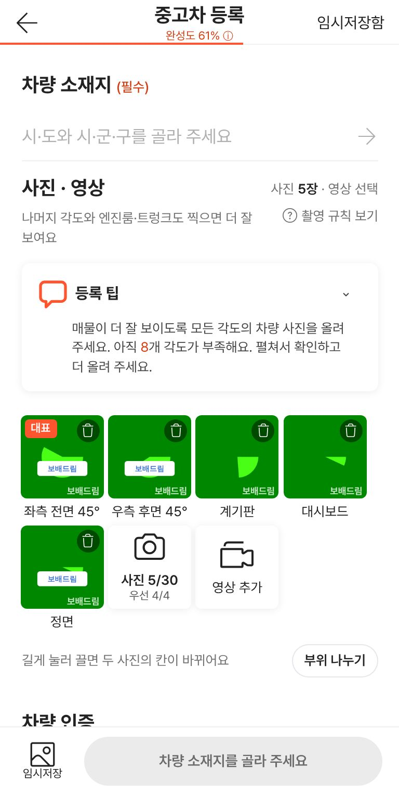
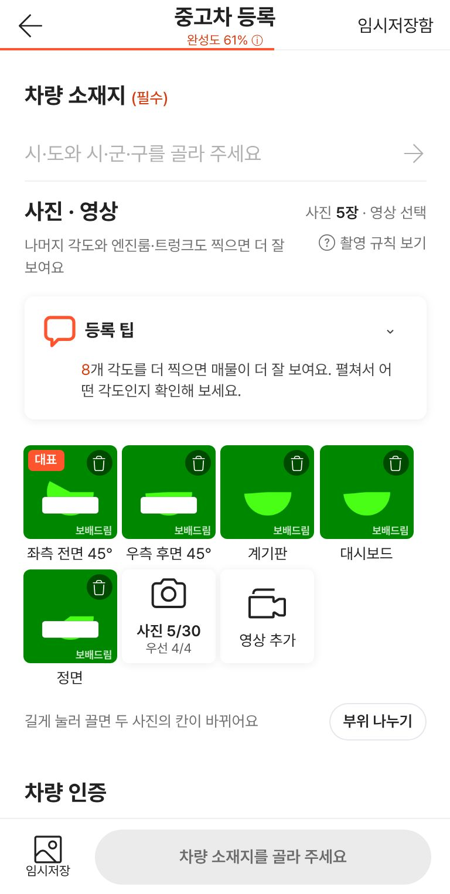
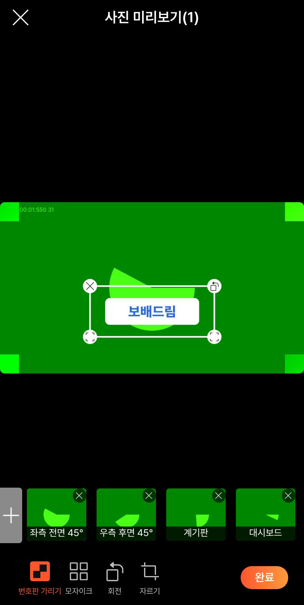
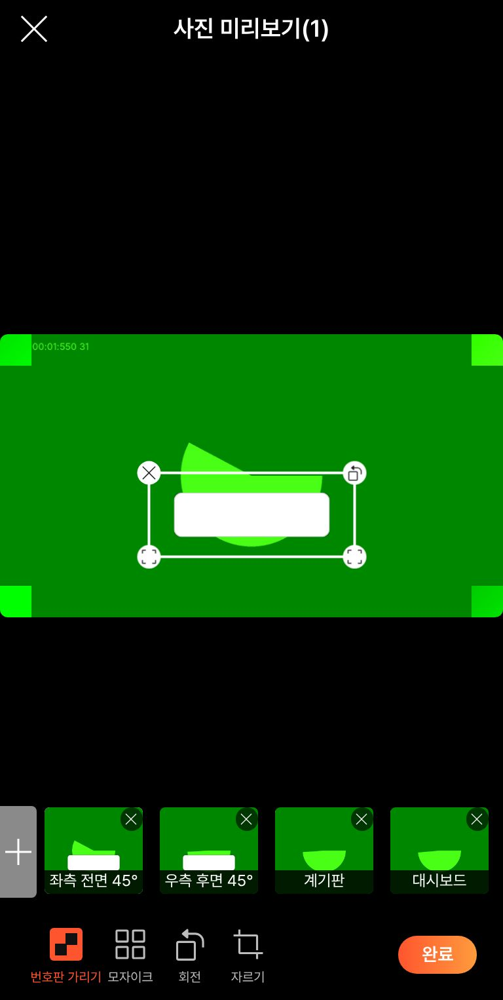
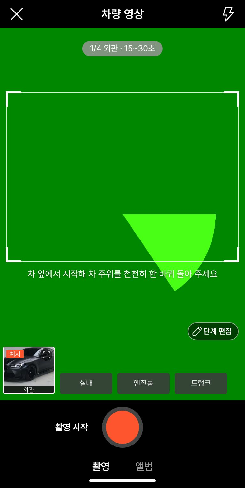
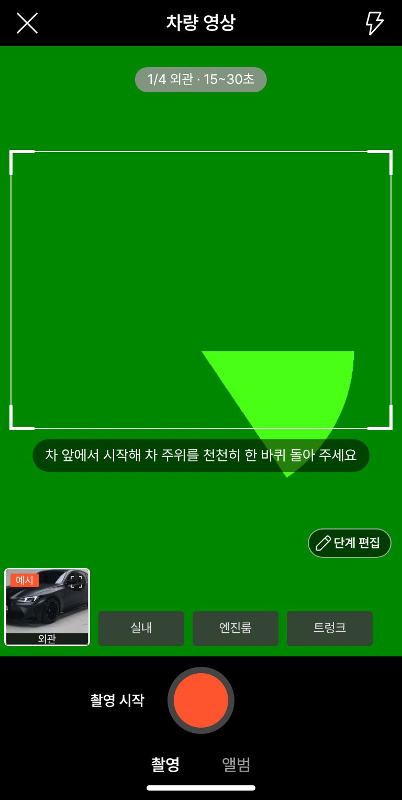

# PR #1055 촬영 쇼츠 키트 배포본 컨설팅 반영

## ① 한 줄 요약
배포본(v=d25c52c)을 컨설팅해 4건을 고쳤다: 글자 없는 흰 번호판 가림, 부드러운 등록 팁 문구, 미리보기 썸네일의 가림 표시, 영상 안내 알약.

## ② 과제 · 브랜치 · 커밋 · 상태
- 과제 ID: 없음(사용자 지시 「컨설팅」 → 「너의 판단」 → 「배포해」)
- 브랜치: fix/shootkit-consult-1027 → main
- 커밋: 43b1d9a (squash)
- PR: https://github.com/bobaekimboae/bobaedream/pull/1055
- 상태: 병합 · 배포 완료, v=90c8374, 번들 `assets/main-CykwhNOi.js`
- 이번 병합으로 main에 함께 들어간 과제: 보고서 PR #1054(지난 #1053 보고서)

## ③ 한 일
- 번호판 가림을 「보배드림」 글자 없는 흰 둥근 판으로 바꿨다. 이제 사진 칸 하나에 워터마크가 한 번만 보인다.
- 등록 팁 문구를 「N개 각도를 더 찍으면 매물이 더 잘 보여요」로 바꿨다. 목록 제목은 「더 찍으면 좋은 각도」다. 우선 4장을 강제하지 않는 정책과 말투를 맞췄다.
- 사진 미리보기 아래 썸네일 줄에도 번호판 가림이 보인다. 가림을 옮기면 0.25초 뒤 썸네일도 바뀐다.
- 영상 촬영 안내 글자(「차 앞에서 시작해…」)에 반투명 검정 알약을 깔아 밝은 화면에서도 읽힌다.
- 58 재현(`&vstage=58`)은 바꾸지 않았다.

## ④ 원본과 비교 (작업 전 → 후)
| 항목 | 전 | 후 |
|---|---|---|
| 번호판 가림 | 「보배드림」 글자 판(워터마크와 겹침) | 글자 없는 흰 판 |
| 등록 팁 | 「아직 N개 각도가 부족해요」 | 「N개 각도를 더 찍으면 매물이 더 잘 보여요」 |
| 미리보기 썸네일 | 가림 없는 원본 | 가림이 보임 |
| 영상 안내 글자 | 그림자만(밝은 화면에서 묻힘) | 검정 50% 알약 |

| 작업 전 | 작업 후 |
|---|---|
|  |  |
|  |  |
|  |  |

## ⑤ 검증
- `npm run verify:qf` 통과
- 회귀 시험 17묶음 FAIL 0, 화면 폭 360·384·412·1280 가로 넘침 0
- 실동작 시험 20/20
- 퀵필터 규격(measure:qf)과 시안형 필터 선택지: 이번 변경 범위 밖(촬영 키트만 고침)

## ⑥ 원본과 다르게 남긴 것과 이유
- 미리보기 사진 위 빈 공간(컨설팅 5번)은 58 원본과 같은 배치라 그대로 두었다.

## ⑦ 못 한 것 · 다음에 할 것
- 실제 폰 점검
- 영상 주소 메모리 해제
- 쇼츠 끝 명함이 빈 카드로 나오는 문제(딜러 숏폼 공용 파일)
- 정책 결정: 지역 필수 여부, 카메라 권한 묻는 시점, 기본 코스, 쇼츠 세로 맞춤, 영상 번호판 흐림

## ⑧ 확인 링크
- 촬영 키트: https://bobaekimboae.github.io/bobaedream/?register=shootkit&v=90c8374
- 모바일: https://bobaekimboae.github.io/bobaedream/?qf=guazi&v=90c8374
- PC: https://bobaekimboae.github.io/bobaedream/?qf=guazi&v=90c8374&pc=1
