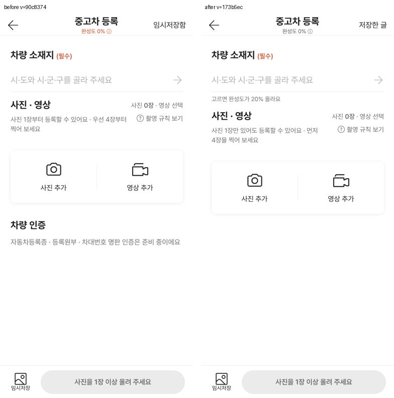
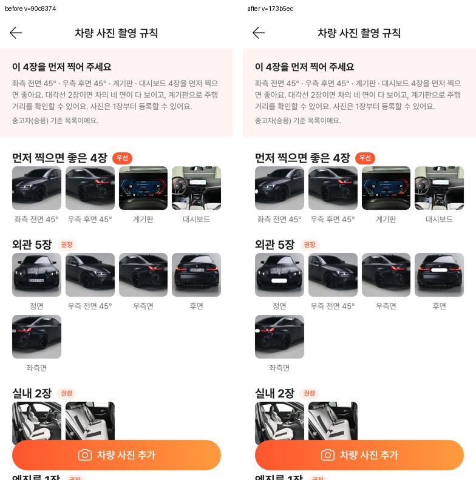
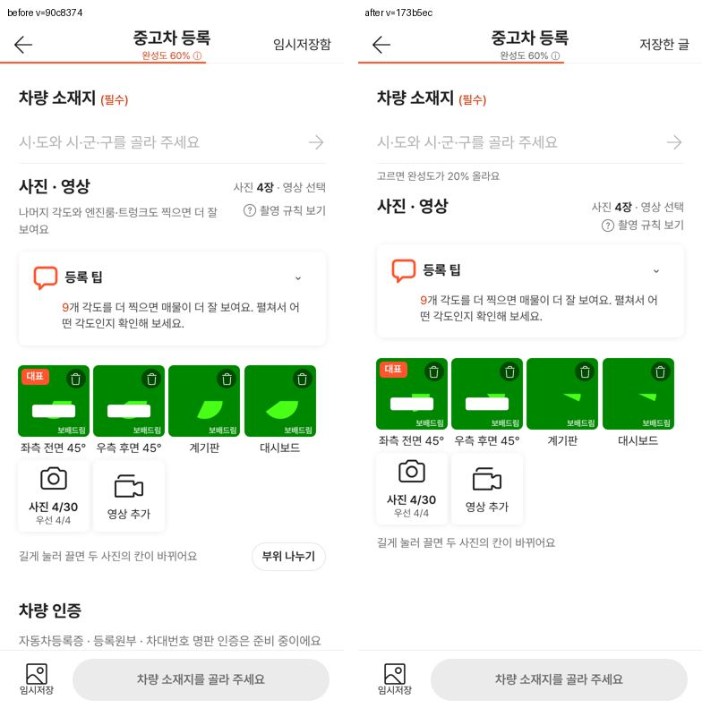
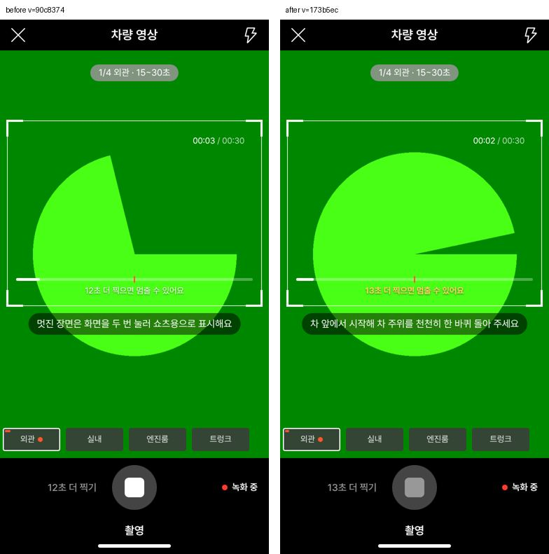
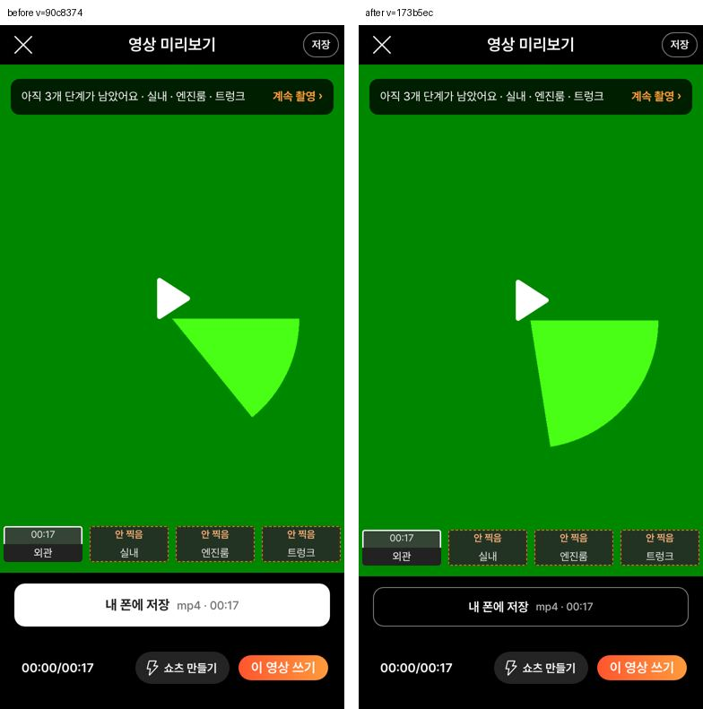
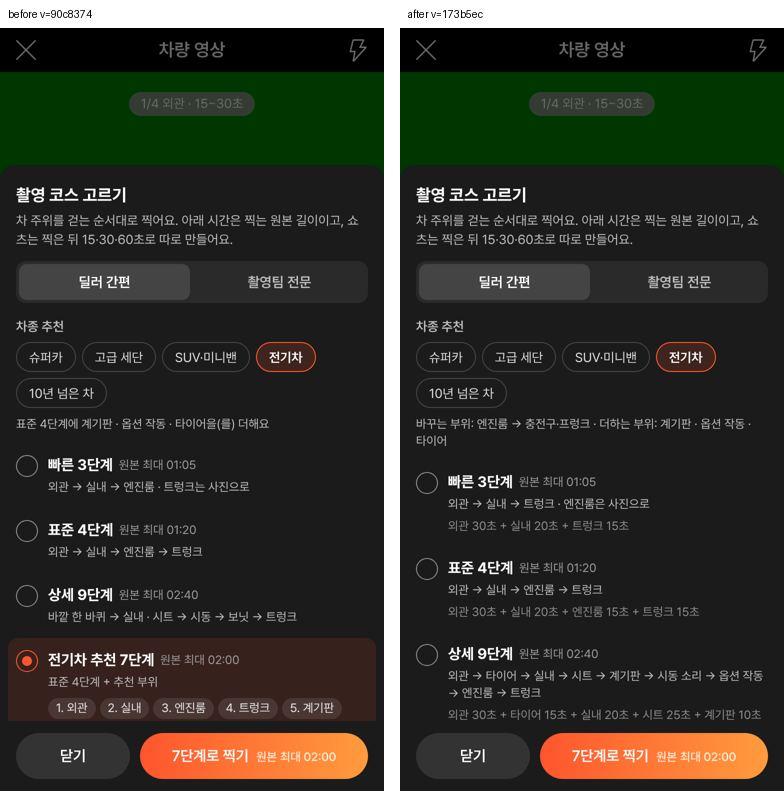

# PR #1057 촬영 쇼츠 키트 — 배포본 컨설팅 2차 + 외부 컨설팅 7건 통합 반영

## ① 한 줄 요약
촬영 쇼츠 키트(`?register=shootkit`) v=90c8374에 대한 자체 컨설팅 9건과 같은 버전 외부 컨설팅 7건 중, 정책 결정 없이 고칠 수 있는 것을 모두 반영해 배포했습니다.

## ② 과제 · 브랜치 · 커밋 · 상태
- 과제: 촬영 쇼츠 키트 배포본 컨설팅 반영(사용자 「고쳐」 → 「판단은」 → 「병합」)
- 브랜치: `fix/shootkit-consult2-1027`
- 커밋: 462be4e1 · a5ab9dba → 병합 커밋 173b5ec
- PR: https://github.com/bobaekimboae/bobaedream/pull/1057
- 상태: 병합 · 배포 완료(deploy run 40406784265 success), v=173b5ec, 번들 `assets/main-D1paeo0n.js`
- 이번 병합으로 main에 함께 들어간 과제: 없음(앞선 main d3f3a19는 다른 작업창 과제로 먼저 배포됨)

## ③ 한 일
- 녹화 중 최소 시간 전에 멈춤을 누르면 알림 대신 버튼을 흐리게 하고 「N초 더 찍으면 멈출 수 있어요」를 노랑으로 흔듭니다. 녹화 중에도 동선 안내를 계속 보이고, 쇼츠 두 번 누르기 안내는 3~7초에만 보입니다.
- 등록 팁 카드와 같은 말을 하던 안내 줄을 숨기고, 규칙 사진 번호판 4장에 흰 판을 덮었습니다(사진 파일은 그대로).
- 문구를 「사진 1장만 있어도 등록할 수 있어요 · 먼저 4장을 찍어 보세요」로 바꿨습니다. 완성도 글자는 회색으로, 소재지 안내를 붙이고, 누르는 곳을 44로 넓혔습니다.
- 「부위 나누기」는 앨범 사진이 있을 때만 보입니다. 「내 폰에 저장」은 테두리 44 버튼으로 낮추고, VP9 경고는 한 줄로 줄였습니다.
- 전기차 추천은 엔진룸을 충전구·프렁크로 바꾸고, 시동 소리·하부를 숨겼습니다. 「을(를)」 조사도 없앴습니다.
- 빠른 3단계를 외관·실내·트렁크로 바꾸고, 상세 9단계는 9개 단계를 모두 나열했습니다. 코스마다 단계 최대 시간의 합을 보여 줍니다.
- 화면이 바뀌면 지난 알림을 닫습니다. 상단 「임시저장함」을 「저장한 글」로 바꾸고, 「차량 인증 준비 중」 줄을 뺐습니다.

## ④ 원본과 비교
| 화면 | 작업 전 → 후 |
| --- | --- |
| 첫 화면 |  |
| 촬영 규칙 |  |
| 사진 4장 뒤 |  |
| 녹화 중 최소 시간 전 멈춤 |  |
| 영상 미리보기 |  |
| 전기차 코스 |  |

동작 점검표:

| 항목 | 결과 |
| --- | --- |
| 멈춤 알림 대신 흔들기 · 버튼 aria-disabled | 통과 |
| 녹화 5초·11초 동선 안내 | 통과 |
| 규칙 번호판 흰 판 4개 | 통과 |
| 완성도 회색 · 누르는 곳 44 · 영상 화면에 알림 안 남음 | 통과 |
| 전기차 코스에 엔진룸 없음 · 충전구 있음 · 시동 소리·하부 숨김 | 통과(배포본 포함) |
| 빠른 3단계 · 상세 9단계 문구 | 통과(배포본 포함) |

## ⑤ 검증
- `npm run verify:qf` 통과
- 회귀 시험 t20k · t21k · t22 · t23 · t24 · t25 · tdrag · tsort2 · tnoreq · tfix26: FAIL 0. 일부러 바꾼 문구·색·차량 인증 숨김 3건은 시험 기대값을 고침
- 새 시험: 전기차 코스 5건 · 알림·완성도 4건 · 컨설팅 2차 13건 통과. 배포본(v=173b5ec)에서 다시 실행해도 통과
- 콘솔 오류: 모바일 384 0건. 이번 변경은 키트 모바일 화면만이라 PC 퀵필터 측정(measure:qf)과는 관계없음

## ⑥ 원본과 다르게 남긴 것과 이유
- 전기차 「충전구·프렁크」 예시 사진은 실사가 없어 문 열기 사진을 임시로 씁니다.
- 쇼츠 SNS 「게시 완료(시안)」 문구는 딜러 숏폼과 같이 쓰는 부품이라 이번에 바꾸지 않았습니다.
- 녹화 중 왼쪽 「N초 더 찍기」와 틀 안 안내는 둘 다 남겼습니다. 버튼 이름과 시간 안내는 역할이 다릅니다.

## ⑦ 못 한 것 · 다음에 할 것
- 다음 차수 추천 순서: 카메라 권한을 「촬영 시작」 때 묻기 → 촬영키트 첫 화면 분리 → 임시저장 실제 구현
- 결정이 필요해 보류한 것: 영상 번호판 자동 블러, 「흠집 공개」 문구 법무 확인, 소재지 필수 여부, 레이어 배경 inert
- 실제 폰 녹화 · 저장 · SNS 업로드 확인

## ⑧ 확인 링크
- 촬영 키트: https://bobaekimboae.github.io/bobaedream/?register=shootkit&v=173b5ec
- 모바일: https://bobaekimboae.github.io/bobaedream/?qf=guazi&v=173b5ec
- PC: https://bobaekimboae.github.io/bobaedream/?qf=guazi&v=173b5ec&pc=1
- 노션: https://app.notion.com/p/405ee9c4b6068106967bd7b8d76f24d4
