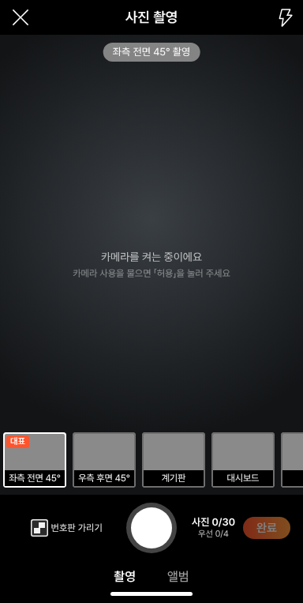
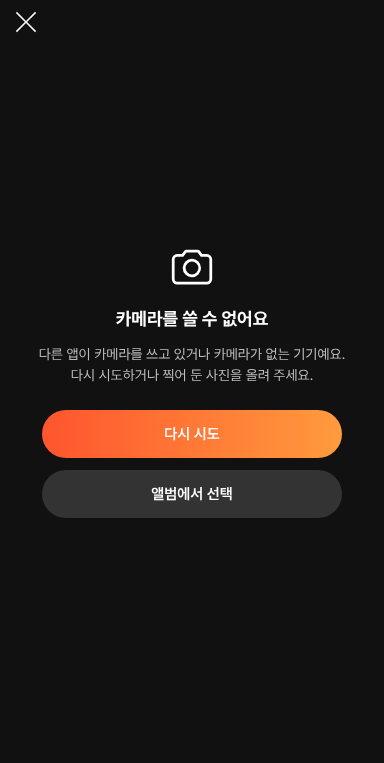

# PR #1059 보고서 — 촬영 쇼츠 키트 실제 폰 시험 전 최종 점검

## ① 한 줄 요약
오늘부터 실제 폰으로 찍어 볼 수 있게 촬영 쇼츠 키트(`?register=shootkit`)에서 진짜 카메라가 없을 때 · 사진 불러오기 실패 · 연타 · 나가기 같은 결함을 고치고 배포했습니다.

## ② 과제 · 브랜치 · 상태
- 과제 ID: 없음(사용자 지시 「수정해라 / 실제 폰으로 촬영하고 테스트 / 최종 크로스체크」)
- 브랜치: `fix/shootkit-phone-ready-1027`
- 커밋: 34c632ac · 896b3d4c → main 병합 `563c3a1`
- PR: https://github.com/bobaekimboae/bobaedream/pull/1059
- 상태: 병합 · 배포 완료, v=`563c3a1`, 번들 `assets/main-BNbbDIuI.js`
- 이번 병합으로 main에 함께 들어간 과제: 없음(직전 main `9261e93`은 다른 작업창 몫)

## ③ 한 일
- 카메라가 없거나 켜지지 않으면(5초) 가짜 화면으로 찍히지 않고 「카메라를 쓸 수 없어요」 안내(다시 시도 · 앨범에서 선택)를 보여 줍니다. PC 시험은 `&fakecam=1`.
- 앨범 사진은 한 장씩 차례로 열고, 열 수 없는 사진만 빼고 「N장은 열 수 없는 사진이라 빼고 불러왔어요」로 알립니다.
- 30장 상한을 연타해도 넘지 않게 하고, 다 차면 셔터가 흐려집니다.
- 영상 표지를 못 만들면 「기본 표지로 쓰기」로 넘어가고, 영상을 지우거나 나가면 메모리를 비웁니다.
- 사진 화면 닫기 확인, 작성 중 새로고침·닫기 경고, 편집 저장 뒤 사진 추가가 이어지게 했습니다.
- 전기차 코스 다시 열기 · 추천 바꾸기 때 이전 추천 단계가 남던 것을 정리했습니다.
- 녹화 카운트다운 중 화면을 떠나면 멈추고 쇼츠 표시를 되돌립니다. 작은 화면(320·360)에서 영상 틀이 버튼과 겹치지 않습니다.

## ④ 원본과 비교
| 영역 | 작업 전 | 작업 후 |
|---|---|---|
| 카메라 없는 사진 촬영 | 「카메라를 켜는 중이에요」에서 멈추고, 셔터를 누르면 가짜 사진이 들어감 | 안내 화면 · 가짜 사진 막음 |
| 깨진 사진 불러오기 | 전체 실패 또는 빈 칸 | 정상 사진만 들어가고 빠진 장수 안내 |
| 30장 연타 | 30장 넘게 들어갈 수 있음 | 30장에서 멈춤 |
| 작은 화면 겹침(320·360·384) | 영상 틀과 버튼 겹침 | 0 |

| 작업 전 | 작업 후 |
|---|---|
|  |  |

(카메라 없는 사진 촬영 화면, 384×763)

## ⑤ 검증
- `npm run verify:qf` 통과
- 회귀 시험 전체 FAIL 0
- 배포본(v=563c3a1)에서 새 시험 17개 모두 통과: 실제 폰 흐름 5 · 카메라 없음 1 · 불러오기 2 · 코스 5 · 알림 4, 페이지 오류 0
- 퀵필터 규격(measure:qf)은 이번 작업이 촬영 화면만 바꿔 해당 없음

## ⑥ 원본과 다르게 남긴 것과 이유
- 58 재현(`&vstage=58`)은 그대로 둡니다(원본 비교용).
- PC처럼 카메라가 없는 곳에서는 `&fakecam=1`이나 `&debug=1`일 때만 시험용 가짜 화면을 씁니다.

## ⑦ 못 한 것 · 다음에 할 것
- 글자 크게 보기 · 어두운 화면, 단계 칩 34 · 촬영/앨범 탭 28 누름 영역, 320 미만 가로 스크롤
- 쇼츠 기본 길이, 진짜 임시저장, 카메라 권한 묻는 시점, 첫 화면 분리
- 영상 번호판 흐림, 「흠집 공개」 문구 법률 확인, 겹친 창 뒤 화면 막기
- 실제 폰 시험 결과를 받아 다시 고치기

## ⑧ 확인 링크
- 촬영 키트: https://bobaekimboae.github.io/bobaedream/?register=shootkit&v=563c3a1
- 모바일: https://bobaekimboae.github.io/bobaedream/?qf=guazi&v=563c3a1
- PC: https://bobaekimboae.github.io/bobaedream/?qf=guazi&v=563c3a1&pc=1
- 배포 확인: 주소 끝에 `&debug=1`
