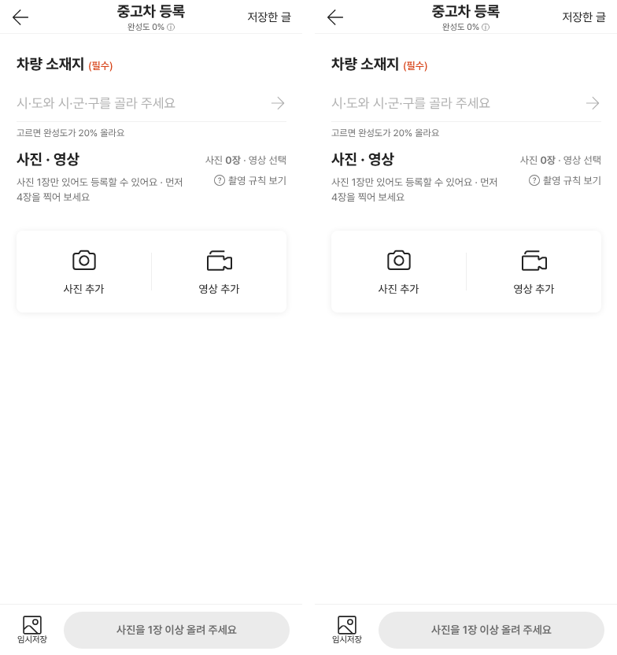
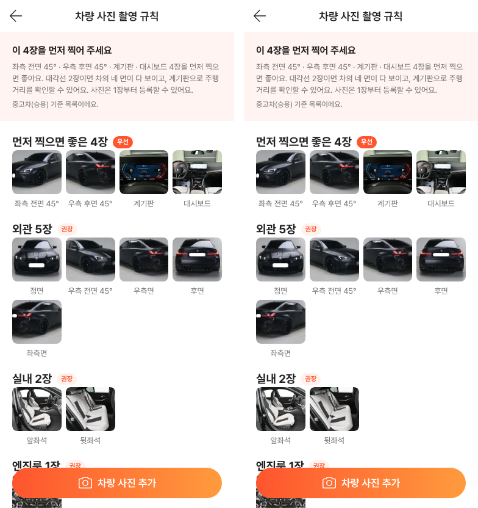
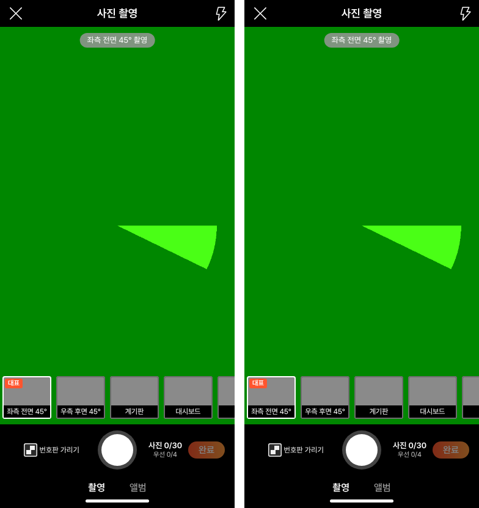

# PR #1061 — 촬영 쇼츠 키트 넉스트(Nuxt 3) 판

## ① 한 줄 요약
리액트로 만든 촬영 쇼츠 키트(`?register=shootkit`)를 보배드림 프런트엔드와 같은 Nuxt 3로 옮겨 `/bobaedream/nuxt-shootkit/`에 따로 배포했습니다. 화면과 동작은 리액트 판과 같습니다.

## ② 과제 · 브랜치 · 커밋 · 상태
- 과제 ID: 없음(사용자 지시 「보배드림 프론트엔드가 넉스트다」)
- 브랜치: `feat/nuxt-shootkit-1028` → 병합 커밋 `db89d16`
- PR: https://github.com/bobaekimboae/bobaedream/pull/1061
- 상태: 병합 · 배포 완료 v=`db89d16`, 사이트 번들 `assets/main-DW5H-itq.js`, 넉스트 번들 `nuxt-shootkit/_nuxt/BB6evFPQ.js`
- 이번 병합으로 main에 함께 들어간 과제: 없음

## ③ 한 일
- 같은 저장소의 새 폴더 `nuxt-shootkit/`에 Nuxt 3.21 + Vue 3.5 앱을 만들었습니다. 리액트 판은 비교용으로 그대로 둡니다.
- 화면 컴포넌트 32개를 Vue로 옮겼습니다. 등록 · 사진 촬영 · 편집 · 영상 촬영 · 미리보기 · 표지 · 쇼츠 · 규칙 · 지역 · 부위 나누기가 포함됩니다.
- 화면과 상관없는 로직은 리액트 판 파일을 그대로 가져왔습니다. 촬영 항목, mp4 저장, 쇼츠 구간 고르기, 그리기, 자동 나누기가 해당합니다.
- 글자 · 모양 · 이름표(class · aria)를 리액트와 똑같이 두어 같은 자동 시험을 그대로 돌릴 수 있게 했습니다.
- 배포는 넉스트 결과물을 `public/nuxt-shootkit/`에 넣는 방식이라 배포 설정은 바꾸지 않았습니다.

## ④ 원본(리액트 판)과 비교
| 화면 | 차이 |
|---|---|
| 등록 화면 | 위치 · 글자 같음 |
| 촬영 규칙 | 같음 |
| 사진 촬영 | 같음(가운데 초록 화면은 시험용 가짜 카메라) |
| 쇼츠 길이 안내 | 줄바꿈 위치만 다름(넉스트가 「부위도」를 한 줄에 둠) |

| 리액트(왼쪽) · 넉스트(오른쪽) | |
|---|---|
| 등록 |  |
| 촬영 규칙 |  |
| 사진 촬영 |  |

화면 22곳을 픽셀 단위로 비교했고, 다른 곳은 가짜 카메라 움직임 부분뿐이었습니다. 화면 폭 360 · 384 · 412 · 1280 점검 결과(지적 건수 12 · 10 · 10 · 5)도 리액트 판과 같았습니다.

## ⑤ 검증
- `vue-tsc`(형식 검사) 오류 0 · `nuxt generate` 성공 · `npm run verify:qf` 통과
- 로컬 회귀 시험 19종 모두 FAIL 0: t20k 25 · t21k 19 · t22 29 · t23 10 · t24 28 · t25 6 · tdrag 9 · tsort2 10 · tnoreq 10 · tvar 20 · tfix 10 · tphone 5 · tcourse 5 · ttoast 4 · tnocam 1 · timport 2 · tesc · tas3(리액트와 출력 동일) · 작은 화면 겹침 0
- 배포본: t22 29/29 · t24 28/28 통과, 콘솔 오류 0, 404 0, 깨진 이미지 0
- 퀵필터 규격 · 필터 선택지 · 광고기간 항목은 이번 변경과 상관없어 따로 재지 않음

## ⑥ 원본과 다르게 남긴 것과 이유
- 쇼츠 길이 안내 줄바꿈: 넉스트 쪽이 더 읽기 좋아 그대로 둠
- 아이콘 · 예시 사진 · 인식 데이터는 사이트 `public/` 파일을 같이 씀(실서비스로 옮길 때는 `lib/site.ts`의 `SITE_BASE`만 바꾸면 됨)

## ⑦ 못 한 것 · 다음에 할 것
- 부위 자동 나누기 시험(tdrag)은 로컬 인식 모델 서버가 필요해 배포본에서는 돌리지 못함(로컬에서는 9/9 통과)
- walk 시험은 주소가 고정되어 있어 넉스트에 돌리지 못함
- 촬영 항목 JSON(`shoot-items-kit.json`)이 두 판에 복사되어 있어 한쪽을 고치면 다른 쪽도 맞춰야 함
- 실제 폰 시험

## ⑧ 확인 링크
- 넉스트 판: https://bobaekimboae.github.io/bobaedream/nuxt-shootkit/?v=db89d16
- 리액트 판(비교): https://bobaekimboae.github.io/bobaedream/?register=shootkit&v=db89d16
- 모바일: https://bobaekimboae.github.io/bobaedream/?qf=guazi&v=db89d16
- PC: https://bobaekimboae.github.io/bobaedream/?qf=guazi&v=db89d16&pc=1
